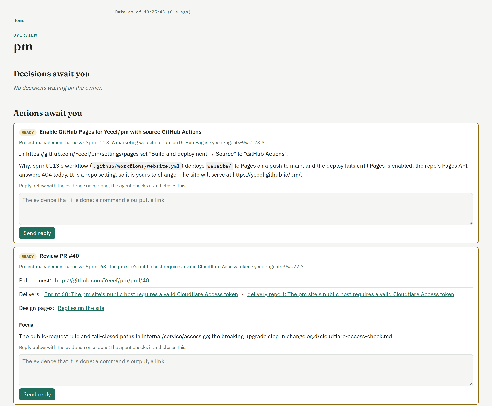
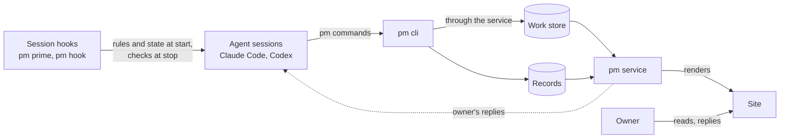
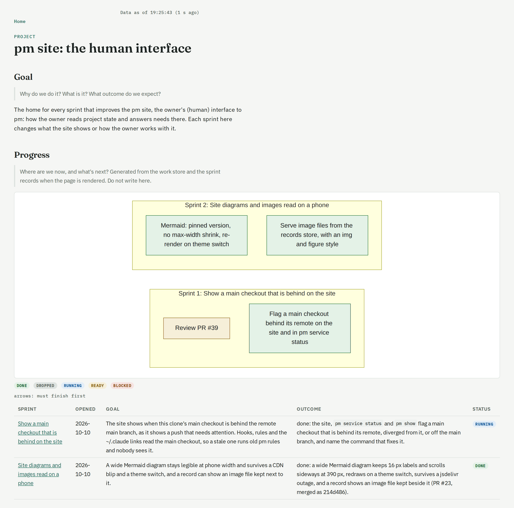
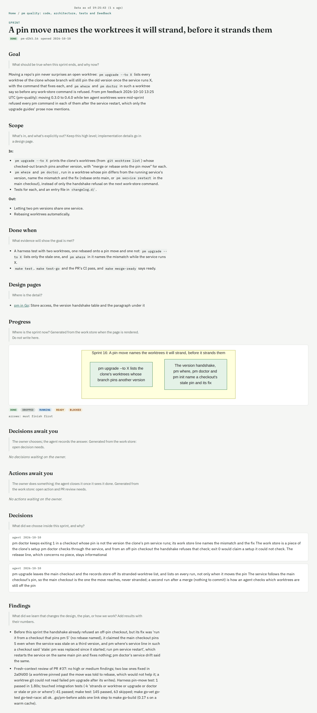
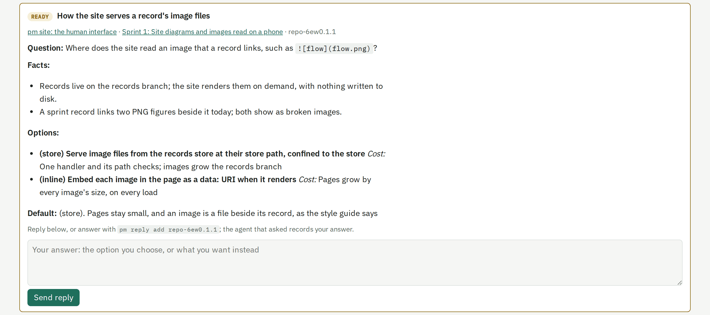

# pm

**Manage outcomes, not agents.**

Website: **[yeeef.github.io/pm](https://yeeef.github.io/pm/)**

pm is project management harness for you and your coding agents. Run tens of agents on one repo: each picks up a task, keeps
what it learns next to that task, and brings you only what needs your call. You steer all of them from one page.



- **Any task, any agent, any time.** A fresh agent picks up where the last one stopped.
- **A home for every plan.** Plans, decisions and findings live as checked records tied to the work, not as
  free-formed `XXXYYYZZZ.md` files scattered through your repo.
- **One view of everything.** Every project, every sprint's goal, and every question waiting on you.
- **Enforced, not asked.** pm is not a pack of prompt files. Agents work through pm's command line and hooks, which
  refuse a move that breaks the rules and say what to do instead.
- **Yours, in your repo.** No account, no hosted service: clone the repo on any machine, run `pm init`, and your
  agents carry on.

Works with Claude Code and Codex.

## What pm does

- **Agent project and task management.** Work is a tree in a work store: projects, sprints, tasks, and needs.
  A sprint opens with a frame (goal, scope, done-when), a task has one holder, and dependencies are recorded.
  This is what lets many agents work at once without stepping on each other.
- **Context management, tied to the work.** The why lives in Markdown records on the repo's `records` branch: a
  project's goal and decisions, a sprint's frame, findings and delivery report, design pages, docs and postmortems.
  Each record points at work-store ids, and every record type but docs has fixed sections.
- **The human's interface.** A pm service per clone serves both layers as a site: every open project and sprint,
  and every decision, action and PR review waiting on the human, with a reply form that sends the answer back to the
  agent session that asked.

## Structural, not prompts

A prompt file asks an agent to behave and has no way to check it did. pm checks:

| Mechanism | What it does |
|---|---|
| `pm` cli | The only write path to the work store, and the write path for records (a hand edit to a record is committed with `pm commit`). Each command checks before it writes and refuses with the reason. |
| Session hooks | At session start, `pm prime` injects pm's rules and the project's live state; at subagent start, the rules. At stop, `pm hook owner-request` and `pm hook stop` check the agent's last turn. |
| Work store | A Dolt database per clone, served by the pm service, synced through the git remote. Holds status, holders and dependencies; records never copy a status. |
| Records store | The `records` branch, checked out once per clone; each worktree's `records/` links to it, so every branch and worktree sees one copy. |

Some of the refusals:

- `pm task claim` refuses a task that another live session holds, and refuses to run in the main checkout: each
  agent changes code in a worktree of its own.
- `pm sprint open` refuses a frame without a goal, an **In:** and **Out:** scope, or a done-when.
- `pm sprint close` refuses while the delivery report is unwritten, a task is open, or a PR review is not merged.
- `pm commit` checks that the whole records store still renders before it commits a hand edit.
- The owner-request Stop hook blocks an agent that ends its turn asking the human for something only in chat, and
  tells it to raise a need instead. A small model, run through `claude -p`, judges the final reply.
- `pm hook stop` blocks an agent that hands back with records it edited left uncommitted.



Agents reach the work store only through the pm service, which also renders the site, syncs both stores with the
git remote and carries the owner's replies back to the session that asked.

## What you get

- **Any task can be picked up by a fresh agent.** Each session starts with the rules and `pm show`, the state of
  every project; `pm show <id>` gives a task's holder, blockers and needs, and the sprint record gives the frame and
  findings. pm reads a session's liveness from its transcript on the same machine: a task whose holder's transcript
  has been idle for 30 minutes can be claimed by another.
- **Context has a home.** A plan is a sprint frame, a ruling is a `::: decision` block with its source, date and
  reason, a result is a finding, a reference is a design page. All live on the `records` branch in a checked format,
  not as `PLANNING.md` or `TASK_67.md` files in the code tree. pm does not block a stray file there; it gives the
  agent a place that checks what goes in, and its rules send context there.
- **Many agents, managed by outcome.** Each agent works in its own worktree and holds its own tasks; `pm show`
  lists what every other live session holds. You manage sprints, each with a goal, a scope and a done-when, and
  answer what the agents raise. pm's own development runs this way, with ten agent worktrees in flight at once.
- **One view of what waits on you.** Agents raise decisions (a question, facts, options with their costs, a
  default), actions and PR reviews. The site lists every open one across projects, and a reply reaches the asking
  session's inbox, or waits in `pm reply read` for the next session.
- **Self-contained.** pm adds no line to your `CLAUDE.md` or `AGENTS.md`; agents get pm's context from its hooks
  and from `pm <noun> --help`. `pm init` writes hook entries into `.claude/settings.json` and `.codex/hooks.json`,
  its own files under `.pm/`, a block in `.gitignore` and a git hook; per clone it adds git excludes and the
  sandbox permissions that let agents write the stores. The one edit it makes to `CLAUDE.md` and `AGENTS.md`
  removes a Beads block, along with Beads' hook entries, from a repo that used Beads.
- **Continue on another machine.** The work store syncs through the remote under `refs/pm/work`, and the records
  through the `records` branch; the pm service pushes both every 10 minutes. Clone the repo elsewhere, run
  `pm init`, and the agents there start from the same projects, sprints, tasks and records.

## The site

The overview, at the top of this page, opens with what waits on you: the decisions and actions your agents raised,
each with its reply form. Below them it lists the recent days and every open project with its sprints.

A project: its goal, and progress generated from the work store, a diagram of its sprints and tasks and a table of
each sprint's goal and outcome.



A sprint: its frame (goal, scope, done-when), progress, decisions and findings, then the delivery report.



A decision need as the owner answers it: the question, the facts, each option with its cost, the agent's default,
and the reply form.



The site is served on `localhost` at the port in `.pm/config.toml`; `pm init --site-url URL` sets the link pm gives
when the site is published elsewhere.

## Install

pm is released for macOS on Apple silicon (`darwin-arm64`) and Linux on x86-64 (`linux-amd64`). Install release
`<X>` (see [Releases](https://github.com/Yeeef/pm/releases); [`CHANGELOG.md`](CHANGELOG.md) lists what each
changed and how to upgrade) on a machine:

```sh
curl -fsSL https://github.com/Yeeef/pm/releases/download/pm-v<X>/install.sh | sh
```

`install.sh` checks the binary against the release's `SHA256SUMS` and installs it to
`${PM_BIN_DIR:-$HOME/.local/bin}/pm`. Then, in each clone of a repo that uses pm:

```sh
pm init
```

`pm init` sets up the repo (its `.pm/config.toml`, which pins the pm version, the hooks and the records branch) and
the clone (the records store, the work store, the pm service). It changes only what is missing; `pm doctor` reports
what differs and `pm upgrade` rewrites it. One `pm` on PATH serves every repo: in a repo that pins another version,
it downloads that release once and runs it.

Needs: `git`; `gh` for pull-request features; `claude`, installed and logged in, for the owner-request hook's judge
and `pm day summarize`, Codex setups included; `uv` only for the one-time move of a clone off the pre-package
harness, which `pm init` names. A repo pinned below 0.2.0 (a retired release) must move its pin with
`pm upgrade --to <X>` first.

## Docs

- `pm --help` and `pm <noun> --help`: every command, its rules and its refusals.
- [`prime.md`](prime.md): the rules `pm prime` gives each agent session.
- [`AGENTS.md`](AGENTS.md): developing pm: layout, tests, releasing.
- [`CHANGELOG.md`](CHANGELOG.md): each release's changes and upgrade guide.

## Credits

- [Beads](https://github.com/gastownhall/beads) inspired pm's work layer: issues with dependencies and ready work,
  tracked for agents in the repo. pm tracked its own development in Beads before it had a work store, and
  `pm init --import-bd` still imports a Beads export.
- [Dolt](https://github.com/dolthub/dolt) is the work store: a SQL database with git-style versioning, embedded in
  `pm` and synced through the repo's git remote.
