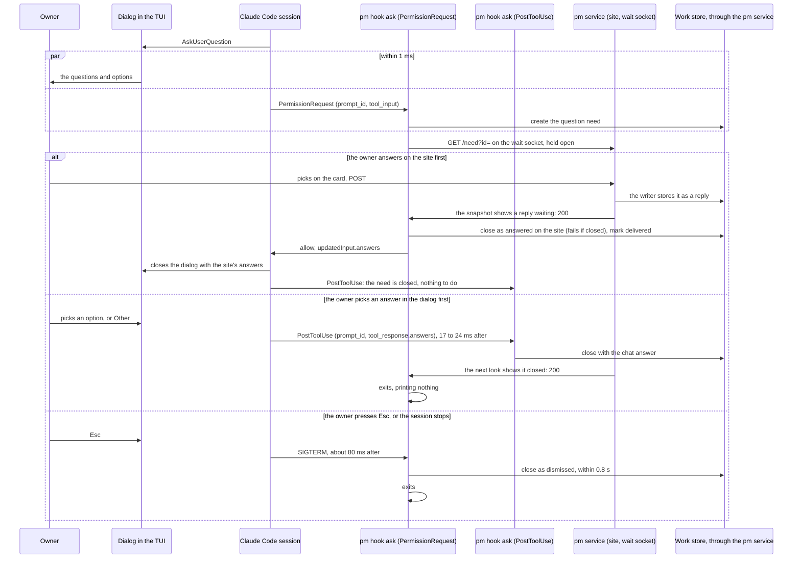
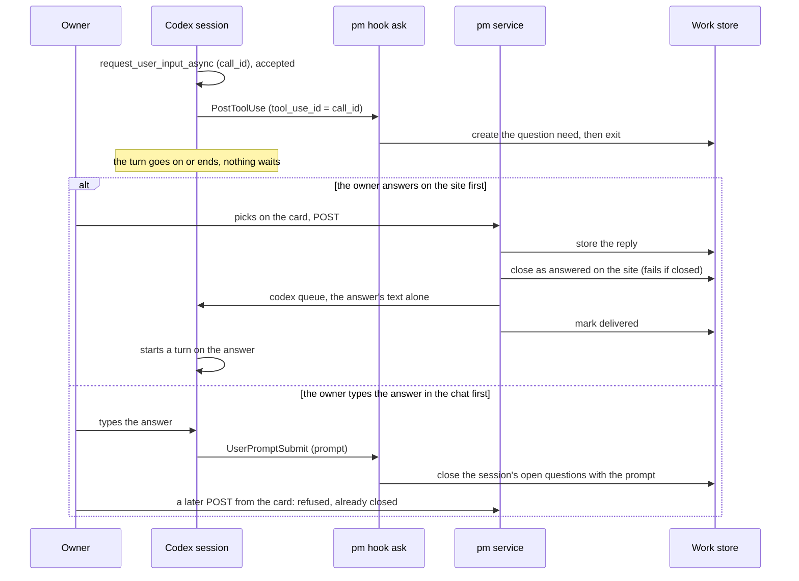
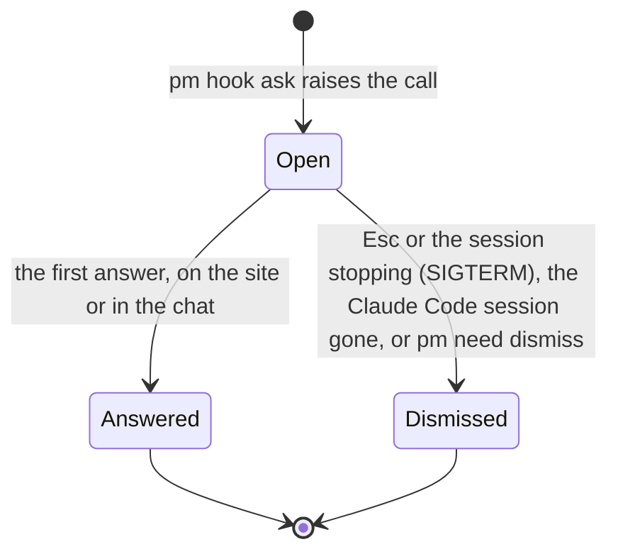

## Problem

> What are we solving, and why now?

- The request rule sends a question that steers the session through its runtime's ask tool (AskUserQuestion in Claude Code, `request_user_input_async` in Codex) ([Owner-request Stop hook](owner-request-hook.md), One rule). Such a question lived only in the session: an owner who stepped away never saw it on the site, and the session waited with no trace in pm.
- A question is not a decision or an action. It asks the owner to steer one session (what to do next, confirm a scope, clarify intent), and its answer is an instruction to that session, not a ruling to record (project decision 2026-10-14: three request kinds). Raising it as a decision need would demand a decision record for every answer.
- An ask tool has two surfaces once pm mirrors it: the session's own (Claude Code's dialog, Codex's chat) and the site's card. Two answers to one question must not both steer the session.

## Goals and non-goals

> What must the design achieve, and what does it deliberately leave out?

Goals:

- Every ask-tool question a main session asks shows on the site as a question need, the moment it is asked.
- The owner answers it in either place: in the session's chat, or on the site's card. The first answer reaches the session and closes the need; the other surface closes.
- The agent does nothing extra: no command raises, closes or records a question. The ask tool stays the agent's whole interface.
- A question's answer records no decision. An answer that turns out to rule the work is recorded by the agent as a decision with `--confirmed`.
- A question in a session nobody watches is not lost: it waits on the site for as long as the session can take the answer.

Non-goals:

- Codex's blocking `request_user_input` (Plan mode): not raised (Open questions).
- Exactly-once across the two surfaces: two accepted windows can let both answers through or record the losing one (First answer wins).
- A subagent's question: Claude Code gives subagents no AskUserQuestion; a Claude Code call with an `agent_id` is stepped over. A subagent gets no request rule and never asks the owner: it reports to its parent, which owns any ask.
- Sync versus async timing as a property of every request: a lens, not built ([Owner-request Stop hook](owner-request-hook.md), Open question 2).

## Constraints and key facts

> Which facts, findings and constraints shaped the design? Only those that
> still hold; sprint records keep the findings as they happened.

Measured with Claude Code 2.1.296 and Codex 0.162.1, TUIs under a pty (sprint pm-harness-118, Findings). Other versions: not recorded.

::: result {title="Claude Code 2.1.296: AskUserQuestion and its hooks"}
| Fact | Measured |
|---|---|
| A PermissionRequest hook with matcher `AskUserQuestion` runs unawaited beside the open dialog | hook and dialog start within 1 ms; a hook sleeping 20 s does not delay the dialog |
| The hook's `allow` with `updatedInput.answers` (keyed by question text) closes the dialog | the dialog closed "Allowed by PermissionRequest hook", `toolUseResult.answers` held the hook's answer; 3 s after the dialog showed (first run), 0.5 s after the owner's POST (parity eval) |
| PermissionRequest's input has no tool-use id | it carries `session_id`, `transcript_path`, `prompt_id`, `permission_mode`, `tool_name`, `tool_input` |
| PostToolUse of AskUserQuestion fires once the dialog is answered | 17 to 24 ms after a chosen answer, and after the hook's own answer too (2 runs per case); its input adds `tool_use_id` and `tool_response`, and `tool_input` and `tool_response` are one object: the questions, `answers` by question text, and `annotations` (left out when the hook answered) |
| On Esc no hook fires, but the waiting PermissionRequest hook gets SIGTERM | 79 to 81 ms after the dialog closed, then SIGKILL about 1.2 s later; not Stop, and PermissionDenied fires only on an auto-mode classifier's denial |
| A session stopped with the dialog open sends the hook SIGTERM | 21 ms after; no hook process outlives the session |
| A chosen answer sends the hook no signal | the hook runs on until it exits itself, so pm's hook must notice the close and exit |
| A hook timeout of 86,400 s is accepted | the settings schema sets no maximum |
| A hook that fails or prints nothing leaves the dialog usable | |
| A subagent cannot call AskUserQuestion | 3 cases: background, foreground, `CLAUDE_CODE_DISABLE_BACKGROUND_TASKS=1`; ToolSearch found no such tool |
:::

Reading: every ending of the dialog reaches pm through an event: a chosen answer through PostToolUse with the answers, Esc and a stopped session through the waiting hook's SIGTERM. The hook can race the dialog for as long as a day and answer it, but it never learns the call's id before PostToolUse.

::: result {title="Codex 0.162.1: request_user_input_async and its tool hooks"}
| Fact | Measured |
|---|---|
| `request_user_input_async` (Default mode) does not block | it writes an AgentMessage `{delivery: async, questions: […]}` to the rollout and returns `{accepted: true}`; the turn goes on or ends; the answer is the next user message |
| PreToolUse and PostToolUse fire for `request_user_input_async` and `request_user_input`; PermissionRequest fires for neither | the hook input carries `tool_use_id` (the rollout's `call_id`), `turn_id`, `transcript_path`, `tool_input` |
| PostToolUse's `tool_response` | `{accepted: true}` for the async tool; `{answers: {<id>: {answers: […]}}}` for the blocking one |
| `codex queue --thread <id> --message <text>` answers a waiting session | the session went on with the answer in 3.4 s and 8.2 s (2 runs); 1.5 to 9.5 s in the parity eval |
| UserPromptSubmit's input carries the prompt the owner typed | `session_id` (the root thread), `turn_id`, `transcript_path`, `prompt` (Codex 0.154.0, captured) |
| Nothing in Codex enforces one answer | a queued message after a chat answer is one more user turn |
| The TUI's pick list (Shift+Left) for an async question is offered only while the turn runs | once the turn is idle the owner answers by typing |
| An idle Codex TUI waiting on the owner looks like an ended session | `codex queue` delivers to a thread when it next loads ([Reply delivery](reply-delivery.md), Constraints) |
| A PreToolUse deny with a reason reaches the model as the tool's output | Default mode, observed; Plan mode untested |
:::

Reading: Codex's question is a message, not a wait: pm raises it at the call and closes it at the owner's next prompt; Codex itself accepts both answers, so pm must decide the winner before it queues one.

Other constraints:

- No transcript or rollout is read for a question (a rollout's path and modification time tell only its CODEX_HOME and whether the session is live): each ending has an event (above), and a transcript is an undocumented format read by polling (project rule 2026-10-14).
- The service pushes into a session's inbox only on the host that raised the question.
- The work store's `need_kind` CHECK admitted only decision, action and review, so a fourth kind is a schema change (version 4).

## Design

> What is it, in its final state? Free `###` subsections. Decisions and plans
> live in the project and sprint records.

### What a question is

| | Question | Decision | Action |
|---|---|---|---|
| Asks the owner to | steer one session: what to do next, confirm a scope or plan, clarify what the owner meant | rule a project's or sprint's outcome that later sessions must follow: a design choice, a scope change, a trade-off | do a step only the owner can do |
| Raised by | pm, from the runtime's ask tool (`pm hook ask`) | the agent, `pm decision need` | the agent, `pm action need` (`--pr` for a review) |
| Parent | the newest open task its session holds, else none | a sprint or task | a sprint or task |
| The answer is | an instruction to the session that asked | a decision the agent records (`pm decision add --need`) or closes as no rule | evidence the agent checks (`pm action done`) |
| Who may act on the answer | only the session that asked | whichever session takes the reply | whichever session takes the reply |
| Closed by | pm, with the first answer | the agent | the agent |
| Lives | while its session can take the answer (Closing) | until answered | until done |

- The agent picks the kind by what it asks, not by whether the owner is in the chat (owner decision 2026-10-14), and splits a mixed ask. "Do you want me to open a sprint for it?" is a question; "should interactive mode also turn off the uncommitted-records check?" is a decision, since it changes what the sprint builds.
- With no ask tool (`claude -p`, a subagent), a question goes as a decision need: its options and default let the session go on, it shows on the site, and `pm decision close` closes an answer that sets no rule. An action need does not fit: answering is not a step the owner does.
- The owner-request hook checks that an ask reaches the owner, not its kind: a decision asked with the ask tool passes ([Owner-request Stop hook](owner-request-hook.md), One rule).
- A question's answer records nothing in the records. If it rules the work, the agent records a decision with `--confirmed`.
- The owner sees it on the site under "Sessions ask you", above the decisions, and in `pm show` (Answering on the site).

### Its record in the work store

A question need is a need of kind `question` ([Work store](work-store.md), Data model). No agent command creates or edits one; pm writes its ask once, at the raise.

| Part | Rule |
|---|---|
| Kind | `question`, schema version 4 (the `need_kind` CHECK, the `ask_call` column, the `ask_questions` and `ask_options` tables) |
| Ask | `call`: the call's key, at most 128 bytes, unequal values fail a merge; the questions in the order asked (`text`, `header`, `multi`), each with its options in order (`label`, `detail`) |
| Call key | Codex: the call's `call_id`, PostToolUse's `tool_use_id`. Claude Code: the hook input's `prompt_id`, `-`, then the first 12 hex digits of the SHA-256 of the questions as pm reads them (the JSON of their text, header, multiple choice and options), since PermissionRequest's input has no tool-use id; it leaves out the answers and annotations PostToolUse's input adds, so both hooks give one key |
| Raised by | the session, its inbox (Claude Code's messaging socket; Codex's `codex-queue:<CODEX_HOME>`) and the host, as for every need ([Reply delivery](reply-delivery.md), Raising) |
| Parent | the newest open task the session holds (latest `claimed_at`), else none. Only an open question may be an open need with no parent: a session that steers a chat may hold no task |
| Title | `Session <the session id's first 8 characters> asks: <the first question>`, on one line, cut at 120 characters |
| Description | each question with its header (`**Header**: text`), "(choose one or more)" on a multiple choice, then its options as a list (`- label: detail`) |
| Checks | an ask exactly on a question need, which a session raised; a call key; one or more questions, each with a text; each option with a label, no label twice in a question |
| Refused | `pm decision add --need`, `pm decision close`, `pm action done` and `pm need edit`, each naming `pm need dismiss`: the answer goes to the session that asked and records no decision |

### Raising

`pm hook ask --runtime claude|codex` raises each question where the runtime shows the call to a hook, and closes it where the runtime shows the answer. `pm init` writes the four entries ([pm as an installable product](pm-product.md)).

| | Claude Code | Codex |
|---|---|---|
| Raises at | `.claude/settings.json`, PermissionRequest, matcher `AskUserQuestion`, timeout 86,400 s: at the call, beside the dialog, which shows at once | `.codex/hooks.json`, PostToolUse, matcher `request_user_input_async`, timeout 30 s: right after the call returns `{accepted: true}`; the turn goes on or ends |
| Closes a chat answer at | PostToolUse, matcher `AskUserQuestion`, timeout 10 s | UserPromptSubmit, timeout 10 s |
| Key | `prompt_id` with the questions' hash | `tool_use_id` |
| Raised once | a call that is an open need of the session is not raised again | a call that is a need of the session, open or closed, is not raised again |
| Then | waits for a site answer or a close (below), up to its 24 h timeout | exits; the pm service carries the site's answer |
| Steps aside | a call with an `agent_id` (a subagent's), another tool | another tool or event |

- Every entry runs `pm hook ask --runtime <runtime> \|\| exit 1`. The hook fails open: on its own error it says why on stderr ("the question stays in the session only"), prints nothing and exits 0, so the dialog stays usable and the turn goes on.
- The inbox of a Codex question is the CODEX_HOME of the rollout the hook input names (Codex runs hooks without its `CODEX_*` variables), else `$CODEX_HOME` or `~/.codex`. pm reads the rollout's path only, never the file.
- Codex's blocking `request_user_input` (Plan mode) is not raised: its answer comes in the session before the turn goes on.

### Claude Code: one question end to end

Reading: the PermissionRequest hook is the only path into the dialog and holds one call to the service for the site; PostToolUse brings the dialog's answer and SIGTERM brings Esc, so whichever closes the need first is the answer the session gets. The service never pushes a Claude Code question's reply into the messaging socket.

### How the Claude Code hook waits for the site

The hook holds one HTTP call on the pm service's wait socket, `<main checkout>/.pm/run/wait.sock` (mode 0600, no longer than `work.sock`, so it fits wherever the work store's socket does), and reaches the work store only when that call answers.

| Part | What it does |
|---|---|
| The call | `GET /need?id=<need>`: answered 200 once the service's snapshot shows the need with a site reply waiting or closed; a need not in the snapshot yet (raised since its last look) is waited for |
| What wakes it | every snapshot the refresher stores wakes every waiter. The writer pokes the refresher right after it stores a site reply, so that reply answers the call at once; a close any command or hook makes reaches it at the service's next look (every 1 s, the look the site's pages already take) |
| Cost while idle | one connection per open question and no store read; the service reads the store once per look for all waiters together. It was one dial, handshake and read per question per second (86,400 a day) |
| After the call answers | the hook reads the need: a site reply waiting closes it as answered on the site, then the decision is printed; a need closed elsewhere (PostToolUse's chat answer) ends the hook, printing nothing |
| A failed call | the service down, restarting or stopping (it answers 503, or the socket refuses): the hook calls again after 1, 2, 4, then 5 s, never sooner than a second. An answer the store does not confirm counts as a failure too. The dialog stays usable throughout, and the first failure is said on stderr when the hook ends |
| Ending it | the hook's return (a site answer printed, a close elsewhere, or a signal) cancels the call; the service drops the wait |
| Long-poll bound | none: the call lives until the need moves, the hook hangs up or the service stops. A unix socket reports the service's exit at once, so no timeout is needed to notice it |

### Codex: one question end to end

Reading: the hook raises at the call and closes at the owner's next prompt; the service closes before it queues, so the close, a compare-and-set, decides the winner and no rollout is read.

### Answering on the site

The question's card ([Replies on the site](site-replies.md)) shows in "Sessions ask you", above the decisions, on its sprint's, its project's and the overview page; a question with no parent shows on the overview only, as "asked outside any task", and in `pm show` under "sessions ask you, outside any task". The card is titled "Session <the session id's first 8 characters> asks you" and holds a fieldset per question:

| Question | Inputs |
|---|---|
| Single choice | a radio button per option (label, then its detail), and an "Other" text: the owner's own answer, instead of an option |
| Multiple choice | a checkbox per option, and an "Other" text, added to the options picked |
| No options | an "Answer" text |

- The inputs belong to the form the service puts in the card's slot (`form="reply-<id>"`), which posts `token`, `id`, `rid` and a field per question (`q<n>`, `q<n>-other`), no text box. The reply id is new whenever the fields change.
- **The reply text rule.** The service makes the reply from the fields: one line per question, in the order asked, `<question>: <answer>`. The question is put on one line (whitespace collapsed); a multiple choice's answer is its picked labels in the options' order, then the Other text, joined with `, `; a single choice's Other text replaces its pick.
- The hook and the service read the text back the same way: each line that starts with a question's one-line text and `:` (the longest question first) starts that question's answer; an answer naming an option's label, in any case, is that label, any other text the owner's own. A reply with no such line (`pm reply add <id>` free text) answers every question whole.
- Refused with 400, naming the question: a question with no answer, a label that is not one of its options, two picks on a single choice. A question closed meanwhile (answered in the session first) refuses the POST as closed. The token and access checks are every reply's (403).
- An answer that failed to store shows its text above the form; the service stores it again from its spool.

### Answering in chat

| | Claude Code | Codex |
|---|---|---|
| Where the owner answers | the dialog: an option, Other, or Esc | the chat: the pick list while the turn runs, else a typed message |
| How pm learns it | PostToolUse of AskUserQuestion: `tool_response.answers`, matched to the question by the call key. Esc: the waiting hook's SIGTERM | UserPromptSubmit: the `prompt`, which answers each open question of the session; a message the service relayed (a site answer it queued, a delivery's `pm: ` text) is left out |
| When | 17 to 24 ms after the dialog closes; Esc about 80 ms after | as the prompt is submitted |
| What the need records | the answer as `<question>: <answer>` lines, by the session; Esc dismisses it as "the session stopped waiting for the answer: Esc in the dialog, or the session ended" | the typed message, by the session |

A chat answer is stored as the need's answer comment. A site reply the need held when the chat answer closed it lost the race: it counts as delivered, with the note "answered in chat first; the site's reply did not reach the session".

### First answer wins

A question closes once. The store's close is a compare-and-set under its write lock ([Work store](work-store.md), Concurrent writers): a close of a closed need fails with `ErrClosed` and changes nothing, so of two closers the second does nothing more, and whoever would deliver an answer closes first.

| Runtime | Guard | Accepted window |
|---|---|---|
| Claude Code | the hook closes the need, then prints `allow`; PostToolUse's close of a need the hook closed fails. Claude Code ignores a hook answer once the dialog is answered | the dialog answered between the hook's close and Claude Code taking its decision (milliseconds): the need records the site answer while the session took the dialog's. The session's transcript stays the truth of what it was told; Claude Code offers no way to retract an answer printed |
| Claude Code, at the raise | none | the dialog answered before the raise stored the need (one store write, tens of ms after the dialog shows): PostToolUse finds no need, so the question stays open on the site until the session stops the hook (dismissed) or the session ends |
| Codex | the service closes the need, then runs `codex queue`; UserPromptSubmit's close of a need the service closed fails | an answer typed after the service's close, before the queued message lands: both reach the session, one extra user turn the agent can see, and the need records the site's. Closing it would need control of Codex pm does not have |

### Closing

Reading: a question has one open state and two ends; nothing reopens it, and a Codex question never ends for idleness.

| Close | Resolution, reason | Claude Code | Codex |
|---|---|---|---|
| Answered on the site | answered, "answered on the site" | by the hook, which then answers the tool | by the service, right before `codex queue` |
| Answered in the chat | answered, the answer as its comment | by the PostToolUse hook, from the tool's answers | by the UserPromptSubmit hook, with the prompt |
| Hook stopped | dismissed, "the session stopped waiting for the answer: Esc in the dialog, or the session ended" | Claude Code stops the hook (SIGTERM, SIGINT, SIGHUP: Esc, the session ending, or its 24 h timeout): one close within 0.8 s, before Claude Code's kill at about 1.2 s; a need closed already stays | none |
| Session ended | dismissed, "the session that asked has ended" | the service's sweep, when the session's messaging socket on this host is gone: a backstop for a hook that could not close | never: an idle Codex TUI looks the same as an ended session, and a late site answer still reaches it |
| By hand | dismissed, the reason given | `pm need dismiss <id> --reason "…"` | the same; the only way to clear a stale Codex question |

- A Codex site answer while the session is not live (its rollout unchanged for 30 minutes), on another host, or with no usable codex is not queued and the question stays open: the sweep tries again once the session's rollouts change.
- A `codex queue` that fails after the service closed the question leaves the answer undelivered; the sweep queues it again (a question closed as answered on the site with replies beyond its delivered count).
- A question raised on another host, or by a Claude Code session with no socket, is left to its hook: the service settles only what it can see.

### What the judge does with an open question

The owner-request Stop hook ([Owner-request Stop hook](owner-request-hook.md), The judge) reads an ask-tool question as an open request the owner sees, so neither the question nor its repeat in the reply blocks:

- The stopping turn's ask-tool calls, read from the transcript, join the open requests as "(asked with the ask tool this turn)".
- An earlier turn's question still open is an open question need of the session, which the judge matches like any need. A Codex question is that need already at Stop, since PostToolUse raised it.
- Another ask left only in chat in the same reply still blocks.

### How it is checked

- Harness tests with the fakes: both races in each runtime, the reply text rule round trip (a question with a newline, a double space or edge whitespace), the refusals, the parent rule, migration 2 to 4 and a version 3 and 4 two-clone merge; PostToolUse closing with the dialog's answer and leaving a closed question alone; SIGTERM dismissing with no transcript; UserPromptSubmit closing with the prompt and leaving a relayed message out; the service closing before it queues, and queueing again after a failed queue.
- The parity live eval's ask-tool scenarios, each runtime's TUI in a pty (`make test-live-parity`, `-k ask_tool`): answered on the site, the session goes on with that answer and the need closes answered on the site, delivered 1; answered in the chat, the need closes with the chat answer, delivered 0, and a later POST from the stale card is refused as closed; Esc on Claude Code's dialog closes the need as dismissed. 5 passed on Claude Code 2.1.296 and Codex 0.162.1; each chat answer and the Esc closed the need by the first check after the key press (within 0.5 s); a site answer reached Claude Code in 0.5 s and Codex in 5.1 s.

## Alternatives considered

> What else was considered and not adopted, and why not?

| Option | Why not |
|---|---|
| A one-way mirror: the site shows the question, only the chat answers | An owner away from the terminal could see the question and not answer it (owner decision 2026-10-13) |
| Always raise a need instead of the ask tool | Brings back the sprint-or-task overhead for a question that only steers the session, and a need does not stop the session's turn for an answer |
| A question as a decision need | A decision rules a project's or sprint's outcome and is recorded; a question steers one session, so every answer would need a decision record or a no-rule close (owner decision 2026-10-14) |
| Sync and async as request kinds | Timing is independent of kind (a sync action exists too); kept as a lens on the [Owner-request Stop hook](owner-request-hook.md) page, not built |
| Claude Code's Remote Control bridge, which races the dialog | Needs the claude.ai bridge; read from Claude Code's strings, not run |
| Claude Code's MCP channels permission relay | Skips tools that require user interaction, AskUserQuestion among them, and carries only allow or deny, no answer |
| Raising a Codex question at Stop from the turn's rollout | Raises the question only when the turn ends and needs a rollout scan to find the calls; PostToolUse fires on the call itself with its id |
| Dismissing a Codex question when its session looks idle | An idle TUI waiting on the owner looks the same as an ended session, and `codex queue` still delivers when the thread next loads; a stale question costs one card the owner can dismiss |
| Pushing a Claude Code question's site answer into the messaging socket | Lands as a separate user turn after the dialog was answered some other way; only the hook closes the open dialog with the answer |
| The Claude Code hook tailing the transcript for the dialog's answer | A poll of an undocumented format; PostToolUse brings the answers 17 to 24 ms after the dialog closes, and the hook's SIGTERM brings Esc, so no fact needs the transcript |
| The service reading a Codex session's rollouts for a chat answer, before a queue and at its sweep | A poll of an undocumented format, and a chat answer closed only at the next sweep (41.5 s in the parity eval); UserPromptSubmit carries the typed prompt, and a close before the queue settles the race without looking |
| Telling Esc from a stopped session | Both reach the hook only as SIGTERM; telling them apart needs the transcript, and both end the question the same way |
| The Claude Code hook reading the need every second | One dial, handshake and read per open question per second, 86,400 a day, and up to a second's delay on a site answer |
| A blocking SQL procedure on the work store's socket (`pm_wait_need`) | Writes reach the store as plain SQL from every client, so the host would still have to poll the change mark; and the work package sits at its size cap |
| The wait on the site's TCP port | The hook would have to find the port (`$PORT`, the unit file, a free port in tests), and the endpoint would face the tunnel; a unix socket beside `work.sock` needs neither |
| A long-poll with a timeout, called again | Bounds nothing a unix socket does not already report: the service's exit ends the call at once |
| A lock or retraction to close the two windows | Claude Code offers no way to take back a hook answer printed; pm has no hold on Codex's queue |

## Prior art

> Optional. What existing work did we learn from, and what did we take?

None yet.

## Open questions

> What is still unresolved?

- **No dismiss control on the site's card.** A question from an abandoned Codex session stays until answered or `pm need dismiss`; the owner cannot clear it from the site.
- **Codex's blocking `request_user_input` (Plan mode).** It blocks inside Codex's app-server, which a second client reaches only with `app-server --listen` and a TUI started with `--remote`. PreToolUse fires for it, and in Default mode a PreToolUse deny with a reason reaches the model as the tool's output, so a hook could carry a site answer that way; whether that holds in Plan mode is untested.
- **Sync and async.** What sets a question apart may be that a session waits on it now, which other kinds can share: see [Owner-request Stop hook](owner-request-hook.md), Open question 2.
