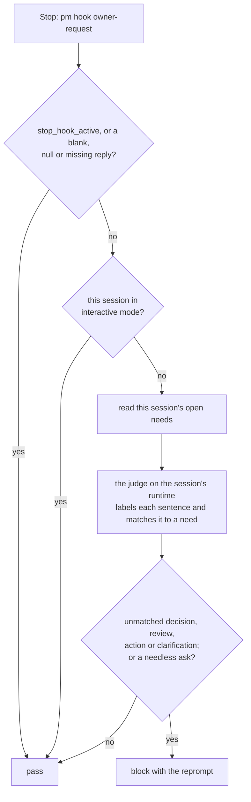

## Problem

> What are we solving, and why now?

- Agents ask the owner for decisions and actions in chat ("needs input: …", "please review …"). When the owner is not watching the chat, those requests never reach the site, so the owner may never see them.
- In context-efficiency sprint 1, four of six things waiting on the owner were asked only in chat, although the rules already required raising them. A rule the agent must remember did not work; the owner wants a check that runs on its own when an agent ends its turn.
- The rule and the check must say the same thing. On 2026-10-10 the hook blocked three of four replies in a conversation the owner was having with an agent: it judges every request, while prime.md and the block text claim a "sprint work waits on it" condition that nothing checks (pm-harness sprint 107, Findings).

## Goals and non-goals

> What must the design achieve, and what does it deliberately leave out?

Goals:

- An agent cannot end its turn with a request to the owner left only in chat. Each request is raised as a need first: a decision, an action or a PR review, under the sprint or task it belongs to; with none, the agent opens one first.
- The agent picks the form by what it asks, not by whether the owner is in the chat: a question that steers its session goes through the runtime's ask tool (AskUserQuestion in Claude Code; `request_user_input_async` in Codex, `request_user_input` in its Plan mode), never as a question in plain text; a decision on a project's or sprint's outcome and a step only the owner can do are needs.
- An ask-tool question is not lost when the owner steps away from the chat: pm raises it as a question need, which shows on the site, and the first answer, in the chat or on the site, reaches the session.
- The agent does what it can itself first, and asks the owner only for what only the owner can do.
- One rule in three texts: the autopilot request rule, the judge prompt and the reprompt allow and block the same cases.
- Few false alarms: a reply that quotes, reports or describes a request without asking it, and an offer nothing waits on, pass.
- Cheap enough to run at every turn end: a few seconds at most.
- While the owner chats in a session, they can have the check turned off for that session alone, and back on.

Non-goals:

- Turning off the uncommitted-records check (`pm hook stop`) in interactive mode: it stays on in both modes.
- Syncing a session's mode across clones: it is local to the clone.
- Enforcing that only the owner sets the mode: an agent can write a mode file however it is meant to be set, and the transcript design that would protect it costs more than the owner chose to pay (Alternatives considered). The rule is that an agent runs `pm interactive` only when the owner asks.
- Checking subagent reports: they end with SubagentStop and go to the main agent, not the owner.
- Proving a matched need is the right one: a semantic match to an open need of this session is enough.

## Constraints and key facts

> Which facts, findings and constraints shaped the design? Only those that
> still hold; sprint records keep the findings as they happened.

- A Stop hook sees the final reply (`last_assistant_message`), `session_id` and `cwd`, and can block once; on `stop_hook_active` the next stop must pass, so the hook can never loop.
- AskUserQuestion runs mid-turn and waits for the answer, so its question is never in `last_assistant_message`. Codex's `request_user_input_async` (Default mode, gpt-6 models) returns `{"accepted":true}` at once and the answer arrives later as a new user message, so the turn ends with the question open, and its text can be in the final message (in `codex exec` it was). `request_user_input` (Plan mode) blocks, with no timeout. In a session nobody watches, a blocking ask waits forever. AskUserQuestion's and `request_user_input_async`'s questions show on the site as question needs ([Owner questions](owner-questions.md)); `request_user_input`'s do not.
- The transcript records each ask: Claude Code's AskUserQuestion `tool_use` (input `questions[].question`), Codex's `function_call` named `request_user_input_async` (arguments `{"questions":[{"title":…,"options":[…]}]}`, measured live) or `request_user_input` (`questions[].question`).
- The Claude judge, `claude -p --model claude-haiku-5-5` with thinking off and no settings, tools or MCP, takes about 2 s; with thinking on a verdict took 5 to 36 s. Its timeout is 15 s, inside the hook's 30 s.
- Each judge runs in a process group of its own, killed whole at its timeout (both CLIs are launcher scripts), and killed by the hook when the runtime stops the hook (SIGTERM, SIGINT, SIGHUP) at its entry's timeout.
- The Codex judge, `codex exec --model gpt-5.6-luna` at medium reasoning effort, takes about 5.5 s (p90 14 s, 8 calls at a time); at low effort it missed 3 or 4 of 189 labelled runs. Its timeout is 40 s, inside the Codex entry's 45 s.
- A `codex exec` child runs the hooks it finds, its own Stop included, so a judge that ran them would run the judge again. `--disable hooks` turns Codex's hook engine off; `--ignore-user-config` drops `$CODEX_HOME/config.toml` (its hooks, MCP servers, notify); `--ignore-rules` drops execpolicy rules. `$CODEX_HOME/AGENTS.md`, the user's own instructions, still loads: no flag turns it off (codex-rs 0.154 `codex-home/src/instructions`).
- The judge sees only the reply and this session's open needs (title and the first 400 characters of the description). It knows nothing of sprints or tasks, so a rule that depends on them cannot be enforced.
- A need's `--parent` must be an open item inside a project with a record. A project itself is refused ("not inside a project with a record"), so every need sits under a sprint or a task.
- Codex runs only command hooks, and trusts each hook per file path and hash: a new or changed hook entry runs only after the owner approves it in `/hooks`.
- Codex's Stop payload differs from Claude Code's in one key the hook reads: `last_assistant_message` is nullable (null for a turn that ended without a message). `session_id` is the root session's in both runtimes.
- A Stop hook that fails (exit 1) lets the stop through in both runtimes; Codex does so silently. A check that cannot run is therefore lost, not blocking: so each session's judge runs on the runtime that session already has.
- Phrase patterns (sprint 13) missed requests worded differently and blocked a reply that cited every request because one line said "waiting on you".
- Agents cite requests by the short id `pm show` prints (`9va.29.4`). An id written in a reply is not a match by itself: only an open need of this session matches.

## Design

> What is it, in its final state? Free `###` subsections. Decisions and plans
> live in the project and sprint records.

### Overview

Reading: every reply of a session in autopilot is judged; a question asked with the ask tool reaches the judge as an open request the owner sees (this turn's from the transcript, any turn's as an open question need), so neither it nor its repeat in the reply blocks.

### One rule

The rule, as all three texts state it:

1. Do what you can yourself first. Ask the owner only for what only the owner can do: a choice, a credential, a review or merge, a step outside the agent's reach.
2. Ask each request in the form that fits what it asks (owner decision 2026-10-14, pm-harness sprint 118), splitting a mixed ask:

   | Kind | What it asks | Form |
   |---|---|---|
   | Question | steers this session: what to do next, confirm a scope or plan, clarify what the owner meant; its answer is an instruction to this session | the runtime's ask tool, never plain text; pm raises it on the site too ([Owner questions](owner-questions.md)). With no ask tool (`claude -p`, a subagent): a decision need, closed with `pm decision close` when its answer sets no rule |
   | Decision | a ruling on a project's or sprint's outcome that later sessions must follow: a design choice, a scope change, a trade-off | `pm decision need`, which becomes a recorded decision |
   | Action | a step only the owner can do | `pm action need`; a PR review or merge is `pm action need --pr` |

   "Do you want me to open a sprint for it?" is a question; "should interactive mode also turn off the uncommitted-records check?" is a decision, since it changes what the sprint builds.
3. Raise a need under the task or sprint it belongs to. If no sprint or task holds it, open one first (`pm task add`, or `pm sprint open` for work no open sprint fits). A question's answer that turns out to rule the work is recorded with `pm decision add --confirmed`.
4. Do not ask leave for a step you are authorized to take: opening the project, sprint or task for work the owner asked for, working a sprint's tasks, committing, pushing its branch, opening its PR. The owner's request is the leave to open; a request that states the goal confirms it. Asking what an unclear goal is stays a clarification, and asking whether to take on work the owner did not ask for stays a decision.

| Text | Where | States the rule as |
|---|---|---|
| Autopilot request rule | `request_rule_autopilot.txt`, the "Never leave a request only in chat" rule the session-start state prints in autopilot (in prime.md until 2026-10-14) | ask only for what you cannot do yourself, then one line per kind with its form (the ask tool named per runtime in one clause), then where a need goes; item 4 is the two invariants that agents push and open PRs, and open the project, sprint or task for work the owner asked for, without asking. The Need row of the objects table points at the invariant. The detail is left to the reprompt, which the agent gets whenever it matters, to keep every session's context small |
| Judge prompt | `owner_request_system.txt` | what to block: an unmatched decision, review, action or clarification asked in the reply, and a needless ask (items 2 to 4); what passes: offers nothing waits on, quotes, reports and plans, and an ask covered by an open request or an ask-tool question |
| Reprompt | `owner_request_reason.txt`, `owner_request_needless.txt` | how to get past a block: item 1, then each kind with its form (item 2) and where a need goes (item 3); item 4 for a needless ask |

- The judge checks that an ask reaches the owner, not which form it took: an ask-tool question passes whatever its kind, a decision included. Its kinds sort what blocks from what passes and are not the rule's three; which form fits is the agent's call, which the autopilot rule and the reprompt guide (Alternatives considered).
- The autopilot rule is short and the reprompt is detailed, but no text adds a condition the others lack. The "sprint work waits on it" condition goes from all three: the judge cannot check it, and a chat request is lost whether a sprint holds it or not.
- A rule change edits all three in one commit, and adds a labelled case to `tests/owner_request_cases.json` for each case it moves.
- Interactive mode is no case of the rule the judge applies: in an interactive session the judge does not run. The judge prompt and the reprompt run only in autopilot, where the rule is unchanged, so no labelled case moves; the interactive text (The rule per mode) is no part of the three.

### Interactive mode

A session is in autopilot, where the judge runs, or in interactive mode, where it does not. Its agent sets the mode when the owner asks for it:

| Command | Does | Prints |
|---|---|---|
| `pm interactive` | writes `<main checkout>/.pm/run/sessions/<session id>` | `session <id> is in interactive mode: the owner-request check lets asks in chat through until pm autopilot`, then the interactive request rule |
| `pm autopilot` | removes it | `session <id> is in autopilot: …`, or, already in autopilot, `… is already in autopilot, the default; nothing changed`, then the autopilot request rule |

- The session is the command's own, from the environment (`CLAUDE_CODE_SESSION_ID`, or Codex's root session), as `pm task claim` takes it; with none, both refuse. The Stop hook's input names the same id in both runtimes.
- Nothing enforces that the owner asked: an agent can run the command, or write the file, itself. The autopilot request rule and `pm interactive --help` say to run it only when the owner asks.
- The mode file is the main checkout's, so every worktree of the clone shares a session's mode; it is never committed or synced. A session id that is not one path component of letters, digits, `_` and `-` gets no mode file, and the judge treats it as in autopilot.
- `pm hook owner-request` checks the mode after its early exits (`stop_hook_active`, a blank reply), before it reads the work store; a mode file it cannot read is a check that did not run (exit 1).
- `pm hook stop`, the uncommitted-records check, runs in both modes.
- The session's end removes its mode file: `pm hook session-end`, on SessionEnd in both runtimes. A session that crashed leaves it; `pm clean` lists each mode file and removes it with `--apply` once the session's transcripts have been untouched for a day, not the 30 minutes that make a session not live, so an interactive session the owner stepped away from keeps its mode.

| SessionEnd (measured 2026-10-14) | Claude Code 2.1.299 | Codex 0.162.1 |
|---|---|---|
| When it fires | when the session ends; `claude -p`: at the end of each run | at the end of `codex exec`; about 90 s after the TUI exits (`/quit`, `/exit`, Ctrl-C twice, Ctrl-D alike) |
| Input | `session_id`, `transcript_path`, `cwd`, `prompt_id`, `reason: "other"` | `session_id` (the thread id), `transcript_path`, `cwd`, `reason: "other"` |

- So a mode lasts one `claude -p` run or one `codex exec`: a resumed run starts in autopilot.

### The rule per mode

How an agent may ask the owner depends on the mode, so the rule is no part of prime.md, which every session and subagent gets alike. It is two texts:

| Mode | Text | Says |
|---|---|---|
| Autopilot | `prompts/request_rule_autopilot.txt` | the rule above (One rule), as prime.md stated it until now, and to run `pm interactive` when the owner asks for interactive mode |
| Interactive | `prompts/request_rule_interactive.txt` | ask the owner in chat when you need to, the hook is off; still ask only for what you cannot do yourself, and raise a need for what must outlive the chat; `pm autopilot` when the owner asks |

- A SessionStart hook of its own, `pm prime --request-rule`, beside the rules chunks on both runtimes (startup, resume, clear and compact), gives the text of the session's mode under a heading naming it. It reads nothing but the hook input's `session_id` and the mode file, and gives autopilot's text on any failure (no session, a cwd outside a repo, an unreadable file). So the rule arrives when the state hook (`pm prime --state`: init, where and show, 30 s) fails, times out or is skipped, as the rules chunks do. A compacted or resumed session gets the rule of its current mode. Run by hand, `pm prime` gives the rules, the rule of the session that runs it, then the state.
- `pm interactive` and `pm autopilot` print the text of the mode they set, since no start hook fires at a switch mid-session.
- A subagent gets neither: it reports to its parent, never to the owner, and its stop is not judged.

### The judge

- `pm hook owner-request --runtime claude|codex` reads the session's open needs from the work store, then asks a small model on that runtime for every sentence of the reply that addresses the owner, its kind, and the open need it matches, by meaning.
- Kinds that block when no open need matches: `decision`, `review`, `action`, `clarification`. A sentence that makes the agent's next step depend on something the owner must first provide or do is an `action`, worded as a condition ("If you paste the log, I'll find the cause") or a statement ("Without the log I can't tell which"). A clarification asked in plain text is lost when nobody reads the chat; asked with AskUserQuestion it is not in the reply.
- Kinds that pass: `offer` and `suggestion` that nothing waits on, and `not asked` (quotes, reports, examples, the agent's own plan, text in code blocks). An offer the work cannot finish without is a request, however politely put.
- `authorized` (a needless ask) blocks even when a need matches.
- The questions the session asked with its ask tool in the stopping turn (read from `transcript_path`: after the user's last prompt in Claude Code, after the last `turn_context` in Codex) join the open requests as entries marked "(asked with the ask tool this turn)", so a sentence asking the same thing matches one. The judge still runs for the turn: another ask in the same reply, left only in chat, blocks. An earlier turn's question still open is an open question need of the session, so a reply that repeats it matches it.

### Ask-tool questions on the site

pm raises each ask-tool question as a question need (`pm hook ask`: Claude Code's PermissionRequest on AskUserQuestion, Codex's PostToolUse on `request_user_input_async`), which the owner answers in the chat or on the site, the first answer winning. Its answer steers the session and records no decision. The whole flow: [Owner questions](owner-questions.md). For this hook it matters only that an open question is an open request the owner sees (The judge).

### The reprompt

The block reason the agent sees (`owner_request_reason.txt`), in this order:

1. The quoted sentences that blocked.
2. Do it yourself first: read the file, run the command, find the transcript, take the step the rules authorize. Only what only the owner can do is a request.
3. Ask each request left in the form that fits what it asks, splitting a mixed ask; a need's parent is the task or sprint it belongs to, created first if there is none (`pm task add`, or `pm sprint open` for work no open sprint fits):
   - a question that steers this session: the session's ask tool, never as a question in plain text; the reason names AskUserQuestion for a Claude Code session and `request_user_input_async` (or `request_user_input` in Plan mode) for a Codex one, from the hook's `--runtime`. With no ask tool, a decision need;
   - a decision on a project's or sprint's outcome: the `pm decision need` form;
   - an action only the owner can do: the `pm action need` form; a PR review or merge: `pm action need --pr`.
4. Then end the reply, with no plain-text question to the owner left in it.

The needless-ask reason (`owner_request_needless.txt`): take the authorized step instead of asking; it lists the same authorized steps as item 4 of the rule, committing included.

### Runtimes

| | Claude Code | Codex |
|---|---|---|
| Entry | `.claude/settings.json`, Stop | `.codex/hooks.json`, Stop (runs once the owner trusts pm's hooks; a session whose start hooks ran is told at its start when Codex skips this one, as after a `pm upgrade` changed it) |
| Command | `pm hook owner-request --runtime claude \|\| exit 1`, 30 s, before `pm hook stop` | `--runtime codex`, 45 s, before `pm hook stop` |
| Reply | `last_assistant_message`, a string | the same key, nullable: null passes |
| Judge | `claude -p`, Haiku, 15 s | `codex exec`, `gpt-5.6-luna`, 40 s, from an empty temp dir with hooks, rules and the user's config off and no saved session (`--ephemeral`); needs no `claude` |
| A check that cannot run | exit 1 with the cause on stderr; the stop goes through | exit 1; Codex passes the stop silently |
| Ask tool (rule item 2, a question) | AskUserQuestion | `request_user_input_async` (Default mode), `request_user_input` (Plan mode) |

- Each entry names its runtime; pm never guesses it. An entry without `--runtime` runs the Claude judge, as every entry did before the flag.
- One judge prompt serves both runtimes, and every labelled case must pass on each.
- `pm doctor` does not check either judge's CLI: a session's judge runs on its own runtime, which runs only where it is installed.
- A Codex subagent's SubagentStop runs only `pm hook stop`; the owner-request check never judges a subagent's report (Non-goals).
- The Stop entry runs only the two checks. A Codex question is an open need by then: PostToolUse raised it at the call.

### How it is checked

- Review: the autopilot request rule, the judge prompt and the reprompt read side by side; no case is allowed by one and blocked by another.
- `make test-live` on `tests/owner_request_cases.json`, on each runtime's judge, each case 3 runs by default (`PM_LIVE_RUNS`), all with the case's verdict (2026-10-13, 68 cases: Claude 204/204, median 2.35 s, p90 4.08 s; Codex 204/204, median 5.77 s, p90 14.74 s, max 33.79 s); after a prompt change, run 10, since a case at 4 in 10 can pass 3 of 3 by chance. Cases include the three replies blocked on 2026-10-10, labelled by the rule (a chat request with no sprint blocks), and a reply whose only question went through AskUserQuestion (passes).
- No recursion: the harness's fake `codex` logs the judge's argv and directory; live, a user Stop hook in `$CODEX_HOME/hooks.json` ran under a plain `codex exec` and did not under the judge's.
- The parity live eval: a Codex session with no `claude` on its PATH that asks the owner only in chat is blocked, then raises a need.
- A live session: a reply that asks the owner for a file only in chat is blocked and the reprompt names doing it yourself first; it passes once a need is raised under a sprint or task, or once the question moves to the ask tool.
- Interactive mode: `test_pm.py` (the commands write and remove the mode file, print their mode's rule, and refuse with no session), `test_owner_request_hook.py` (an interactive session's chat ask passes without the judge; the same ask in another session, or after `pm autopilot`, blocks), `test_hooks.py` (the state opens with the autopilot rule by default and the interactive rule while the session's file exists, on both runtimes' input; SessionEnd removes the file), `test_clean.py` (a mode file goes after a day idle, and stays after two hours). Live: a `claude -p` session told to run `pm interactive` and then ask in chat in the same run is not blocked, and its SessionEnd removes the mode file; after `pm autopilot` the same ask is blocked.
- The parity live eval's ask tool scenario: an interactive session (Claude Code's and Codex's TUI) asks a multiple-choice question with its ask tool, the test picks an option at the keyboard, and the Stop hook does not block; the question need pm raised closes with the keyboard's answer.

## Alternatives considered

> What else was considered and not adopted, and why not?

| Option | How it works | Why not chosen |
|---|---|---|
| **Keep the sprint-work condition** | Exempt requests no sprint waits on | The judge cannot see sprints or tasks, so the condition was never checked; and a chat request in an unattended session is lost whether a sprint holds it or not |
| **The owner's prompt `pm interactive`, caught by a UserPromptSubmit hook** | A UserPromptSubmit hook writes the mode file on that exact prompt and blocks it; no command sets the mode | The file it writes is one an agent can write too, so the keyword protects nothing a command does not; two paths for one switch (owner decision 2026-10-14) |
| **The mode read from the transcript** | The session is interactive when its latest owner prompt `pm interactive` or `pm autopilot` is `pm interactive`; no state | Protects the mode, since only the runtime writes owner prompts, but costs a transcript scan per stop (0.1 s for grep over a 410 MB transcript, warm) and a parser per runtime for which user entries are the owner's; the owner chose the simplest design (2026-10-14) |
| **Pass when the session holds no claimed task and no open need** | Deterministic gate before the judge | Lets every request through in a planning or Q&A session where the owner may not be watching |
| **Needs filed under the project** | A request outside any sprint becomes a project-level need | The owner ruled that every request is tracked work: open a sprint or task first (2026-10-10); pm also refuses a project as `--parent` |
| **Claude Code prompt hook** (`"type": "prompt"`, the earlier design) | Haiku reads the reply in-process | Cannot read the work store, so it checked that an id was cited, not that the need was open; Claude Code only |
| **Phrase patterns** (sprint 13) | A phrase list plus a cited-id check | Missed requests worded differently; blocked a reply that cited its needs |
| **Rule only** | The agent remembers | Four of six requests were asked only in chat |
| **`claude -p` for every runtime** (sprint 1) | Codex sessions call the Claude judge | A Codex-only machine has no `claude`; the judge fails at every stop and Codex passes each silently (owner decision 2026-10-12) |
| **Skip the judge for a turn with an ask tool call** | Any ask tool call in the turn lets the stop through | Another ask left only in chat in the same reply would pass; giving the tool's questions to the judge as asked keeps it judged |
| **An ask-tool question as a decision need** | The hook raises a decision need for the question | A decision rules a project's or sprint's outcome and is recorded; a question steers one session and its answer is not recorded, so a decision need would demand a decision record for every answer (owner decision 2026-10-14) |
| **The judge blocks a decision asked with the ask tool** | The judge sorts each ask-tool question into question or decision and blocks a decision | The judge sees one sentence, not the sprint, so whether an ask changes a sprint's outcome is a call it can only guess, and a wrong block costs a retry; a decision asked with the ask tool is not lost, since it shows on the site, and an answer that rules the work is recorded with `--confirmed` (sprint pm-harness-118) |
| **The owner's presence in the chat picks the form** | A need by default; the ask tool when the owner is plainly in the chat (the rule until 2026-10-14) | Now that an ask-tool question shows on the site, presence no longer decides whether a request is lost; what the request asks decides what its answer is, an instruction or a recorded decision (owner decision 2026-10-14) |
| **Fall back to the other runtime's CLI** | Try codex when claude is missing, or the reverse | Hides a missing runtime and changes which model judges; the entry names the runtime instead |

## Prior art

> Optional. What existing work did we learn from, and what did we take?

- The hooks survey for this project ([Hooks for the pm harness](../docs/2026-10-04-hooks-for-pm.md)) measured hook costs and found that Codex has no prompt hooks.

## Open questions

> What is still unresolved?

1. **A decision asked as a question:** the judge does not check the kind, so a decision asked with the ask tool is recorded only when the agent records the answer with `--confirmed`. If agents misjudge the kind, the judge could flag a decision in an ask-tool question.
2. **Sync and async requests:** a request's kind (question, decision, action) says what the owner gives; its timing says who waits. A sync request is one a session waits on now: light in form, tied to that session, closed by the first answer in chat or on the site. An async request is one the session moves on from, answered later by whichever session takes the reply. The axes are independent: an action can be sync ("log in to `gh`, then I continue"), and a decision can be asked while the owner is in the chat. Not built: kept as a lens for when timing, not kind, has to drive what the site shows or how a reply is delivered (sprint pm-harness-118).
