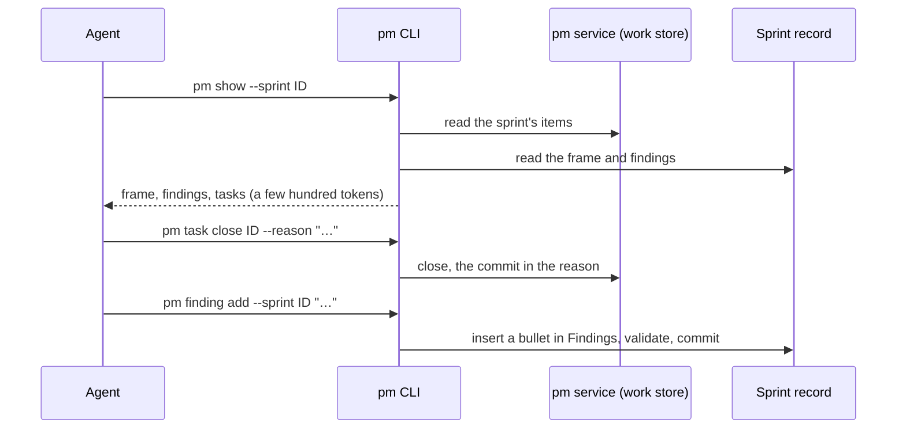

## Problem

> What are we solving, and why now?

Part of the [Project management harness](pm-harness.md) design. A project lives in two layers, the [work store](work-store.md) and the Markdown records, and `pm` is the agents' only write path to both.

- Records that agents edit freely drift from their format.
- An action that touches both layers (opening a sprint, answering a need) takes several steps that an agent can get wrong.
- Agents need the project state without reading every record.
- The command surface is itself a cost: every command, flag and name is something an agent must hold, and the surface grows one command at a time.

## Goals and non-goals

> What must the design achieve, and what does it deliberately leave out?

**Goals**

- Agents read the project state in a few hundred tokens (`pm show`), level by level, and write through commands that check every write.
- One command for each action that touches both layers or needs a check.
- A surface an agent can predict from one grammar (Naming, below), and that tells its own detail: rules, then state, then each command's `--help`.

**Non-goals**

- A generic record editor: sections other than Findings and Decisions stay hand edits that `pm commit` checks.
- Editing or deleting a written entry; that is done by hand.
- Aliases for removed or renamed commands and flags.

## Constraints and key facts

> Which facts, findings and constraints shaped the design? Only those that
> still hold; sprint records keep the findings as they happened.

- A repo holds many projects, each with several sprints that can be open at once, so nothing can be inferred from "the only project" or "the open sprint".
- Agents run under the owner's git identity, so git cannot tell an agent's change from the owner's.
- Some tasks commit nothing, so a task close cannot require a commit.
- An agent's shell may give a command stdin as a socket that never closes, so a read of stdin can hang forever. A body passed as `--text="$(cat <<'EOF' … EOF)"` breaks on macOS bash 3.2 when it holds an apostrophe or a lone `)`, and a backtick inside double quotes executes.
- Agents read refusals, rarely `--help`, and use few commands. Measured on Claude Code transcripts over 11 days in one owner's repos:

::: result {title="How agents use the CLI"}
| Measure | Value |
|---|---|
| Invocations | 3,768, of which 6.7% failed |
| Share carried by the top 20 of 65 commands used | 91% |
| Failures followed by a `--help` of the command | 5 of 252 |
| Failed bare `pm show --record X` calls, before it printed an outline | 41 of 42 |
:::

Reading: the refusal text is what an agent learns from, so it must carry the expected shape; the rules print full procedures only for the commands that carry most use.

- The command grammar, the `--help` texts and the refusal wording are interface: `prime.md`, the tests and the agents' habits rely on them. `internal/cli/testdata/help.golden` freezes every `--help`, and `tests/test_pm.py` asserts the refusal texts that `prime.md` and the `--help` texts name.
- Claude Code passes a hook's context inline only up to 10,000 characters, so the rules and the session-start state each fit that cap.

## Design

> What is it, in its final state? Free `###` subsections. Decisions and plans
> live in the project and sprint records.

### Principles

| Principle | What it means for a command |
|---|---|
| Self-contained, progressive disclosure | `pm prime` prints the model and the procedures for the most used commands, and names the rest in one line each; `pm show` prints the state, one level at a time; each command's `--help` holds its flags and refusals. `pm --help` lists the agent commands; `pm --help --all` adds the machinery. |
| Wrap only what touches both layers or needs a check | A command exists for an act agents do. The work store has no write path but `pm`, so its plain writes (`dep add`, `comment add`, `task edit`) are thin commands with no records step. |
| Every write names its target | No command infers its project or sprint. A missing or ambiguous target is refused, never guessed. |
| Refusals show the expected shape | A refusal names what is wrong and gives the command that would pass. A removed name is removed, not aliased: it fails as an unknown command or flag. |
| Fail hard | No silent default stands in for a required input: `pm task close` requires `--reason`. |
| One body form | A body (a goal, a frame, a description, a reason, an answer) is `--text` for one plain line or `--text-file PATH`, exclusive. Structured parts are flags, one line each (`decision add`, `decision need`). |
| Checked writes | Every write validates the whole record set with the new text substituted, and writes nothing when the result would not validate. |

`--text-file -` reads stdin only when it is a pipe or a file, so agents give multi-line text as `--text-file - <<'EOF'` … `EOF`. Any other stdin (a tty, a socket, a device) is refused before reading. No other command reads stdin; hooks read their JSON input.

### Command families

`pm --help` lists the families below; each command's `--help` holds its arguments, its effect on each layer and its refusals.

| Family | Commands | What they do |
|---|---|---|
| State | `show`, `where`, `record link`, `day`, `check` | Read the project state level by level; list every location and its state; print a record's URL on the site; the generated day pages; validate the records without a write |
| Records | `finding add`, `decision add`, `design new\|rename\|unchanged`, `doc new\|rename`, `postmortem new`, `feedback add`, `commit` | Insert into a named section, create a record with every section, or commit hand edits by path |
| Work | `project open\|close`, `sprint open\|close\|edit\|move`, `task add\|claim\|close\|move\|ready\|edit\|release`, `dep add\|rm`, `comment add` | Items, holders, status and dependencies; an action that also has a record writes both |
| Owner requests | `decision need\|close`, `action need\|done`, `need edit\|dismiss`, `reply read\|add` | Raise a need, a PR review (`action need --pr`), read the owner's reply, close a need ([Decision need layout](decision-need-layout.md), [Reply delivery](reply-delivery.md)) |
| Setup and service | `init`, `doctor`, `upgrade`, `uninstall`, `clean`, `service install\|status\|restart\|stop\|logs`, `interactive`, `version` | Install and check pm in a repo, clone and worktree ([pm as an installable product](pm-product.md)); run the pm service; set this session's owner-request mode |
| Machinery, under `pm --help --all` | `prime`, `hook …`, `push`, `sync`, `export`, `service run`, `day summarize`, `autopilot` | What the runtimes' hooks, the pm service and the scheduler run; dispatched and documented, not typed by agents |

### What `pm show` prints

Each level names the command for the next.

| Level | Command | Prints |
|---|---|---|
| Top | `pm show` | A push-failure warning; the tasks other live sessions hold; the `site:` line; the `feedback:` line (the repo's one feedback doc); the open questions no task holds; one line per open project, each followed by one line per owner request, with `[undelivered reply: pm reply read ID]` where a site reply has not reached a session |
| Project | `pm show --project NAME` | Goal; the owner requests in full; the `feedback:` line; each open sprint with its goal, done-when count and open tasks with holders; the last decisions |
| Sprint | `pm show --sprint ID` | One sprint's frame, findings and tasks |
| Record | `pm show --record TARGET` | The record's outline: its header ids, each section with its line count, and the `--section` command for each. TARGET is a path, sprint id, project name or design slug |
| Section | `pm show --record TARGET --section NAME` | One section, from its heading to the next heading of the same or a higher level, as the renderer parses headings |
| Item | `pm show ID` | One item of any type: fields, holder, blockers, children, needs and comments |

`--json` prints every level's data as one object. Session start injects the top level, which shares the 10,000-character hook cap with the rest of the start context, so it holds only what an agent must see before it starts work: its size grows with open projects and owner requests, not with sprints and tasks. Not chosen: one level cut at the hook cap, which dropped whatever came last.

### How a write runs

- **Records.** `pm` only creates files and inserts into a named section: a bullet at the end of Findings, a block at the end of Decisions, replacing the section's "None yet." on first insert. The insertion point is the section's line range from the parser; the file is otherwise byte-for-byte unchanged. Goal, Scope, Done when, the delivery report, design pages, docs and postmortems are edited by hand, then committed with `pm commit -m "…" <path>…`, which commits only the named paths ([Record drafts and publishing](record-drafts.md)). Not chosen: editing or removing blocks by line range, which needs stable block ids and is rare enough to do by hand.
- **One validator.** The parser and validator that the site renders with check every write, so `pm` cannot accept a record the site rejects. Each records write takes the store's lock, builds the new text in memory, validates every record with it, writes atomically (temp file and rename), and commits exactly the files written on the `records` branch.
- **Both layers.** The work-store step runs first, through the pm service ([work store](work-store.md)); the records step runs after it succeeds. A failed records step undoes the work-store step (a created item is closed as dismissed, a moved task goes back, a renamed sprint takes its old title) and the refusal says so.

### Closing points to a commit

- `pm task close <id> --reason "…"` stores the commit that holds the work in the close reason: HEAD when committed after the task started, else `--commit` (a commit here, `OWNER/REPO@SHA` or a PR URL). `--dropped` closes a task not done, with no commit.
- `pm sprint close` and `pm project close` refuse while records have uncommitted changes, check the committed delivery report or Outcome, and close the item with the records commit in its reason.
- **A sprint closes on merge.** The agent writes and commits the delivery report first; `pm action need --pr` refuses a sprint whose report is not written, and puts the review under the first sprint, so the open review blocks the close. Once the PR is on main, the agent closes the review with `pm action done <id> --reason "merged as <sha>"`, and `pm sprint close` stamps "Merged as <sha> (PR #N)." into the Outcome. A PR merged with no review takes `pm sprint close <id> --merged <sha> [--pr URL]`, the sha on the remote's main. Both run the design-page gate on the PR's changed files ([Sprint lifecycle](sprint-lifecycle.md)).
- Not chosen: refusing a task close without a commit, since some tasks commit nothing; an interactive sprint close that writes the report, which hides the most important text behind prompts; asking GitHub whether a PR merged, since GitHub reports a stacked PR merged before it reaches main, and the review's close reason is the merge evidence.

### Naming

The grammar every command follows; a new command or flag uses it, and a deviation is a defect to remove.

| Concept | Rule | Examples |
|---|---|---|
| Shape | `pm <noun> <verb>` for an act on an object; a bare top-level verb only for a whole-repo act | `pm task close`, `pm sprint open`; `pm show`, `pm check`, `pm commit`, `pm init` |
| Create a container | `open` | `project open`, `sprint open` |
| Add an item or a note | `add` | `task add`, `finding add`, `decision add`, `dep add`, `comment add`, `feedback add` |
| Create a record from its template | `new` | `design new`, `doc new`, `postmortem new` |
| Ask the owner | `need`, under the kind of need | `decision need`, `action need` |
| Close | `close` for work items; `done` for a done action; `dismiss` for a need that became moot | `task close`, `sprint close`, `project close`, `decision close`; `action done`; `need dismiss` |
| Change | `edit` for a title or body, `move --to` for a parent, `rename --to` for a slug | `sprint edit`, `need edit`, `task move --to`, `design rename --to` |
| Scope of a write | `--sprint ID`, `--task ID` or `--project NAME`, each meaning that container on every command | `finding add --sprint`, `doc new --sprint\|--task\|--project`, `postmortem new --sprint\|--project` |
| Sub-item | `--parent ID`, only for an item of the same kind | `task add --parent <task>` |
| Body | `--text` or `--text-file`, exclusive; structured parts as flags, one line each; a close takes `--reason`; `commit` takes `-m` | `sprint open --text-file -`; `decision add --decision --reason` |
| Positional id | Named for what it is: `task_id`, `sprint_id`, `need_id`, `slug`, `project`, `target` for a lookup that takes several kinds | `pm task close <task_id>`, `pm record link <target>` |
| Machinery | Hidden from `pm --help`, listed by `pm --help --all` | `pm hook stop`, `pm service run` |

Where the surface still deviates:

| Deviation | Grammar | State |
|---|---|---|
| `decision need` and `action need` take `--parent ID` for their sprint or task | `--sprint` or `--task` | Kept for now |
| `decision add --level project\|sprint` beside `--project` or `--sprint`, which already name the level | The scope flag alone | Kept for now |
| A need closes four ways: `decision add --need`, `decision close`, `action done`, `need dismiss` | One verb for a need that sets no rule; `decision add --need` for one that sets a rule | Kept for now |
| `finding add` takes its text as a positional | A body form | Kept: one short line, failing 2.6% of calls |

### Agent hooks

`pm init` writes pm's hook entries into `.claude/settings.json` and `.codex/hooks.json` ([pm as an installable product](pm-product.md)), the same command per event in both runtimes but `pm hook ask`, which runs where each runtime's ask tool can be seen; each runs `pm prime` or `pm hook <name>`, whose logic ships in the binary:

| Event | Command | Does |
|---|---|---|
| SessionStart (Claude Code: every source; Codex: `startup\|resume\|clear\|compact`) | `pm prime --rules N` per chunk, `pm prime --state`, then `pm prime --request-rule` | The rules, the request rule of the session's mode, then `pm init --session-start`, `pm where` and `pm show --refresh-inbox`, each hook's text within the 10,000-character cap; a step that fails is one line saying so, and the session starts anyway |
| SubagentStart | the same chunks, then `pm prime --subagent` | The rules and pm's git rule for agents |
| Claude Code's PermissionRequest and PostToolUse on AskUserQuestion; Codex's PostToolUse on `request_user_input_async` and its UserPromptSubmit | `pm hook ask --runtime claude\|codex` | Raises the session's ask-tool question as a question need, so the owner can answer it on the site too; the first answer, there or in chat, closes it ([Owner questions](owner-questions.md)) |
| SessionEnd | `pm hook session-end` | Removes the ended session's interactive-mode file ([Owner-request Stop hook](owner-request-hook.md)) |
| Stop | `pm hook owner-request` | Blocks once a reply that asks the owner only in chat, unless the session is in interactive mode, which `pm interactive` sets and `pm autopilot` clears ([Owner-request Stop hook](owner-request-hook.md)) |
| Stop; Codex's SubagentStop | `pm hook stop` | Blocks once while the store holds uncommitted files that this session's tool calls name by their path; another session's file is left alone |

`pm hook stop` cannot see a file edited without naming its path (after `cd` into a store folder, or through a glob) and lets the stop through. Not chosen: a Stop check for unclosed claimed tasks (a task stays open across turns by design), PreToolUse guards on `records/` (Bash and `sed` bypass them, and `pm check` catches a bad record from any tool), and needs on every prompt (they show at session start and on the site).

### Agent identity

Agents run under the owner's git identity. `pm` makes the difference visible where it matters: `pm task claim` records the session that holds a task ([Session claims](session-claims.md)), a need records the session that raised it, and `pm decision add` writes `source=agent` unless it answers a need (`--need`) or the owner confirmed it (`--confirmed`).

### Code structure

- `cli` owns the command tree (`commands.go`, every command with its help text), the session and config checks, dispatch, and one file per noun's body; `go doc ./internal/cli` has the file map. Every command pm dispatches is in the tree.
- `cli/parse` builds the tree on Cobra; each leaf parses its own arguments with pflag in pm's grammar: switches, single, repeated and two-value options (`--option LABEL TEXT`), required, optional and trailing positionals, alternative groups (`--text` or `--text-file`) and choices. An option is read only by its whole name. Not chosen: Cobra's own required-flag and flag-group checks, whose messages differ from pm's.
- `cli/setup` owns `init`, `doctor`, `upgrade` and `uninstall`; `cli/clean` owns `clean`; `cli/fsutil` holds the path helpers both share.
- Caps: 800 lines per Go file under `internal/cli` and a package-size ratchet (`size_test.go`); functions are capped by `.golangci.yml`. A file or function past a cap is split along a seam.

### Example: an update during work

*Reading:* the agent reads one level and sends small commands; the site, served by the pm service, shows each write on the next page load.

## Alternatives considered

> What else was considered and not adopted, and why not?

| Alternative | Why not |
|---|---|
| Regroup the commands into fewer nouns | The surface is wide and shallow (depth 2) and agents know it; the cost is in naming spread, not in count. Hiding the machinery from `pm --help` removes most of the noise instead |
| Aliases for old names | An alias keeps two names for one act in every agent's memory and in the help; a removed name fails as unknown, and the refusal points at the current form |
| A generic section editor (`pm section set`) | Records stay free-form hand edits; `pm commit` checks them, and only Findings and Decisions take inserts |
| Full procedures for every command in `prime.md` | Every inlined flag and refusal is a copy that drifts from `--help`, and the rules share a hook cap; the top 20 commands carry 91% of use |
| Guidance only in `--help` | Agents rarely run `--help`; the rules still state the key rules that code enforces, so agents avoid the guards rather than learn them from refusals |
| Inferring a decision's level or a write's target | Wrong silently when several projects and sprints are open |

Smaller alternatives sit beside the choice they lost to in Design, marked "Not chosen".

## Prior art

> Optional. What existing work did we learn from, and what did we take?

- `git` and `gh`: `noun verb` subcommands with a short top-level help and full per-command help; pm takes the shape and per-command `--help` as the detail level.
- Beads (`bd`), pm's earlier work layer: `bd prime` gave an agent its context at session start. pm took the session-start priming and replaced the raw store commands with its own, since `bd` knew nothing of records.

## Open questions

> What is still unresolved?

- Whether `decision need` and `action need` move from `--parent` to `--sprint`/`--task`, and `decision add` drops `--level`: one scope vocabulary.
- Whether one verb closes a need that sets no rule, in place of `decision close`, `action done` and `need dismiss`.
- A CI check over `commands.go` that refuses a scope flag, create verb or positional name outside the Naming grammar, once those two are settled.
- Whether Codex agents use the CLI differently: the usage figures hold no Codex invocations.
