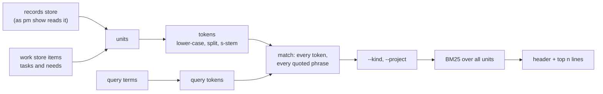

## Problem

> What are we solving, and why now?

Part of the [Work context](work-context.md) design. Before an agent frames a sprint, it should know what earlier sprints, decisions, design pages, docs and tasks already say about the topic: what was tried, what was dropped and why, and what rule still binds. The records hold this, but the only way to reach it across projects is `grep records/`:

- grep returns lines. An agent wants the section or decision that holds them, with its date and state.
- grep misses the work store. Task and need titles and close reasons, including the dropped ones, live there and nowhere else.
- grep has no ranking. A common word floods the output and spends the agent's context.

## Goals and non-goals

> What must the design achieve, and what does it deliberately leave out?

**Goals**

- One command finds the units (a section, a decision, a work item) that hold all the query's words, best first, across every project.
- Each hit is one line that says what it is, when it is from and whether it is done, and how to read exactly that unit next.
- Output is capped. An agent can tell from the header whether to refine the query.
- The result is deterministic: the same store and the same query give the same lines.
- One run stays under 1 s on this repo's store.

**Non-goals**

- Semantic or embedding search, query expansion and synonyms. The procedure asks for two or three wordings instead.
- A persistent index, an index in the service, or any state kept between runs.
- Searching code (`rg` serves it), the site's pages, or a worktree's drafts workspace.
- Printing unit bodies. Search points; `pm show` reads.
- Marking decisions superseded (an open question of [Work context](work-context.md)).

## Constraints and key facts

> What is fixed, and what facts does the design rest on?

Measured on this repo's store on 2026-10-17, in process, one run each.

::: result {title="Corpus and cost"}
| Quantity | Value |
|---|---|
| Records | 230 (180 sprint, 25 design, 17 doc, 6 project, 2 postmortem); 2.09 MB |
| Record units | 2,355: 1,440 sprint sections, 453 decisions, 321 design sections, 99 doc sections, 30 project sections, 12 postmortem sections |
| Work items | 946: 481 tasks, 280 needs, 179 sprints, 6 projects; every closed item has a close reason |
| Read, split and tokenize all record units | 13 ms read + 15 ms split + 36 ms tokenize = 64 ms |
| Fetch every work item through the service | about 50 ms (`pm export`) |
| `pm show`, `pm show --project pm-harness`, end to end | 0.14–0.15 s |
| Design pages' dates, one `git log` over `design/` | 27 ms |
:::

The scan costs about 0.1 s next to the 0.15 s every store-reading command already pays, so no index is needed.

::: result {title="Units that hold all the query's terms versus any of them"}
| Query | All terms | Any term |
|---|---|---|
| claim history | 12 | 168 |
| owner-request judge | 81 | 784 |
| design page index | 30 | 1,395 |
| records workspace drafts | 38 | 628 |
| launcher sha256 | 10 | 63 |
:::

Matching any term returns up to 59 % of the corpus for a three-word query. Matching all terms returns 10 to 81 units.

| Fact | Consequence |
|---|---|
| `records.Words` splits on whitespace only and keeps case, punctuation and whole code spans (`judge,`, `` `pm task claim` ``) | Search has its own tokenizer |
| 2,708 of the 11,449 code spans hold a path or a file name | A path in a query must match the path, not only its parts |
| Every decision block carries `date=`; every doc header carries `date:`; a postmortem's file name starts with its date; sprint and project records carry no date | Dates come from those, from the work item for sprint and project records, and from git for design pages |
| `pm show --record <target> --section <name>` takes a sprint name, project name, design slug or path, and any `##` or `###` heading; a decision block is not a heading | A hit's address is a record and a section; a decision is addressed by its record's Decisions section and its date |
| `internal/cli` sits at its size cap (`size_test.go`: 7,365 lines) | The search lives in its own package; the command file in `internal/cli` only wires it |

## Design

> How does it work? Use ### subsections, mermaid diagrams, tables, figures.



Every run builds the units, keeps those that hold the whole query, filters them, ranks them, and prints the top `n`.

### Command

```text
pm search <term>… [--kind KIND]… [--project NAME] [-n/--limit N]
```

| Argument | Meaning |
|---|---|
| `<term>…` | One or more terms. A unit must hold every term. A term with a space is a phrase. |
| `--kind` | Keep only these kinds, repeatable: `sprint`, `project`, `decision`, `design`, `doc`, `postmortem`, `task`, `need` |
| `--project NAME` | Keep only units of that project (its name or its item id): its records, design pages and docs, and items under it |
| `-n N`, `--limit N` | Print at most N hits; default 10 (pm's parser gives every short option a long name) |

It refuses an empty query (no letter or digit in any term), an `-n` below 1, an unknown kind (a usage error listing the kinds) and an unknown project (naming the projects).

### Units

| Source | Unit | Kind | Text indexed |
|---|---|---|---|
| Sprint record | each `##` section except Progress, Decisions and Design pages | `sprint` | record title, heading, section body |
| Project record | each `##` section except Progress, Decisions and Design pages | `project` | as above |
| Sprint or project record | each `::: decision` block in Decisions | `decision` | record title, the block's body |
| Design page | each `###` under Design, and Design's text before its first `###`; each other `##` | `design` | page title, heading, body |
| Doc, postmortem | each `##` section, and the text before the first one; the whole body when it has none | `doc`, `postmortem` | title, heading, body |
| Work store | each task and need | `task`, `need` | title, description, close reason |

- Progress is generated and repeats the work store; sprint and project items are left out because their records hold their text.
- Design pages is a list of links to pages that are indexed themselves; as units, these short lists of page titles ranked above the sections that hold the substance.
- A decision's address names its record's Decisions section, but the heading is not indexed, so every block does not hold the word `decision`.
- A `#` heading starts a section as a `##` does. A body starts after its heading's own lines, a setext heading's underline included.
- Prompt lines (`> …`) and "None yet." / "Not closed yet." lines are dropped; a unit left with nothing but headings is not indexed.
- Records split at the headings `pm show --record` parses (`records.Headings`), so every address names a section it prints.

### Tokens

A text becomes tokens in three steps:

1. **Split** on every rune that is not a letter or digit, after lower-casing: `` `internal/cli/task.go` `` gives `internal`, `cli`, `task`, `go`.
2. **Stem** each token with the S-stemmer (Harman 1991), applied to tokens of 4 runes or more. The first rule that matches applies:
   - `-ies` → `-y`, unless the token ends in `-eies` or `-aies`.
   - `-es` → `-e`, unless the token ends in `-aes`, `-ees` or `-oes`.
   - `-s` → nothing, unless the token ends in `-us` or `-ss`.

   So `pages` → `page` and `claims` → `claim`, while `status` and `access` stay as they are.
3. **Match.** A query term is tokenized the same way, and a unit must hold every token. A query term holding a space, a `/` or a `.` (a phrase or a path) must also appear in the unit's lower-cased text as written, each run of white space read as one space so a phrase matches across a line break. So `internal/cli/task.go` matches that path, not a section that only uses the words `task` and `go` somewhere.

### Ranking

BM25 over the matched units, with the statistics of the whole corpus, so a filter never changes a unit's score:

```text
score(u) = Σ over query tokens t:  idf(t) · tf(t,u) · (k1 + 1) / (tf(t,u) + k1 · (1 − b + b · |u| / avgdl))
idf(t)   = ln(1 + (N − n(t) + 0.5) / (n(t) + 0.5))
k1 = 1.2,  b = 0.75
```

- N is the number of units, n(t) the number of units holding t, |u| a unit's length in tokens, and avgdl the mean length.
- A unit's title and heading are part of its text, so a hit in a heading counts like one in the body. There is no field weighting.
- Equal scores are ordered by date, newest first, then by address.
- A token the query repeats counts once.

### Dates and states

| Kind | Date | State |
|---|---|---|
| `sprint`, `project` | the item's close date when closed, else its creation date | the item's: `done`, `dropped`, `running`, … (`site.State`) |
| `decision` | the block's `date` | its record's item state |
| `design` | the page's last change on the records branch (`store.DesignDates`) | `-` |
| `doc` | the header's `date` | `-` |
| `postmortem` | the date in its file name | `-` |
| `task`, `need` | close date when closed, else creation date | the item's state |

Dates print as `YYYY-MM-DD`.

### Output

```text
$ pm search claim history
4 units hold all of: claim, history
decision    2026-09-30  done     pm-harness-112 Decisions           Claims keep only the current holder; history is the …
design      2026-10-02  -        session-claims Claiming            A claim records who holds the task and when; only a …
sprint      2026-09-30  done     pm-harness-112 Findings            The work store keeps no claim history: an item holds …
task        2026-09-12  dropped  yeeef-agents-9va.88.2              Record every claim in an events table
read one: pm show --record <record> --section <section>; an item: pm show <id>
```

The lines show the output shape; the hits are illustrative.

- The header gives the number of matches after `--kind` and `--project`, and the terms as typed, so an agent seeing `212 units hold all of …` knows to narrow the query.
- The columns are kind, date, state, address and snippet, each as wide as its widest printed value. The address is the record and section that `pm show --record` takes (shell-quoted as its outline quotes them), or the item id. A doc's or postmortem's record is its path (`docs/<date>-<slug>`), as is a record whose name another sprint, project or design record shares; a unit whose heading the record repeats is addressed by its record alone, since `pm show --section` refuses a repeated heading.
- The snippet is the unit's first sentence that holds a query token (its first sentence when only the title or heading does), with Markdown marks removed and a table row as its cells joined by `; `, cut at 80 runes.
- With no match the output is one line, `no unit holds all of: a, b; try other words`, and the exit is 0.
- No link is printed. A link is for the owner, and `pm record link` gives it.

### Code

- `internal/search` holds the units, the tokenizer, the stemmer, the match, BM25 and the output lines. It is pure: it takes parsed records, items and dates, and returns the lines, and it has no I/O.
- `internal/cli/search.go` only wires it: it loads the records as `pm show` does (the shared store, not a worktree's drafts), fetches the items, reads the design dates and calls `internal/search`. `internal/cli` sits at its size cap, so the heading parser that `pm show --record` and search share moved to `internal/records`.
- The index's line `prior work: pm search <topic>` ([Work context](work-context.md)) is printed from the release that ships this command.

## Alternatives considered

> What else did we weigh, and why not?

| Alternative | Why not |
|---|---|
| Match any term, ranked by BM25 | A three-word query returned up to 1,395 of 2,355 units; the cap would hide nothing useful and the count would mean nothing |
| A fallback to any-term matching when no unit holds all terms | It changes what a hit means without saying so; the no-match line asks for other words instead |
| Bleve or SQLite FTS5 | A dependency and an index to keep in step with two stores, for a corpus that scans in 0.1 s |
| The Porter stemmer | More rules and more surprising conflations (`general` and `generate` share a stem); plurals are the case that the measured queries need |
| BM25F with a weight on headings | One more parameter to tune with no labelled queries to tune it on; headings already count as text |
| Indexing sprint and project items | Their titles and close reasons repeat their records' Goal and Outcome |
| Printing each hit's link | Doubles the line length; agents read with `pm show`, and the owner's link comes from `pm record link` |

## Prior art

> Optional: published work or other systems this design learned from.

- S. Robertson and H. Zaragoza, "The Probabilistic Relevance Framework: BM25 and Beyond", 2009: the scoring function and the k1 and b defaults; the idf form is Lucene's, which is never negative.
- D. Harman, "How effective is suffixing?", JASIS 1991: the S-stemmer.
- `rg` and `git grep`: line search, which this command complements with units, state and ranking.

## Open questions

> What is not decided yet?

- How search grows past a full scan, and how it is judged against `rg`: the RFC sub page [Search index](search-index.md).
- Whether search reads a worktree's drafts workspace as well as the published store.
- A `--json` output, if a tool rather than an agent comes to read the hits.
