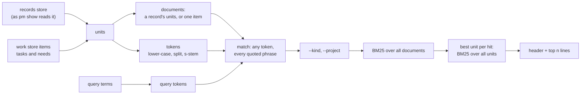

## Problem

> What are we solving, and why now?

Part of the [Work context](work-context.md) design. Before an agent frames a sprint, it should know what earlier sprints, decisions, design pages, docs and tasks already say about the topic: what was tried, what was dropped and why, and what rule still binds. The records hold this, but the only way to reach it across projects is `grep records/`:

- grep returns lines. An agent wants the section or decision that holds them, with its date and state.
- grep misses the work store. Task and need titles and close reasons, including the dropped ones, live there and nowhere else.
- grep has no ranking. A common word floods the output and spends the agent's context.

## Goals and non-goals

> What must the design achieve, and what does it deliberately leave out?

**Goals**

- One command finds the records and work items that hold the query's words, best first, across every project, and points each at the unit to read: a section, a decision or the item.
- It finds the earlier records a sprint cites better than `rg` does, on the [Search index](search-index.md) page's retrieval eval.
- Each hit is one line that says what it is, when it is from and whether it is done, and how to read exactly that unit next.
- Output is capped. An agent can tell from the header whether to refine the query.
- The result is deterministic: the same store and the same query give the same lines.
- One run stays under 1 s on this repo's store.

**Non-goals**

- Semantic or embedding search, query expansion and synonyms. The procedure asks for two or three wordings instead.
- A persistent index, an index in the service, or any state kept between runs ([Search index](search-index.md) stages 3 and 4).
- Searching code (`rg` serves it), the site's pages, or a worktree's drafts workspace.
- Printing unit bodies. Search points; `pm show` reads.
- Marking decisions superseded (an open question of [Work context](work-context.md)).

## Constraints and key facts

> What is fixed, and what facts does the design rest on?

Measured on this repo's store on 2026-10-17, in process, one run each.

::: result {title="Corpus and cost"}
| Quantity | Value |
|---|---|
| Records | 230 (180 sprint, 25 design, 17 doc, 6 project, 2 postmortem); 2.09 MB |
| Record units | 2,355: 1,440 sprint sections, 453 decisions, 321 design sections, 99 doc sections, 30 project sections, 12 postmortem sections |
| Work items | 946: 481 tasks, 280 needs, 179 sprints, 6 projects; every closed item has a close reason |
| Read, split and tokenize all record units | 13 ms read + 15 ms split + 36 ms tokenize = 64 ms |
| Fetch every work item through the service | about 50 ms (`pm export`) |
| `pm show`, `pm show --project pm-harness`, end to end | 0.14–0.15 s |
| Design pages' dates, one `git log` over `design/` | 27 ms |
:::

The scan costs about 0.1 s next to the 0.15 s every store-reading command already pays, so no index is needed. One `pm search` on the store of 2026-10-25 takes 0.15–0.19 s end to end (pm-harness-129 Findings).

::: result {title="Units that hold all the query's terms versus any of them"}
| Query | All terms | Any term |
|---|---|---|
| claim history | 12 | 168 |
| owner-request judge | 81 | 784 |
| design page index | 30 | 1,395 |
| records workspace drafts | 38 | 628 |
| launcher sha256 | 10 | 63 |
:::

Matching any term returns up to 59 % of the corpus for a three-word query, so the header gives both counts: how many hits hold every word, and how many hold some.

::: result {title="Retrieval eval, strict labels, best of 3 queries (pm-harness-129 Findings)"}
| Ranking | recall@10 | MRR |
|---|---|---|
| A unit must hold every word, units ranked (sprint 126) | .509 | .417 |
| Records and items, any word, one mean length | .610 | .427 |
| Records and items, any word, each set's own mean length (this page's ranking) | .705 | .531 |
| `rg`, every word, newest file first (the best `rg` variant) | .692 | .505 |
| Whole-record BM25, any word, records only | .767 | .564 |
:::

The shipped ranking beats every earlier one and `rg` by match count, and ties `rg` newest first: the difference's 95 % CI spans 0 (+0.014 [−0.089, +0.116] recall@10).

| Fact | Consequence |
|---|---|
| `records.Words` splits on whitespace only and keeps case, punctuation and whole code spans (`judge,`, `` `pm task claim` ``) | Search has its own tokenizer |
| 2,708 of the 11,449 code spans hold a path or a file name | A path in a query must match the path, not only its parts |
| Every decision block carries `date=`; every doc header carries `date:`; a postmortem's file name starts with its date; sprint and project records carry no date | Dates come from those, from the work item for sprint and project records, and from git for design pages |
| `pm show --record <target> --section <name>` takes a sprint name, project name, design slug or path, and any `##` or `###` heading; a decision block is not a heading | A hit's address is a record and a section; a decision is addressed by its record's Decisions section and its date |
| A record's words often fall in different sections; a unit-level AND loses that record | A record is scored as one document; the unit only decides where its line points |
| A record has hundreds of tokens, a task or need tens | Against one mean length the items took 40 % of the top-10 lines; each set is normalized by its own mean |
| `internal/cli` sits at its size cap (`size_test.go`) | The search lives in its own package; the command file in `internal/cli` only wires it |

## Design

> How does it work? Use ### subsections, mermaid diagrams, tables, figures.



Every run builds the units, groups them into documents, keeps the documents that hold any query word, filters them, ranks them, points each at its best unit, and prints the top `n`.

### Command

```text
pm search <term>… [--kind KIND]… [--project NAME] [-n/--limit N]
```

| Argument | Meaning |
|---|---|
| `<term>…` | One or more terms. A record or item matches when it holds any of them. A term with a space is a phrase. |
| `--kind` | Show only units of these kinds, repeatable: `sprint`, `project`, `decision`, `design`, `doc`, `postmortem`, `task`, `need`. A record none of whose units of these kinds holds a query word is left out. |
| `--project NAME` | Keep only hits of that project (its name or its item id): its records, design pages and docs, and items under it |
| `-n N`, `--limit N` | Print at most N hits; default 10 (pm's parser gives every short option a long name) |

It refuses an empty query (no letter or digit in any term), an `-n` below 1, an unknown kind (a usage error listing the kinds) and an unknown project (naming the projects).

### Units and documents

A unit is what a line points at; a document is what is ranked. A record's units together are one document; a task or need is a document of one unit.

| Source | Unit | Kind | Text indexed |
|---|---|---|---|
| Sprint record | each `##` section except Progress, Decisions and Design pages | `sprint` | record title, heading, section body |
| Project record | each `##` section except Progress, Decisions and Design pages | `project` | as above |
| Sprint or project record | each `::: decision` block in Decisions | `decision` | record title, the block's body |
| Design page | each `###` under Design, and Design's text before its first `###`; each other `##` | `design` | page title, heading, body |
| Doc, postmortem | each `##` section, and the text before the first one; the whole body when it has none | `doc`, `postmortem` | title, heading, body |
| Work store | each task and need | `task`, `need` | title, description, close reason |

- A record's document is its title once, then each unit's heading and body.
- Progress is generated and repeats the work store; sprint and project items are left out because their records hold their text.
- Design pages is a list of links to pages that are indexed themselves; as units, these short lists of page titles ranked above the sections that hold the substance.
- A decision's address names its record's Decisions section, but the heading is not indexed, so every block does not hold the word `decision`.
- A `#` heading starts a section as a `##` does. A body starts after its heading's own lines, a setext heading's underline included.
- Prompt lines (`> …`) and "None yet." / "Not closed yet." lines are dropped; a unit left with nothing but headings is not indexed.
- Records split at the headings `pm show --record` parses (`records.Headings`), so every address names a section it prints.

### Tokens

A text becomes tokens in three steps:

1. **Split** on every rune that is not a letter or digit, after lower-casing: `` `internal/cli/task.go` `` gives `internal`, `cli`, `task`, `go`.
2. **Stem** each token with the S-stemmer (Harman 1991), applied to tokens of 4 runes or more. The first rule that matches applies:
   - `-ies` → `-y`, unless the token ends in `-eies` or `-aies`.
   - `-es` → `-e`, unless the token ends in `-aes`, `-ees` or `-oes`.
   - `-s` → nothing, unless the token ends in `-us` or `-ss`.

   So `pages` → `page` and `claims` → `claim`, while `status` and `access` stay as they are.
3. **Match.** A query term is tokenized the same way, and a document matches when it holds any token. A query term holding a space, a `/` or a `.` (a phrase or a path) must also appear in the document's lower-cased text as written, each run of white space read as one space so a phrase matches across a line break. So `internal/cli/task.go` keeps only the records that hold that path.

### Ranking

BM25 over the matched documents, with the statistics of every document, so a filter never changes a score:

```text
score(d) = Σ over query tokens t in d:  idf(t) · tf(t,d) · (k1 + 1) / (tf(t,d) + k1 · (1 − b + b · |d| / avgdl(d)))
idf(t)   = ln(1 + (N − n(t) + 0.5) / (n(t) + 0.5))
k1 = 1.2,  b = 0.75
```

- N is the number of documents, records and items together, and n(t) the number holding t; |d| is a document's length in tokens.
- avgdl(d) is the mean length of the records for a record, and of the items for an item. A record is long and an item short: against one mean, the items would outrank the records holding the same words.
- A document that holds more of the query's tokens, and rarer ones, scores higher wherever in it they fall.
- Equal scores are ordered by the shown unit's date, newest first, then by address.
- A token the query repeats counts once. There is no field weighting: counting the title three times changed no measure (pm-harness-129 Findings).

**Best unit.** Each hit's line shows its document's unit with the highest BM25 score for the query, computed with the statistics of all units (N, n(t) and avgdl over units), the first on a tie. With `--kind`, only units of those kinds are candidates.

### Dates and states

| Kind | Date | State |
|---|---|---|
| `sprint`, `project` | the item's close date when closed, else its creation date | the item's: `done`, `dropped`, `running`, … (`site.State`) |
| `decision` | the block's `date` | its record's item state |
| `design` | the page's last change on the records branch (`store.DesignDates`) | `-` |
| `doc` | the header's `date` | `-` |
| `postmortem` | the date in its file name | `-` |
| `task`, `need` | close date when closed, else creation date | the item's state |

Dates print as `YYYY-MM-DD`.

### Output

```text
$ pm search claim history
4 records hold all of: claim, history; 41 hold some
decision    2026-09-30  done     pm-harness-112 Decisions           Claims keep only the current holder; history is the …
design      2026-10-02  -        session-claims Claiming            A claim records who holds the task and when; only a …
sprint      2026-09-30  done     pm-harness-112 Findings            The work store keeps no claim history: an item holds …
task        2026-09-12  dropped  yeeef-agents-9va.88.2              Record every claim in an events table
read one: pm show --record <record> --section <section>; an item: pm show <id>
```

The lines show the output shape; the hits are illustrative.

- The header gives how many hits hold every word and how many hold some, after `--kind` and `--project`, and the terms as typed.
- One line per record or item. The columns are kind, date, state, address and snippet of its best unit, each as wide as its widest printed value. The address is the record and section that `pm show --record` takes (shell-quoted as its outline quotes them), or the item id. A doc's or postmortem's record is its path (`docs/<date>-<slug>`), as is a record whose name another sprint, project or design record shares; a unit whose heading the record repeats is addressed by its record alone, since `pm show --section` refuses a repeated heading.
- The snippet is the unit's first sentence that holds a query token (its first sentence when only the title or heading does), with Markdown marks removed and a table row as its cells joined by `; `, cut at 80 runes.
- With no match the output is one line, `no record or item holds any of: a, b; try other words`, and the exit is 0.
- No link is printed. A link is for the owner, and `pm record link` gives it.

### Code

- `internal/search` holds the units, the documents, the tokenizer, the stemmer, the match, BM25 and the output lines. It is pure: it takes parsed records, items and dates, and returns the lines, and it has no I/O.
- `internal/cli/search.go` only wires it: it loads the records as `pm show` does (the shared store, not a worktree's drafts), fetches the items, reads the design dates and calls `internal/search`. `internal/cli` sits at its size cap, so the heading parser that `pm show --record` and search share moved to `internal/records`.
- `tests/search_eval` is the retrieval eval that gates a ranking change (`make search-eval`; the [Search index](search-index.md) page's Evaluation). Its `searchrun` calls `search.Run` on an as-of corpus.
- The index's line `prior work: pm search <topic>` ([Work context](work-context.md)) is printed from the release that ships this command.

## Alternatives considered

> What else did we weigh, and why not?

| Alternative | Why not |
|---|---|
| A unit must hold every term, units ranked (sprint 126's ranking) | It loses the records whose words fall in different sections: recall@10 .509 against .705, best of 3 queries; 15.5 % of single queries return nothing |
| One mean length over records and items | The short items took 40 % of the top-10 lines: recall@10 .610 against .705 |
| The whole record body as the document (prompts, Progress, Design pages) | recall@10 .719 against .705, inside the noise (+0.014), for boilerplate in every document |
| A fallback to any-term matching when no unit holds all terms | It changes what a hit means without saying so; matching any term always, with the all-terms count in the header, does not |
| Bleve or SQLite FTS5 | A dependency and an index to keep in step with two stores, for a corpus that scans in 0.1 s |
| The Porter stemmer | More rules and more surprising conflations (`general` and `generate` share a stem); plurals are the case that the measured queries need |
| BM25F with a weight on titles | The title counted three times changed no measure on the eval |
| Indexing sprint and project items | Their titles and close reasons repeat their records' Goal and Outcome |
| Printing each hit's link | Doubles the line length; agents read with `pm show`, and the owner's link comes from `pm record link` |

## Prior art

> Optional: published work or other systems this design learned from.

- S. Robertson and H. Zaragoza, "The Probabilistic Relevance Framework: BM25 and Beyond", 2009: the scoring function and the k1 and b defaults; the idf form is Lucene's, which is never negative.
- D. Harman, "How effective is suffixing?", JASIS 1991: the S-stemmer.
- `rg` and `git grep`: line search, which this command complements with records, state and ranking.

## Open questions

> What is not decided yet?

- It does not beat `rg` newest first on the eval: most earlier records a sprint cites are the latest sprints. Whether a recency signal belongs in the ranking, or the live agent eval decides it ([Search index](search-index.md)).
- How search grows past a full scan: the RFC sub page [Search index](search-index.md).
- Whether search reads a worktree's drafts workspace as well as the published store.
- A `--json` output, if a tool rather than an agent comes to read the hits.
