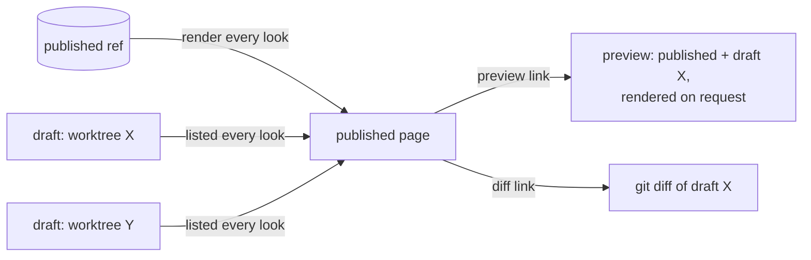
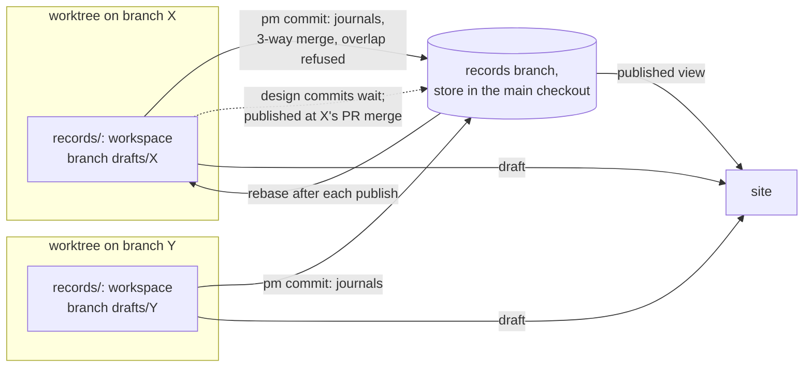
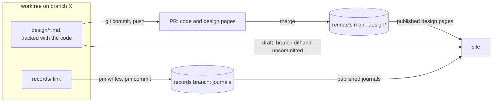

## Problem

> What are we solving, and why now?

Every session writes records in one shared working tree, and the site renders that tree. Two open sprints edited the same 8 design pages in it, one starting two minutes after the other's commit; nothing was lost only because of that gap ([the starting analysis](../docs/2026-10-14-record-layer-concurrency.md)). Three problems follow from the one shared tree:

| Problem | Database name | Today |
|---|---|---|
| Two agents write one file | Dirty write, lost update | `pm commit` commits a named file whole, so it can carry another session's half-made edit to that file |
| The owner wants work in progress | Dirty read, wanted on purpose | The site renders uncommitted edits, unlabelled by writer and with no mark of done |
| Records describe code before it merges | Atomicity across two stores | A design page edit is published at `pm commit`; its code lands at the PR's merge. `pm check` lists 10 covers patterns waiting on unmerged work in this repo as this page is written |

This page works out two candidate models, A (shadow records branches) and B (design pages in the code tree), and what they share. It states the agent's recommendation, labelled as such; it does not pick one.

## Goals and non-goals

> What must the design achieve, and what does it deliberately leave out?

**Goals**

- No commit carries another writer's edit; two writers' edits to one file merge by hunk, and an overlap is refused with the other commit named.
- The owner sees published records by default and every draft beside them, labelled by worktree, branch, sprint and session, live.
- A design page's edit is published when the code it describes reaches main, not before.
- A draft that does not parse breaks only its own preview.
- The Stop hook knows a session's uncommitted record edits by construction, not by matching paths in its transcript.

**Non-goals**

- Merging concurrent keystrokes (OT, CRDTs): agents make discrete edits to sectioned Markdown.
- Changes to the work store.
- Showing uncommitted edits made on another machine.

## Constraints and key facts

> Which facts, findings and constraints shaped the design? Only those that
> still hold; sprint records keep the findings as they happened.

**The store and its writers**

- One records store per clone: the `records` branch checked out at `<main checkout>/.pm/store/records`. Each worktree's `records/` is a git-ignored link to it, made by `pm init` ([Shared records store](records-store.md)).
- pm one-shot writes (`pm finding add`, `pm decision add`, …) validate against the store's HEAD plus their planned writes, refuse a target file with uncommitted changes, and commit exactly their paths. They hold an exclusive `flock` on the store directory from the work-store connection to the end of the command.
- `pm commit` also holds that lock from its start. It validates HEAD plus the named files (not the working tree), then commits the named files whole. It never checks who edited a file or whether it moved since the committing session read it.
- Agents edit records with their own file tools; pm sees those edits only at `pm commit`. A file tool writes to a path, and `records/` resolves the same for every session in one worktree.
- Store commits run with `--no-verify`.

**The site**

- The site renders the working tree, uncommitted edits included. The service looks for a change every second (a digest of every record file and the store's HEAD files).
- One record that does not parse makes the whole load fail, and every page is then served as a 500 error page until it is fixed.

**Hooks, sessions, sync**

- The Stop hook lists the store's uncommitted files and blocks when the session's transcript names one of their paths in a tool call (substring match); a path named only by a running subagent's prompt is left out.
- A session's id comes from its environment. `session.Uses` maps each worktree under `.claude/worktrees` to its latest live session; only `pm clean` uses it today.
- One session changes code only in its own worktree; `pm task claim` refuses the main checkout.
- The service runs the push every 600 s. Records are not pulled when only behind. When ahead and behind, the store rebases onto the remote under the store lock; it skips the rebase while tracked records have uncommitted edits.
- The git `post-checkout` hook (`pm hook git-post-checkout`) sets up every new worktree as a code worktree and skips only the store's own checkout. A second worktree of `records` fails it: "this repo has no .pm/config.toml" (reproduced while measuring below).

**Design pages and the code**

- A design page names its code in `covers:`. `pm check` lists a pattern that matches no tracked file as waiting on unmerged work and passes. `pm action need --pr` and `pm sprint close` run the gate: a page covering a changed file must be updated (a records commit to it since the sprint opened, and a link in the sprint's Design pages) or waived. `pm sprint close` fetches the remote's main and refuses while a pattern the sprint added matches no file there ([Sprint lifecycle](sprint-lifecycle.md)).
- The service learns of a merge only for an open PR review: every 60 s it runs `gh pr view --json state,mergeCommit` for each review without a seen merge, then fetches main. A PR merged without a review (`pm sprint close --merged`) is never seen by the service.
- pm's own PRs are squash-merged (`make merge-ready` prints `gh pr merge --squash`).

**Runtimes** (from [Shared records store](records-store.md), Constraints)

- Claude Code writes through `records/` only with the store in `permissions.additionalDirectories`; a session started with `claude -w` is refused "a different worktree" for any other git worktree, the store included.
- Codex's workspace-write sandbox keeps every git dir read-only unless that git dir is itself a writable root; pm lists the store and the store's git dir (`.git/worktrees/records`) in `writable_roots`.

::: result {title="Measured on this clone"}
| Quantity | Value |
|---|---|
| Records store working tree | 2.6 MB on disk (2.2 MB apparent), 231 tracked files |
| Design pages | 24 files, 532 KB |
| Commits on `records` / touching `design/` | 845 / 78 |
| A new worktree of `records` (`git worktree add`, hooks off) | 0.01 s; 2.6 MB tree + 56 KB admin dir (21 KB index) |
| `git status --porcelain` in the store | 1 ms (mean of 20) |
| `git status -- design` plus `git diff --name-only origin/main...HEAD` in a code worktree (324 files) | 3 ms (mean of 20) |
| `git merge-tree --write-tree` on two `records` commits | 1 ms (mean of 20) |
| `pm check` on the whole store (226 pages, work store read) | 0.20 s |
| Worktrees of this clone | 12, of which 10 are code worktrees besides the main checkout and the store |
| Design pages in yeeef-agents' store | 21 |
:::

*Reading:* a records workspace costs about 2.6 MB and 10 ms per worktree; listing drafts costs a few ms per worktree; one draft preview costs at most one full record-set check.

## Design

> What is it, in its final state? Free `###` subsections. Decisions and plans
> live in the project and sprint records.

### Shared

**Terms**

| Term | Meaning |
|---|---|
| Journal | Every record but a design page: project and sprint records, docs, postmortems, day summaries. Facts as they occur |
| Design page | The reference for one area of the code, in its final state |
| Published | A record's text at the ref the site renders by default |
| Draft | A change to a record that is not published: committed on a branch that has not published it, or uncommitted in a working tree |
| Workspace | The private working tree in which one code worktree's sessions edit records |

**The published view.** The site renders committed records at a git ref, never a working tree. Model A publishes everything on `records`; model B publishes journals on `records` and design pages on the remote's main.

**Drafts beside the published page.** A page with drafts carries one line per draft:

`Draft edits: <worktree> on <branch>, sprint N, session S (committed on branch / uncommitted): preview, diff`

| Label part | Source |
|---|---|
| Worktree, branch | `git worktree list --porcelain` from the main checkout |
| Session | `session.Uses` for the worktree, widened from `.claude/worktrees` to every worktree of the clone; none shown when no live session used it |
| Sprint | The sprints of the open tasks that session holds in the work store; several when it holds several |
| Committed / uncommitted | Draft commits not yet published, and the working tree's status |

- The preview renders the published set with the draft's files laid over it, on request, not on every look. A draft that does not parse serves its own preview as the error page and marks its label "does not render"; the published pages stay 200.
- The diff is `git diff` of the draft against the published text.
- A new page that exists only as a draft is listed on the index as a draft. A published journal may link a design page that exists only in a draft (a sprint record's Design pages link to a new page); the site links the draft's preview and marks it, and `pm check` accepts a link that resolves in a draft of this clone.

*Reading:* the published page renders only a ref; each draft is a labelled link to its own preview and diff, so a broken draft fails only its preview.

**The isolation unit is the code worktree.** One session's own worktree holds one code branch, which is about one PR.

| Unit | Why not, or why |
|---|---|
| Session | The main checkout is shared by sessions, and `records/` there is one path for all of them. Agents write with file tools, which cannot see the session id in the environment. A session is not a PR: it can run several sprints, and its subagents share its id |
| Sprint | A sprint can span several worktrees and PRs, so its sessions would share one tree again; file tools cannot choose a sprint's tree |
| Code worktree (chosen) | Already private to one session by the invariant; `records/` already resolves per worktree; its branch is what merges |

**The main checkout** keeps the store as its records tree, shared by the sessions there, as today. Code is never changed there and no task is claimed there; what remains is the owner's and read-mostly sessions' hand edits. Its uncommitted edits show as one draft labelled "main checkout".

**The Stop hook** checks only the session's own worktree's uncommitted record edits, where the model gives the worktree its own copy; in the main checkout it keeps today's transcript match.

### Model A: shadow records branches

Every record stays on the records branch's side. Each code worktree gets a workspace: a git worktree of a branch `drafts/<code-branch>`, cut from `records`, checked out at `<worktree>/records` in place of today's link. `/records` is already git-ignored in code worktrees, so the code branch never tracks it.

*Reading:* each worktree edits records in its own branch; journals reach `records` at `pm commit` by a three-way merge, design pages at the PR's merge.

**Write path**

| Writer | Where it writes | What pm does |
|---|---|---|
| Agent's file tools, in a worktree | `<worktree>/records/…`, inside its own worktree | Nothing until `pm commit` |
| `pm commit` in a worktree | The workspace | Commits the named files on `drafts/<branch>`, journal and design paths as separate commits, then publishes the journal commit |
| One-shot write (`pm finding add`, …) from anywhere | `records` directly, in the store, as today | Then brings the calling worktree's workspace onto `records`. It refuses a target with uncommitted edits in the calling workspace or in the store |
| Any write in the main checkout | The store | As today: journals and design pages publish at `pm commit` |
| The service (day summaries) | `records` in the store | As today |

One-shot writes go straight to `records` because each is a function of the current text (append a finding, add a decision): computed on the newest `records` HEAD under the store lock, two of them never conflict. Merged as text, two findings appended to one Findings section would conflict on adjacent lines.

**Publish path**

1. `pm commit` takes the store lock and rebases `drafts/<branch>` onto `records` in the workspace. Disjoint hunks merge. An overlapping hunk stops the rebase: pm leaves the conflict markers in the workspace file, refuses, and names the `records` commits that touched the file since the workspace's base (`git log <base>..records -- <path>`). The agent resolves the file and runs `pm commit` again, which continues.
2. pm cherry-picks the journal commits onto `records` in the store. They now apply cleanly, since the rebase put them on `records`' tip. A cherry-pick that would overwrite an uncommitted edit in the store (a main-checkout session's) is refused, naming the file.
3. The next rebase drops the published commits from `drafts/<branch>` (same patch).
4. Design-page commits stay on `drafts/<branch>`; the site shows them as that worktree's draft.

**Publishing design pages**

| Sprint | Published when | By |
|---|---|---|
| With a PR review | The service sees the PR merged (the existing 60 s look), with the PR's head branch read from the same `gh pr view` call | The service: steps 1 and 2 without an agent. On a conflict it aborts, leaves `records` unchanged, flags the draft on the site and in `pm show`, and adds the conflict to the merge message it already delivers to the session that raised the review |
| Merged without a review (`--merged`) | `pm sprint close` | pm, run by the agent |
| No PR (a records-only sprint) | `pm sprint close`, or earlier by `pm design publish [<slug>…]` from the worktree | pm |

- `pm sprint close` refuses while a page that the sprint's Design pages link has unpublished commits or uncommitted edits in any workspace of the clone; it publishes them when they are the closing worktree's own. The Design pages links are the sprint-to-draft map: no commit needs a sprint id.
- Records-only sprints publish at the close, not at `pm commit`: the owner reviews a design sprint's page as a draft, as in a code review.
- **The conflict found only after the code merged**: the code is on main and the page is not yet published. The published page lags the code; it never runs ahead of it. The session resolves in its workspace and runs `pm design publish`; the sprint cannot close until it does.

**What it retires and what it changes in the covers machinery**

- A published page changes only when its code is on main, so a published covers pattern names a file main has. `pm check` fails on a published pattern that matches no file on the remote's main. The "waiting on unmerged work" list, the close's hold on main (`LiveOnMain`, `Own`) and their author-date window retire.
- In a workspace, `pm check` checks draft pages against that worktree's tracked files.
- The gate's "updated" reads a commit to the page on `drafts/<branch>` instead of on `records`.

**Sync across machines**

- The service pushes `records` as today. It also pushes each `drafts/<branch>` that has unpublished commits to `refs/pm/drafts/<branch>` on the remote, outside `refs/heads`, as the work store uses `refs/pm/work`. It deletes the remote ref after the publish.
- Another machine's service fetches `refs/pm/drafts/*` and lists them as committed drafts with no session. Uncommitted edits stay local.
- Each machine owns the drafts of its own branches; a non-fast-forward push is refused and flagged, never forced.

**Setup**

- `pm init` in a worktree makes the workspace when it is missing: `git worktree add <worktree>/records drafts/<branch>` with `-c core.hooksPath=/dev/null`, after removing the link. The `post-checkout` hook skips every worktree on a `drafts/` branch, as it skips the store today.
- A worktree that switches its code branch keeps its workspace: the workspace belongs to the worktree, and its branch name records which code branch it was made for. Publish at merge finds the workspace by the PR's head branch.
- Claude Code writes inside its own worktree, so the store need not be in `additionalDirectories` for a worktree session. Whether `claude -w` isolation treats a nested git worktree as "a different worktree" is untested (Open questions).
- Codex writes the workspace's files inside its writable worktree; committing needs the workspace's git dir (`.git/worktrees/<name>`) writable. That is one more writable root per worktree in the user's Codex config, unless pm runs outside the sandbox through `.codex/rules/pm.rules`.

**Code**

| Adds | Retires or shrinks |
|---|---|
| Workspace setup and removal in `pm init`, `pm clean`, `pm doctor`, `pm where` | The close's covers hold on main and `pm check`'s waiting list |
| `store.Find` resolving the workspace of the current worktree | The Stop hook's transcript match, for worktree sessions |
| The publish engine: split by kind, rebase, cherry-pick, conflict refusal | The store in each worktree's Claude `additionalDirectories` |
| Publish at merge in the service's merge handler; `pm design publish`; the close's draft check | |
| The site's published ref, draft listing, preview and diff routes | |
| Draft ref push and fetch in the sync | |

**Failure modes**

| Failure | Effect | Guard |
|---|---|---|
| A code worktree removed with `git worktree remove` or by Claude Code at session end | Its uncommitted record edits are lost; its committed drafts survive on `drafts/<branch>` and the remote ref | `pm clean` refuses a worktree whose workspace has uncommitted edits; `pm where` lists orphaned drafts branches |
| `git clean -ffdx` in a code worktree | Deletes the nested workspace (`-fdx` skips it as a nested repository) | As above |
| A workspace that never publishes | Stale drafts listed on the site | The sprint close's draft check; `pm where` shows age |
| Publish conflict at merge | Page lags code | Flagged on the site, in `pm show` and in the merge message; the close refuses |
| A broken draft | Its preview is the error page | Published pages are unaffected |
| The store has uncommitted main-checkout edits to a file being published | Cherry-pick refused | Refusal names the file; commit or revert it |

**Cost**

- Disk: about 2.6 MB per worktree for the workspace, about 26 MB for the 10 code worktrees this clone has now.
- Time: a workspace is made in about 10 ms; a publish is a rebase and a cherry-pick of a few files under the store lock.
- Concepts: a second branch per worktree, two publish moments, and a conflict state that can outlive the code's merge.

### Model B: design pages in the code tree

Design pages leave the records store for `design/<slug>.md` in the code tree, tracked on main and every code branch. Journals stay in the shared records store.

*Reading:* a design page travels in its code PR and is published by the merge; journals keep the shared store.

**What travels with the code**

- A design-page edit is a code change: committed with git on the code branch, reviewed in the PR's diff beside the code, published by the merge.
- Two PRs editing one page conflict in git; GitHub shows it before the second merges, and the second rebases.
- Each git worktree is already private: no new workspace, no publish engine.

**Where the site reads design pages**

| View | Source |
|---|---|
| Published | `design/` at `<remote>/<main>`, the remote-tracking ref the service already reads; the service fetches it after each merge it sees and in each 600 s sync |
| Drafts | For each worktree of the clone: `git diff --name-only <merge-base with main>...HEAD -- design/` (committed on branch) and `git status -- design/` (uncommitted); 3 ms per worktree measured |
| Other machines' drafts | Pushed branches of open PRs, with the PR's files from `gh` (committed only) |

**The covers machinery**

| Today | Model B |
|---|---|
| `pm check` lists patterns waiting on unmerged work | Retires: a page and its code share one tree, so a pattern that matches no file in that tree is dead and fails |
| `pm sprint close` holds the sprint's patterns to the remote's main (`LiveOnMain`, `Own`, the author-date window) | Retires: the page merges with the file |
| The gate's "updated": a records commit since the sprint opened, plus the Design pages link | The PR's changed files include `design/<slug>.md`, plus the Design pages link; the waiver stays a sprint decision |
| The gate reads changed files from GitHub's PR files API | Kept for the close; at `pm action need --pr` it can read the local branch diff |
| The page's dates and the code changes after it, from the records branch's log | From main's `git log --first-parent -- design/<slug>.md` and the covered files |

**Links between the two stores**

- Journals keep linking `../design/<slug>.md`; design pages keep linking `../sprints/<id>.md` and `../projects/<name>.md`. The site and `pm check` resolve both forms against one virtual tree: the records store mounted with `design/` from the published ref, or from the worktree's own tree in a draft.
- On GitHub these cross links do not resolve: the files are in different refs.

**`pm design new`** writes `design/<slug>.md` in the current worktree, uncommitted; the agent commits it with the code. It refuses the main checkout: a design page is now a code-tree file, changed only in a worktree of one's own. `pm commit` refuses a path under `design/` and names `git commit`.

**Rule changes** (`prime.md`)

- "No code branch tracks `records/`" stays; design pages are no longer under `records/`. A new rule: code branches track `design/`, edited only in one's own worktree, reviewed and published with the PR.
- "Records writes may run anywhere" covers journals only.
- A records-only sprint that edits a design page now needs a worktree, a branch and a PR.

**Migration** (`pm upgrade --to X`, for every repo that uses pm, yeeef-agents among them)

1. The upgrade PR adds `design/` to the code branch, with its history: the `records` branch's history filtered to `design/`, keeping the `design/` path (`git filter-repo --path design/`, a separate tool from git), merged with `--allow-unrelated-histories`. `git log -- design/<slug>.md` on main then walks the old commits (78 in this repo). That PR must merge with a merge commit; this repo squash-merges by default. If it is squashed, the history stays reachable on the `records` branch, which keeps every commit.
2. Once the new pin runs in the main checkout, `pm init` removes `design/` from `records` in one commit. It first checks each page on `records` against the copy the upgrade took, and refuses, naming each page, when one was edited on `records` after that; such an edit is ported by a PR first.
3. A worktree on a branch cut before the move runs the old pin until it merges main; with `design/` gone from `records`, that pm sees no design pages, and its gate passes vacuously.

**Journals stay shared: what remains of the three problems**

| Problem | For journals in Model B |
|---|---|
| Dirty write | Stays for hand edits to one file by two sessions: the Goal, Scope, Done when and delivery report are per sprint, usually one session's; docs and postmortems have one author. One-shot writes are safe as today |
| Dirty read | Solved for display: the site publishes `records` HEAD and shows uncommitted journal edits as one draft labelled "records store, uncommitted", with no writer named |
| Records ahead of code | Does not apply: journals record facts as they occur |
| Stop hook | Design pages: the session's own worktree's uncommitted `design/` edits, by construction. Journals: today's transcript match |

**B′: journals in workspaces too.** B′ adds model A's per-worktree workspaces for journals, publishing every journal at `pm commit` by A's rebase and cherry-pick, with no publish at merge. It removes the remaining dirty write and the transcript match, at the cost of A's workspace machinery (setup, nested worktree, runtime access) without A's hardest part.

### Comparison

| Dimension | Model A | Model B |
|---|---|---|
| Isolation | Every record, per worktree workspace | Design pages per git worktree; journals shared (B′: per workspace) |
| Live view | Workspace drafts: committed and uncommitted | Branch diffs and uncommitted edits; journals as one unattributed draft |
| Publish with code | Service at the review's merge; close as backstop; can conflict after the merge | By construction: the merge publishes |
| Where conflicts surface | `pm commit` (journals); the publish at merge (design pages), after the code merged | `pm commit` is unchanged for journals; GitHub and git, before the merge, for design pages |
| New code | Workspaces, publish engine, publish at merge, draft refs sync, draft site | Design pages read from a git ref and worktrees, draft site, migration |
| Retired code | Covers waiting and hold; Stop hook transcript match for worktrees | Covers waiting and hold; records-commit side of the gate; design pages out of the store |
| Rule changes | `records/` in a worktree is a private workspace; design pages publish at merge | Code branches track `design/`; design pages edited only in a worktree, through a PR |
| Migration | Per worktree: link replaced by a workspace; no data moves | Pages and their history move to main once per repo; a records commit removes them |
| Cross-machine drafts | Committed drafts through `refs/pm/drafts/*` | Committed drafts through pushed branches and open PRs |
| Runtime access | Nested worktree under `claude -w` untested; one Codex root per workspace | Nothing new: the worktree is the session's own |

**The starting analysis's open questions**

| Question | Model A | Model B |
|---|---|---|
| Per-session or per-sprint workspaces | Neither: per code worktree (Shared) | Same; for design pages the worktree itself is the copy |
| What the Stop hook's check becomes | The own workspace's uncommitted edits; the main checkout keeps the transcript match | The own worktree's uncommitted `design/` edits; journals keep the transcript match (B′: the own workspace) |
| Generated records and sync | Day summaries are still committed on `records` by the service; Progress is still rendered; workspaces follow `records` at each publish and one-shot write; the sync also pushes draft refs | Unchanged for journals; design pages ride the code branches' pushes; the sync also fetches main |
| Serving a draft without breaking the published page | The published view renders only `records`; each preview renders the published set plus one draft, alone (Shared) | Same, with `design/` from the remote's main |
| Cost of drafts and stale workspaces | Listing: about 1 to 3 ms per worktree per look; a preview: at most one record-set check (0.20 s), on request. A workspace lives as long as its worktree; `pm clean` removes it once nothing is unpublished or uncommitted | Listing: 3 ms per worktree per look; previews as in A. No workspace to age out: a draft ends when its branch merges or its worktree goes |

**Agent's recommendation: Model B.** The incident and the 10 waiting covers patterns are design-page problems, and B removes them with mechanisms that already exist: the PR diff, git's merge and GitHub's conflict check. A builds a second branch per worktree, a publish engine and a post-merge conflict state to reproduce what the PR already does for code. B's costs are a one-time migration, design sprints needing a PR, and the journals' remaining dirty write, which B′ removes if it is observed.

### Increments

| Step | Models | Builds | Check that shows it works |
|---|---|---|---|
| 1 | Both | The published view at a ref; uncommitted store edits as one labelled draft with preview and diff | In a scratch clone: a hand edit to a sprint record leaves its published page unchanged and adds a draft line; a draft with a malformed header serves its preview as an error while every published page returns 200 |
| A2 | A | Workspaces in `pm init` and `pm clean`; `pm commit` and one-shot writes with rebase and cherry-pick; Stop hook on the own workspace | Two scratch worktrees edit disjoint sections of one sprint record and both `pm commit`: `records` holds both. Overlapping edits: the second is refused naming the first commit, with markers only in its own workspace. The Stop hook blocks only the editing session |
| A3 | A | Design commits held on `drafts/<branch>`; publish at merge, `pm design publish`, the close's draft check; covers waiting and hold retired | Scratch origin, fake `gh` reporting a merge: the page reaches `records` within one 60 s look; a conflicting page is flagged and `pm sprint close` refuses until `pm design publish` succeeds |
| A4 | A | `refs/pm/drafts/*` push and fetch | A second scratch clone's site lists the first's committed draft after one sync each |
| B2 | B | pm reads design pages from the worktree and the published ref; drafts from worktree diffs; `pm design new` in a worktree; gate on the PR diff; covers waiting and hold retired | Scratch repo: a page edited on a branch shows only as that worktree's draft and is published after the branch merges to main; the gate passes a PR that edits the page |
| B3 | B | Migration in `pm upgrade` and `pm init` | A scratch copy of a repo with 21 pages: after the upgrade, `git log -- design/<slug>.md` on main lists the pre-move commits; the records removal refuses a page edited after the cut |
| B4 | B′ | Journal workspaces with A2's publish at `pm commit` | A2's check, for journals |

## Alternatives considered

> What else was considered and not adopted, and why not?

| Alternative | Why not |
|---|---|
| A per-file version check in `pm commit`: refuse a file that moved since this session's last write | Rejected by the owner: it refuses the second writer without separating the two sessions' edits, works per file not per hunk, and pm cannot see edits made with file tools without a new hook |
| Per-session workspaces | `records/` is one path per worktree, the main checkout is shared, and a session is not a PR (Shared) |
| Per-sprint records branches, as the starting analysis proposed | A sprint spans worktrees, so its sessions would share one tree again; file tools cannot choose a sprint's tree |
| OT or CRDTs (Google Docs, Automerge, Yjs) | They merge keystrokes; agents make discrete edits to sectioned Markdown, which git's three-way merge handles |
| Dolt for records | Loses hand-editable Markdown and git tooling ([Shared records store](records-store.md)) |
| Jujutsu (jj): conflicts as first-class objects | A second VCS on every machine and runtime; its gain, never refusing a writer, is what the overlap refusal deliberately gives up |

## Prior art

> Optional. What existing work did we learn from, and what did we take?

| Source | Idea | Taken by |
|---|---|---|
| MVCC, snapshot isolation | Each transaction writes privately and publishes at commit | A's workspaces |
| Optimistic concurrency control (Kung and Robinson, 1981); HTTP `If-Match` (RFC 9110) | A write carries its base; a stale base is refused | Both: the overlap refusal, by hunk |
| Preview deployments (Vercel, Netlify) | Each branch gets a rendered preview; the main site shows merged work | Shared: drafts beside the published page |
| CMS draft and publish (WordPress revisions, Contentful environments) | Readers see published; reviewers see marked drafts | Shared: the published view and the draft line |
| Architecture Decision Records (Nygard, "Documenting Architecture Decisions"), kept in the code repository; the Linux kernel's and Git's in-tree `Documentation/` | Design text changes in the same commit and review as the code | B |
| Proposal repositories separate from the code: Python PEPs, Kubernetes KEPs, Go proposals, Rust RFCs | The design document is reviewed and merged on its own, not with its implementation | A's separate store, without its publish at the code's merge |
| Git's three-way merge and `git merge-tree` | Disjoint hunks merge; overlaps conflict | A's publish engine; B's PRs |

## Open questions

> What is still unresolved?

- Model A: whether `claude -w` isolation refuses writes to a git worktree nested inside the session's own worktree; a live check decides whether A works there.
- Model A: whether pm commits in a workspace from inside Codex's sandbox (one writable root per workspace) or only through `.codex/rules/pm.rules`.
- Drafts made on other machines: both models show only committed, pushed drafts; whether the site should show them at all, given they carry no live session.
- Model B: GitHub does not resolve links between `design/` and the records branch; whether the site's links suffice for readers who browse GitHub.
- Model B: the main checkout's sessions, the owner's included, can no longer hand-edit a design page; every design change goes through a PR.
