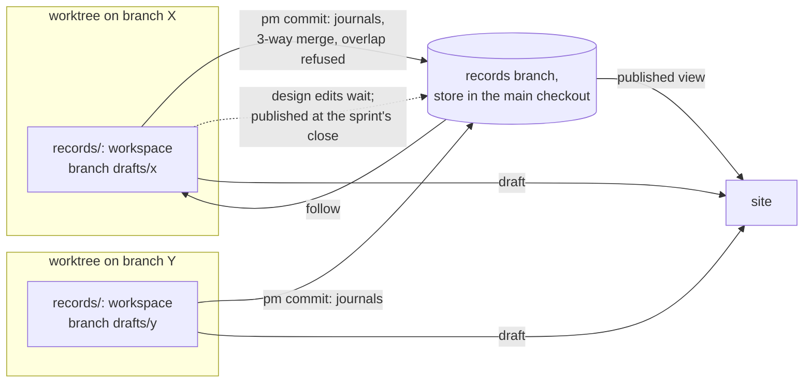
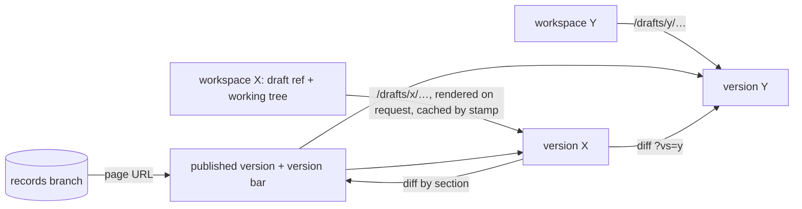

## Problem

> What are we solving, and why now?

Every session writes records in one shared working tree, and the site renders that tree. Two open sprints edited the same 8 design pages in it, one starting two minutes after the other's commit; nothing was lost only because of that gap ([the starting analysis](../docs/2026-10-14-record-layer-concurrency.md)). Three problems follow from the one shared tree:

| Problem | Database name | Today |
|---|---|---|
| Two agents write one file | Dirty write, lost update | `pm commit` commits a named file whole, so it can carry another session's half-made edit to that file |
| The owner wants work in progress | Dirty read, wanted on purpose | The site renders uncommitted edits, unlabelled by writer and with no mark of done |
| Records describe code before it merges | Atomicity across two stores | A design page edit is published at `pm commit`; its code lands at the PR's merge. `pm check` lists covers patterns waiting on unmerged work (11 in this repo when this design began) |

This page is the record layer's model for drafts and publishing: each code worktree edits records in a private workspace on a shadow branch of `records`, journals publish at `pm commit` by a three-way merge, and design pages publish at their sprint's close.

## Goals and non-goals

> What must the design achieve, and what does it deliberately leave out?

**Goals**

1. No commit carries another writer's edit; two writers' edits to one file merge by hunk, and an overlap is refused with the other commit named.
2. The owner sees published records by default and every draft beside them, labelled by worktree, branch, sprint and session, live.
3. A design page's edit is published at its sprint's close, once the code it describes is on main, not before.
4. A draft that does not parse breaks only its own render.
5. The owner reads every version of a page on the site: the published one and each worktree's draft.
6. The Stop hook knows a session's uncommitted record edits by construction, not by matching paths in its transcript.

**Non-goals**

- Merging concurrent keystrokes (OT, CRDTs).
- Changes to the work store.
- Showing uncommitted edits made on another machine.

## Constraints and key facts

> Which facts, findings and constraints shaped the design? Only those that
> still hold; sprint records keep the findings as they happened.

**The store and its writers**

- One records store per clone: the `records` branch checked out at `<main checkout>/.pm/store/records`. The main checkout's `records/` is a git-ignored link to it; each other worktree's is its workspace (Workspaces), made by `pm init` ([Shared records store](records-store.md)).
- pm one-shot writes (`pm finding add`, `pm decision add`, …) validate against the store's HEAD plus their planned writes, refuse a target file with uncommitted changes, and commit exactly their paths, under an exclusive `flock` on the store directory.
- `pm commit` holds that lock from its start, validates HEAD plus the named files (not the working tree), and commits the named files whole. In the shared store it never checks who edited a file or whether it moved since the committing session read it; from a workspace, follow does (Writes and journal publish).
- Agents edit records with their own file tools; pm sees those edits only at `pm commit`.

**The site**

- The site renders the `records` branch (one `git archive`, 0.01-0.02 s on this store), and as drafts the store's uncommitted edits, `store`, and each workspace's; the service looks for a change every second.
- A draft that does not parse fails only its own version's URLs; its diff still renders, and every published page stays 200.

**Hooks, sessions, sync**

- The Stop hook blocks when the session's transcript names an uncommitted store file in a tool call (substring match).
- `session.Uses` maps each worktree under `.claude/worktrees` to its latest live session; only `pm clean` uses it today.
- One session changes code only in its own worktree; `pm task claim` refuses the main checkout.
- The service pushes every 600 s. Records are not pulled when only behind. When ahead and behind, the store rebases onto the remote under the store lock, skipped while tracked records have uncommitted edits. The service fetches main only after it sees a review's PR merge.
- pm installs no git hook: session start's `pm init --session-start` sets up every worktree an agent works in as a code worktree. In a second worktree of `records` it fails ("this repo has no .pm/config.toml").

**Design pages and the code**

- `pm check` passes a `covers:` pattern that matches no tracked file, listing it as waiting on unmerged work. The gate (`pm action need --pr`, `pm sprint close`) passes a page covering a changed file when it was updated (a records commit since the sprint opened, plus a Design pages link) or waived. `pm sprint close` refuses while a pattern the sprint added matches no file on the remote's main ([Sprint lifecycle](sprint-lifecycle.md)).
- `pm sprint close` already refuses an unwritten report, an open task, and a review not closed `merged as <sha>`; a PR merged with no review is given by `--merged <sha>`, which must be on the remote's main. With a PR it stamps the merge into the Outcome in one commit on `records`.

**Runtimes** ([Shared records store](records-store.md), Constraints)

- Claude Code writes through `records/` only with the store in `permissions.additionalDirectories`; a `claude -w` session is refused "a different worktree" for any other git worktree, the store included. A workspace nested in the session's own worktree is writable without either: Claude Code 2.1.300 allowed Write and Edit at `<worktree>/records/…` from a `claude -w` session and from a plain one with no `additionalDirectories`; `-w` isolation goes by path prefix, not by git worktree.
- Codex's sandbox keeps every git dir read-only unless that git dir is itself a writable root; pm lists the store and its git dir in `writable_roots`.

::: result {title="Measured on this clone"}
| Quantity | Value |
|---|---|
| Records store working tree | 2.6 MB, 231 files |
| A new worktree of `records` (`git worktree add`, hooks off) | 0.01 s; 2.6 MB tree + 56 KB admin dir |
| `git status` in the store; `git merge-tree --write-tree` on two `records` commits | 1 ms each (mean of 20) |
| `pm check` on the whole store (226 pages, work store read) | 0.20 s |
| Code worktrees of this clone | 10 |
:::

*Reading:* a records workspace costs about 2.6 MB and 10 ms per worktree; listing drafts costs about 1 ms per worktree; one version render costs at most one full record-set check.

## Design

> What is it, in its final state? Free `###` subsections. Decisions and plans
> live in the project and sprint records.

*Reading:* each worktree edits records in its own branch; journals reach `records` at `pm commit` by a three-way merge, design pages at their sprint's close.

### Terms

| Term | Meaning |
|---|---|
| Journal | Every record but a design page: project and sprint records, docs, postmortems, day summaries. Facts as they occur |
| Published | A record's text on the `records` branch, which the site renders by default |
| Publish | Merging a draft into `records`: a journal at `pm commit`, a design page at its sprint's close |
| Draft | A change to a record that is not published: in a workspace's draft commit, or uncommitted in a working tree |
| Workspace | The private working tree in which one code worktree's sessions edit records |
| Version | One rendering of a record: the published one, or the published set with one draft laid over it |

### Published view and versions

A page's URL renders its published version: the record on `records`, never a working tree. A page with drafts carries a version bar:

| Entry | Shows |
|---|---|
| Published | The page's URL |
| One per draft | Worktree name, branch, sprints, session (when live), and its state: committed on the draft branch, uncommitted edits, or conflict (markers in the file, or a publish refused). A link to its full render and to its diff against published |

Worktree and branch come from `git worktree list`, the session from `session.Uses` widened to every worktree, the sprints from the open tasks that session holds. The shared store's uncommitted edits (the main checkout's) are one more draft, named `store` and labelled "uncommitted edits in the shared store". The site takes drafts from a source (`store.DraftSource`); the store's edits are its first, and each workspace plugs in as another.

**A version's URL** is `/drafts/<worktree>/<record path>.html`, for example `/drafts/pm-records-1/design/record-drafts.html`. A path rather than a query string (`?v=<worktree>`) because a record's relative links then stay in the same version: a link from a draft to another record renders that record in the same draft, which is the published text wherever the draft does not change it. The worktree's admin name is unique in the clone and stable for the worktree's life.

**A version's render**

- Its record set is the published set with the draft's files laid over it: the draft ref's tree (`drafts/<name>`) for committed edits, then the workspace's working tree for uncommitted ones.
- The service looks for a change every second (the stamp: the store's record files and its refs, read without git). When the stamp moves it reads again: the published set and the drafts' list (`git status` in each workspace, about 1 ms). A version is built on its first request and cached for that read, so a version is rebuilt only after its draft, the published set or the work store moved; a read whose stamp did not move keeps every built version.
- A draft that cannot be read (git status fails, or a listed file is no file) is listed with its error, which fails only its version. A listed file that holds its published text (a mode change, an edit staged then undone) is no change.
- Figures are not versioned: a published page's figures are read from the `records` branch, a version's from the store's working tree.
- A version that does not parse serves its own render as the error page and its entry says "does not render"; the published pages and every other version stay 200.

**Diffs**

- Against published: by section. Each `##` or `###` section the draft changes is shown with a line diff of its Markdown; unchanged sections fold. `/drafts/<worktree>/<path>.diff.html`.
- Between two drafts: `/drafts/<a>/<path>.diff.html?vs=<b>`, the same view with draft B as the base. Both texts are already read for the version bar, so it costs one text diff of one file.

*Reading:* the page URL renders only the branch; each draft is a separate render at its own URL, so a broken draft fails only its own version.

- A published journal may link a design page that exists only in a draft (a new page in a sprint's Design pages); the site links the draft's version, and `pm check` accepts a link that resolves in a draft of this clone.
- The version bar applies to every record type: versions are built the same way whatever the record, and journals have drafts too (a delivery report in progress). Design pages are where several drafts of one page coexist, so they are where it matters most.

### Workspaces

- Each code worktree gets a workspace: a git worktree of the branch `drafts/<name>`, where `<name>` is the worktree's admin name (unique in the clone), checked out at `<worktree>/records` in place of today's link. `/records` is already git-ignored in code worktrees.
- The isolation unit is the code worktree: private to one session by the invariant, its branch is what merges, and `records/` already resolves per worktree. Alternatives considered says why not per session or per sprint.
- `drafts/<name>` is always a `records` commit (its base) plus at most one draft commit, which holds the worktree's committed, unpublished design-page edits and names each page's sprint.
- pm never runs `git rebase`, `git merge` or `git stash` in a workspace: it computes merges with `git merge-tree --write-tree` and `git merge-file`, writes commits with `git commit-tree`, moves refs with `git update-ref`, and writes files itself. No workspace is ever left mid-rebase or mid-merge: each operation runs under the store lock and either completes or changes nothing.
- **The main checkout** keeps the store as its records tree for journal hand edits, shared by its sessions as today; its uncommitted edits show as one draft, `store`. Design pages are edited only in a worktree: `pm commit` in the main checkout refuses a design page and names a worktree.
- **The Stop hook** checks the session's own workspace's uncommitted edits; in the main checkout it keeps the transcript match.

### Follow

Follow brings a workspace onto `records`. Every pm write from the worktree runs it first.

1. New draft tree: `git merge-tree --write-tree --merge-base <base> records <draft>`.
2. Each file that `records` changed since the base and that is uncommitted in the workspace: `git merge-file` of its base text, the working text and the `records` text. The merged text is written to the file, with conflict markers where hunks overlap.
3. A committed draft file that conflicts in step 1 leaves the draft commit: the file keeps the agent's text, merged with markers, as an uncommitted edit.
4. The ref moves to the `records` tip plus the new draft commit; files not uncommitted are refreshed from the new tree.

A file with conflict markers stays an ordinary uncommitted edit; `pm commit` refuses it, naming the `records` commits that touched it since the old base (`git log <base>..records -- <path>`). The markers carry that range (`>>>>>>> records <base>..<tip>`), so a later `pm commit` names the commits whichever follow wrote them. Step 2 rewrites a file the worktree's own sessions are editing, never another worktree's; a file tool that checks the file moved since it read it then rereads it.

### Writes and journal publish

Agents write `<worktree>/records/…` with file tools, inside their own worktree. Writes in the main checkout and the service's day summaries stay as today.

- **`pm commit` in a worktree**: follow; refuse a named file with markers; commit the named journal files on `records` in the store (the follow put them on its tip, so they apply cleanly); put named design pages into the draft commit, each with its sprint (Publish at sprint close); move the base to the new tip.
- **A one-shot write** commits on `records` in the store, computed on its newest HEAD as today, then follows. Each is a function of the current text, so two findings appended to one Findings section never conflict, while merged as text they would conflict on adjacent lines.
- A commit on `records` that would overwrite an uncommitted edit in the store (a main-checkout session's) is refused, naming the file.

### Publish at sprint close

`pm sprint close` publishes the sprint's design-page drafts; nothing else publishes a design page. A sprint with PRs and a records-only sprint with none publish the same way.

**Which drafts are the sprint's.** The draft commit names each page's sprint. `pm commit` takes it from the open sprints whose Design pages link the page and in which the committing session holds a task: it refuses with none (link the page first) and takes `--sprint ID` with several. The close publishes every page attributed to the sprint, in every workspace and `drafts/*` branch of the clone, whichever worktree or session made it. Why this rule:

- The writer fixes it when the edit is made, so it survives the session's end and the worktree's removal, and reads no transcript.
- The Design pages links alone cannot tell two open sprints' drafts of one page apart, the case this design exists for.
- "The worktrees whose sessions held the sprint's tasks" needs a session-to-worktree history that pm does not keep: `session.Uses` sees only live sessions.

**The close, in order**

1. The existing checks: the report written, every task closed, every review closed `merged as <sha>` or `--merged` given.
2. The drafts: it refuses while the closing workspace has uncommitted edits to a page the sprint links, and while another clone's draft ref holds a page of the sprint, naming that clone.
3. Covers: each `covers:` pattern a page to publish adds or changes must match a file on the remote's main; the existing check, read from the draft.
4. The merge: from the `records` tip, each draft in turn, `git merge-tree --write-tree --merge-base <draft base> <tip> <draft>`, taking only the sprint's pages. An overlap refuses the close and changes nothing, naming the commit that touched the page since the draft's base (`git log <base>..records -- <path>`): a page another sprint published first, or the sprint's other draft. The agent runs follow in that workspace (any pm write there; the markers become uncommitted edits), resolves them, runs `pm commit`, and closes again.
5. One commit on `records`, under the store lock: the pages, with the Outcome's merge stamp when the sprint has a PR. Each draft commit drops the published pages; a `drafts/<name>` branch left empty with no worktree is deleted, with its remote ref.
6. The sprint closes in the work store. A close stopped after step 5 finds nothing left to publish when run again.

**`--discard <slug> --reason "…"`** drops the sprint's draft of that page instead: the page leaves each draft commit, the closing workspace's uncommitted edits to it are reverted, and the reason is recorded as a sprint decision, as `pm design unchanged` does. It repeats for several pages.

**A removed worktree.** Its workspace's uncommitted edits are lost; its `drafts/<name>` branch and remote ref keep the draft commit, and the close publishes from them. `pm clean` refuses a worktree whose workspace has uncommitted edits or unpublished design drafts.

### Covers

A page publishes only at its sprint's close, after the close found its PRs and covers on main, so `pm check` fails on a published pattern that matches no file on the remote's main. The waiting list and the close's hold (`LiveOnMain`, `Own`, the author-date window) retire. In a workspace, `pm check` checks draft pages against that worktree's tracked files; the gate's "updated" reads the draft commit.

### Draft refs

The service pushes `records` as today, and each draft commit to `refs/pm/drafts/<clone>/<name>`, where `<clone>` is an id `pm init` generates once per clone: each clone is the only writer of its namespace. The draft commit is rewritten at every follow, so the push is forced with `--force-with-lease` against the sha this clone last pushed; a lease failure is flagged. The remote ref is deleted once the close has published every page in it. Other clones fetch `refs/pm/drafts/*` and list them as committed drafts with no session.

### Setup

`pm init` replaces a worktree's link with `git worktree add <worktree>/records drafts/<name>`; no git hook of pm's runs there, and session start skips a `drafts/` checkout as it skips the store. Claude Code then writes inside its own worktree. Codex writes the files there too, but committing needs the workspace's git dir as one more writable root per worktree, unless pm runs outside the sandbox (`.codex/rules/pm.rules`).

### Failure modes and cost

- A code worktree removed by `git worktree remove`, by Claude Code at session end or by `git clean -ffdx` loses its uncommitted record edits; the draft commit survives on its branch and remote ref. `pm clean` refuses a worktree whose workspace has uncommitted edits, and `pm where` lists orphaned draft branches.
- A draft not published holds its sprint's close: an overlap refuses the close, naming the other commit, and `--discard` drops a draft that should not publish.
- A sprint with several PRs publishes its pages at its close, not each with its PR; until then the owner reads the new text as a labelled version.
- Two open sprints editing one page in one worktree share one draft text; the first close publishes both edits.
- About 2.6 MB per workspace (26 MB for this clone's 10 code worktrees), made in about 10 ms; a follow is a merge-tree and a few file writes under the store lock.

### The starting analysis's open questions

| Question | Answer |
|---|---|
| Per-session or per-sprint workspaces | Per code worktree (Workspaces) |
| The Stop hook's check | The own workspace's uncommitted edits; the main checkout keeps the transcript match |
| Generated records and sync | The service commits day summaries on `records`; Progress is rendered; workspaces follow at each pm write; the sync pushes draft refs |
| A draft's render without breaking the published page | Each version renders the published set plus one draft, alone, at its own URL |
| Cost of drafts and stale workspaces | About 1 ms per worktree per look; a version's render at most 0.20 s, on request, then cached by stamp; a workspace lives with its worktree until `pm clean` |

### Increments

| Step | Builds | Check |
|---|---|---|
| 1 | The published view at the `records` ref; the version bar, per-version renders and diffs, over the shared store's uncommitted edits as one draft | Scratch clone: a hand edit leaves the published page unchanged and adds a version; the version renders at its URL; its diff against published and a draft-to-draft diff show exactly the edited lines; a malformed draft fails only its own version, every published page 200 |
| 2 | Workspaces, follow, journal publish at `pm commit`; each workspace a draft | Scratch clone with two worktrees: each edits one design page differently; the page shows three versions, each renders. Disjoint edits to one sprint record from both reach `records`; an overlap is refused naming the first commit, markers only in the second workspace |
| 3 | Stop hook on the own workspace; `pm clean` and `pm where` guards; the main checkout's design-page refusal | The Stop hook blocks only the editing session; `pm clean` refuses a worktree whose workspace has uncommitted edits or unpublished design drafts |
| 4 | Each draft page's sprint at `pm commit`; publish at `pm sprint close` and `--discard`; covers waiting and hold retired | Scratch sprint with drafts in two worktrees: the close publishes both in one `records` commit. A page another sprint published first refuses the close, naming that commit; after the agent resolves and commits in its workspace, the close passes. `--discard` drops the draft and records the sprint decision. `pm check` passes no published pattern that matches no file on main |
| 5 | Per-clone draft refs | A second clone lists the first's draft as a version after two follows and one sync each |

## Alternatives considered

> What else was considered and not adopted, and why not?

| Alternative | Why not |
|---|---|
| A per-file version check in `pm commit`: refuse a file that moved since this session's last write | Rejected by the owner: it refuses the second writer without separating the two sessions' edits, works per file not per hunk, and pm cannot see edits made with file tools without a new hook |
| Per-session workspaces | `records/` is one path for every session in a worktree, the main checkout's included: file tools cannot see the session id. A session is not a PR: it runs several sprints, and its subagents share its id |
| Per-sprint records branches, as the starting analysis proposed | A sprint spans worktrees and PRs, so its sessions would share one tree again; file tools cannot choose a sprint's tree |
| Following `records` with `git rebase --autostash` | Rebase refuses a dirty tree, the stash pop can conflict, and a stopped rebase outlives the command's lock |
| OT or CRDTs (Google Docs, Automerge, Yjs) | They merge keystrokes; agents make discrete edits to sectioned Markdown, which git's three-way merge handles |
| Dolt for records | Loses hand-editable Markdown and git tooling ([Shared records store](records-store.md)) |
| Jujutsu (jj): conflicts as first-class objects | A second VCS on every machine and runtime; its gain, never refusing a writer, is what the overlap refusal gives up on purpose |
| Design pages in the code tree (`design/*.md` on main), journals staying in the shared store | Not chosen by the owner. Its real advantage: a page travels in its code PR, so conflicts surface on GitHub before the merge and the merge publishes it by construction. But journals keep the shared tree, so goals 1, 2 and 6 go unmet for them; it reverses the rule that no code branch tracks records; and every repo using pm needs a migration of its pages and their history |
| The same, with journals in per-worktree workspaces | Meets every goal, but needs this design's workspaces and follow anyway, plus the migration |
| Publish when the service sees the PR merge | Its one advantage: pages publish with each PR, not at the sprint's end. But a conflict with a page another sprint published first is found only after the code merged, when the service can only flag it and the page falls behind its code; the close, whose session can resolve it, already checks the sprint's PRs and covers on main; and it needs a service publish, a `gh` poll, a PR-branch-to-worktree match, and the close's own path anyway for a PR merged without a review and for a records-only sprint |

## Prior art

> Optional. What existing work did we learn from, and what did we take?

| Source | Idea | Taken by |
|---|---|---|
| MVCC, snapshot isolation | Each transaction writes privately and publishes at commit | Workspaces |
| Optimistic concurrency control (Kung and Robinson, 1981); HTTP `If-Match` (RFC 9110) | A write carries its base; a stale base is refused | The overlap refusal, by hunk |
| Preview deployments (Vercel, Netlify); CMS draft and publish (WordPress revisions, Contentful environments) | Readers see published work; each branch or draft gets a marked preview at its own URL | Versions beside the published page |
| Architecture Decision Records (Nygard, "Documenting Architecture Decisions"), kept in the code repository; the Linux kernel's and Git's in-tree `Documentation/` | Design text changes in the same commit and review as the code | The alternative not chosen: design pages in the code tree |
| Python PEPs, Kubernetes KEPs, Go proposals, Rust RFCs, each in a repository of its own | A design document is reviewed and merged in its own repository, apart from the code that implements it | The separate records store; this design adds the publish at the sprint's close, once its code is on main, which these processes do not have |
| Git's three-way merge, `git merge-tree`, `git merge-file` | Disjoint hunks merge; overlaps conflict | Follow and journal publish |

## Open questions

> What is still unresolved?

- Whether a sandboxed Codex agent can write and `git commit` in its nested workspace: a commit also writes the shared `.git` objects and refs. Untested: Codex's workspace-write sandbox fails before any command on the test host (bwrap under `kernel.apparmor_restrict_unprivileged_userns=1`); pm itself commits through `.codex/rules/pm.rules`, outside the sandbox, which worked.
- Whether pm commits a workspace from inside Codex's sandbox (one writable root per workspace) or only through `.codex/rules/pm.rules`.
- Whether the site should show other machines' committed drafts, which carry no live session.
