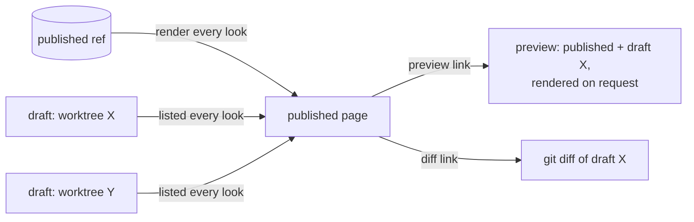
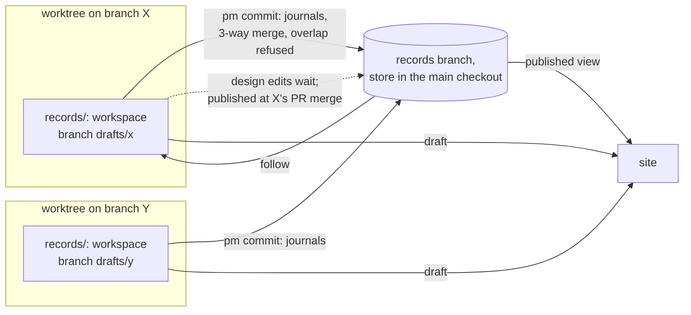
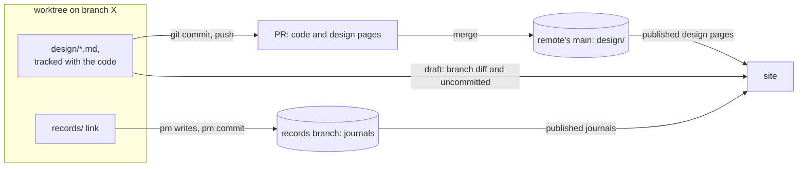

## Problem

> What are we solving, and why now?

Every session writes records in one shared working tree, and the site renders that tree. Two open sprints edited the same 8 design pages in it, one starting two minutes after the other's commit; nothing was lost only because of that gap ([the starting analysis](../docs/2026-10-14-record-layer-concurrency.md)). Three problems follow from the one shared tree:

| Problem | Database name | Today |
|---|---|---|
| Two agents write one file | Dirty write, lost update | `pm commit` commits a named file whole, so it can carry another session's half-made edit to that file |
| The owner wants work in progress | Dirty read, wanted on purpose | The site renders uncommitted edits, unlabelled by writer and with no mark of done |
| Records describe code before it merges | Atomicity across two stores | A design page edit is published at `pm commit`; its code lands at the PR's merge. `pm check` lists 11 covers patterns waiting on unmerged work in this repo as this page is written |

This page works out two candidate models, A (shadow records branches) and B (design pages in the code tree), and what they share. It states the agent's recommendation, labelled as such; it does not pick one.

## Goals and non-goals

> What must the design achieve, and what does it deliberately leave out?

**Goals**

1. No commit carries another writer's edit; two writers' edits to one file merge by hunk, and an overlap is refused with the other commit named.
2. The owner sees published records by default and every draft beside them, labelled by worktree, branch, sprint and session, live.
3. A design page's edit is published when the code it describes reaches main, not before.
4. A draft that does not parse breaks only its own preview.
5. The Stop hook knows a session's uncommitted record edits by construction, not by matching paths in its transcript.

**Non-goals**

- Merging concurrent keystrokes (OT, CRDTs).
- Changes to the work store.
- Showing uncommitted edits made on another machine.

## Constraints and key facts

> Which facts, findings and constraints shaped the design? Only those that
> still hold; sprint records keep the findings as they happened.

**The store and its writers**

- One records store per clone: the `records` branch checked out at `<main checkout>/.pm/store/records`. Each worktree's `records/` is a git-ignored link to it, made by `pm init` ([Shared records store](records-store.md)).
- pm one-shot writes (`pm finding add`, `pm decision add`, …) validate against the store's HEAD plus their planned writes, refuse a target file with uncommitted changes, and commit exactly their paths, under an exclusive `flock` on the store directory.
- `pm commit` holds that lock from its start, validates HEAD plus the named files (not the working tree), and commits the named files whole. It never checks who edited a file or whether it moved since the committing session read it.
- Agents edit records with their own file tools; pm sees those edits only at `pm commit`.

**The site**

- The site renders the working tree, uncommitted edits included; the service looks for a change every second.
- One record that does not parse fails the whole load, and every page is served as a 500 error page until it is fixed.

**Hooks, sessions, sync**

- The Stop hook blocks when the session's transcript names an uncommitted store file in a tool call (substring match).
- `session.Uses` maps each worktree under `.claude/worktrees` to its latest live session; only `pm clean` uses it today.
- One session changes code only in its own worktree; `pm task claim` refuses the main checkout.
- The service pushes every 600 s. Records are not pulled when only behind. When ahead and behind, the store rebases onto the remote under the store lock, skipped while tracked records have uncommitted edits. The service fetches main only after it sees a review's PR merge.
- The git `post-checkout` hook sets up every new worktree as a code worktree and skips only the store's own checkout. A second worktree of `records` fails it ("this repo has no .pm/config.toml", reproduced while measuring below).

**Design pages and the code**

- `pm check` passes a `covers:` pattern that matches no tracked file, listing it as waiting on unmerged work. The gate (`pm action need --pr`, `pm sprint close`) passes a page covering a changed file when it was updated (a records commit since the sprint opened, plus a Design pages link) or waived. `pm sprint close` refuses while a pattern the sprint added matches no file on the remote's main ([Sprint lifecycle](sprint-lifecycle.md)).
- The service learns of a merge only for an open PR review: every 60 s, `gh pr view --json state,mergeCommit` per review. A PR merged without a review (`pm sprint close --merged`) is never seen by the service.
- pm's own PRs are squash-merged (`make merge-ready` prints `gh pr merge --squash`).

**Runtimes** ([Shared records store](records-store.md), Constraints)

- Claude Code writes through `records/` only with the store in `permissions.additionalDirectories`; a `claude -w` session is refused "a different worktree" for any other git worktree, the store included.
- Codex's sandbox keeps every git dir read-only unless that git dir is itself a writable root; pm lists the store and its git dir in `writable_roots`.

::: result {title="Measured on this clone"}
| Quantity | Value |
|---|---|
| Records store working tree | 2.6 MB, 231 files; 24 design pages |
| Commits on `records` / touching `design/` | 845 / 78 |
| A new worktree of `records` (`git worktree add`, hooks off) | 0.01 s; 2.6 MB tree + 56 KB admin dir |
| `git status` in the store; `git merge-tree --write-tree` on two `records` commits | 1 ms each (mean of 20) |
| `git status -- design` plus `git diff --name-only origin/main...HEAD` in a code worktree | 3 ms (mean of 20) |
| `pm check` on the whole store (226 pages, work store read) | 0.20 s |
| Code worktrees of this clone; design pages in yeeef-agents | 10; 21 |
:::

*Reading:* a records workspace costs about 2.6 MB and 10 ms per worktree; listing drafts costs a few ms per worktree; one draft preview costs at most one full record-set check.

## Design

> What is it, in its final state? Free `###` subsections. Decisions and plans
> live in the project and sprint records.

### Choosing

| Goal | Model A | Model B | Model B′ |
|---|---|---|---|
| 1. No swept edits; merge by hunk | Met | Design pages: met through git and the PR. Journals: not met for hand edits of one file by two sessions | Met |
| 2. Published view, labelled drafts | Met | Design pages: met. Journals: published view met; their uncommitted edits are one draft with no writer named | Met |
| 3. Design page published with its code | Met through the service and the close; a conflict found after the merge leaves the page behind the code until resolved | Met by construction | Met by construction |
| 4. A broken draft breaks only its preview | Met | Met | Met |
| 5. Stop hook by construction | Met in worktrees; the main checkout keeps the transcript match | Design pages: met. Journals: transcript match | As A |

| Dimension | Model A | Model B |
|---|---|---|
| Where conflicts surface | Journals at `pm commit`; design pages at the publish, which can come after the code merged | Design pages in git and on GitHub before the merge; journals as today |
| New code | Workspaces, follow and publish, publish at merge, draft refs | Design pages from a ref and worktrees, a virtual link tree, a main fetch, migration |
| Retired code | Covers waiting list and close hold; Stop hook transcript match | Covers waiting list and close hold; the records-commit side of the gate |
| Migration | Per worktree: the link becomes a workspace; no data moves | Pages and their history move to main once per repo |
| Cross-machine drafts | Committed drafts through per-clone draft refs | Committed drafts through pushed branches and open PRs |
| Runtime access | Nested worktree under `claude -w` untested; Codex git dir per workspace | Nothing new |

**Agent's recommendation: Model B.** The incident and the 11 waiting covers patterns are design-page problems, and B removes them with mechanisms that already exist: the PR diff, git's merge and GitHub's conflict check. A builds a second branch per worktree, the follow and publish operations, and a conflict state that can outlive the code's merge, to reproduce for design pages what the PR already does. B's costs, all of them:

- Journals keep the shared tree: goal 1 is missed for hand edits of one journal file by two sessions, goal 2 shows uncommitted journal edits with no writer, goal 5 keeps the transcript match. B′ closes all three at the price of A's workspaces.
- Every design edit needs a worktree, a branch and a PR; the owner can no longer hand-edit a design page in the main checkout.
- A virtual link tree joins `design/` and the records store for the site and `pm check`; on GitHub the cross links do not resolve.
- The sync fetches main every 600 s, which it does not do today.
- A one-time migration per repo.

### Shared

**Terms**

| Term | Meaning |
|---|---|
| Journal | Every record but a design page: project and sprint records, docs, postmortems, day summaries. Facts as they occur |
| Published | A record's text at the ref the site renders by default |
| Draft | A change to a record that is not published: committed on a branch that has not published it, or uncommitted in a working tree |
| Workspace | The private working tree in which one code worktree's sessions edit records |

**The published view.** The site renders committed records at a git ref, never a working tree: model A everything on `records`; model B journals on `records` and design pages on the remote's main.

**Drafts beside the published page.** A page with drafts carries one line per draft:

`Draft edits: <worktree> on <branch>, sprint N, session S (committed on branch / uncommitted): preview, diff`

Worktree and branch come from `git worktree list`, the session from `session.Uses` widened to every worktree (none when no live session used it), the sprints from the open tasks that session holds.

- The preview renders the published set with the draft's files laid over it, on request. A draft that does not parse serves its own preview as the error page and marks its label "does not render"; published pages stay 200.
- The diff is `git diff` of the draft against the published text.
- A published journal may link a design page that exists only in a draft (a new page in a sprint's Design pages); the site links the draft's preview, and `pm check` accepts a link that resolves in a draft of this clone.

*Reading:* the published page renders only a ref; each draft is a labelled link to its own preview and diff, so a broken draft fails only its preview.

**The isolation unit is the code worktree**: private to one session by the invariant, its branch is what merges, and `records/` already resolves per worktree. Alternatives considered says why not per session or per sprint.

**Design pages are edited only in a worktree**, in both models. The main checkout keeps the store as its records tree for journal hand edits, shared by its sessions as today; its uncommitted edits show as one draft labelled "main checkout". `pm commit` there refuses a design page and names a worktree.

### Model A: shadow records branches

Each code worktree gets a workspace: a git worktree of the branch `drafts/<name>`, where `<name>` is the worktree's admin name (unique in the clone), checked out at `<worktree>/records` in place of today's link. `/records` is already git-ignored in code worktrees.

*Reading:* each worktree edits records in its own branch; journals reach `records` at `pm commit` by a three-way merge, design pages at the PR's merge.

**The workspace's state.** `drafts/<name>` is always a `records` commit (its base) plus at most one draft commit, which holds the worktree's committed, unpublished edits (design pages). pm never runs `git rebase`, `git merge` or `git stash` in a workspace: it computes merges with `git merge-tree --write-tree` and `git merge-file`, writes commits with `git commit-tree`, moves refs with `git update-ref`, and writes files itself. No workspace is ever left mid-rebase or mid-merge: each operation runs under the store lock and either completes or changes nothing.

**Follow: bringing a workspace onto `records`.** Run by every pm write from the worktree, before anything else.

1. New draft tree: `git merge-tree --write-tree --merge-base <base> records <draft>`.
2. Each file that `records` changed since the base and that is uncommitted in the workspace: `git merge-file` of its base text, the working text and the `records` text. The merged text is written to the file, with conflict markers where hunks overlap.
3. A committed draft file that conflicts in step 1 leaves the draft commit: the file keeps the agent's text, merged with markers, as an uncommitted edit.
4. The ref moves to the `records` tip plus the new draft commit; files not uncommitted are refreshed from the new tree.

A file with conflict markers stays an ordinary uncommitted edit; `pm commit` refuses it, naming the `records` commits that touched it since the old base (`git log <base>..records -- <path>`). Step 2 rewrites a file the worktree's own sessions are editing, never another worktree's; a file tool that checks the file moved since it read it then rereads it.

**Write path**

Agents write `<worktree>/records/…` with file tools, inside their own worktree. Writes in the main checkout and the service's day summaries stay as today.

- **`pm commit` in a worktree**: follow; refuse a named file with markers; commit the named journal files on `records` in the store (the follow put them on its tip, so they apply cleanly); put named design pages into the draft commit; move the base to the new tip.
- **A one-shot write** commits on `records` in the store, computed on its newest HEAD as today, then follows. Each is a function of the current text, so two findings appended to one Findings section never conflict, while merged as text they would conflict on adjacent lines.
- A commit on `records` that would overwrite an uncommitted edit in the store (a main-checkout session's) is refused, naming the file.

**Publishing design pages**

| Sprint | Published when | By |
|---|---|---|
| With a PR review | The service sees the PR merged (the existing 60 s look) and finds the worktree whose current branch is the PR's head | The service: follow's merge, then a commit on `records`. On a conflict it changes nothing and flags the draft on the site, in `pm show` and in the merge message it already delivers |
| Merged without a review, or no worktree on the head branch any more | `pm sprint close` | pm |
| No PR (a records-only sprint) | `pm sprint close`, or earlier by `pm design publish [<slug>…]` from the worktree | pm |

- `pm sprint close` refuses while a page the sprint's Design pages link has draft edits in any workspace, and publishes the closing worktree's. Those links are the sprint-to-draft map, so no commit carries a sprint id.
- **A conflict found after the code merged** leaves the page behind its code, never ahead. The session resolves it in its workspace and runs `pm design publish`; the sprint cannot close until it does.

**Covers.** A published page changes only when its code is on main, so `pm check` fails on a published pattern that matches no file on the remote's main. The waiting list and the close's hold (`LiveOnMain`, `Own`, the author-date window) retire. In a workspace, `pm check` checks draft pages against that worktree's tracked files; the gate's "updated" reads the draft commit.

**Sync across machines.** The service pushes `records` as today, and each draft commit to `refs/pm/drafts/<clone>/<name>`, where `<clone>` is an id `pm init` generates once per clone: each clone is the only writer of its namespace. The draft commit is rewritten at every follow, so the push is forced with `--force-with-lease` against the sha this clone last pushed; a lease failure is flagged. The remote ref is deleted after the publish. Other clones fetch `refs/pm/drafts/*` and list them as committed drafts with no session.

**Setup.** `pm init` replaces a worktree's link with `git -c core.hooksPath=/dev/null worktree add <worktree>/records drafts/<name>`; the `post-checkout` hook skips `drafts/` branches as it skips the store. Claude Code then writes inside its own worktree. Codex writes the files there too, but committing needs the workspace's git dir as one more writable root per worktree, unless pm runs outside the sandbox (`.codex/rules/pm.rules`).

**Failure modes.** A code worktree removed by `git worktree remove`, by Claude Code at session end or by `git clean -ffdx` loses its uncommitted record edits; the draft commit survives on its branch and remote ref. `pm clean` refuses a worktree whose workspace has uncommitted edits, and `pm where` lists orphaned draft branches. A draft never published, or a publish conflict, is flagged and holds the sprint's close.

**Cost.** About 2.6 MB per workspace (26 MB for this clone's 10 code worktrees), made in about 10 ms; a follow is a merge-tree and a few file writes under the store lock.

### Model B: design pages in the code tree

Design pages leave the records store for `design/<slug>.md` in the code tree, tracked on main and every code branch. Journals stay in the shared records store.

*Reading:* a design page travels in its code PR and is published by the merge; journals keep the shared store.

**What travels with the code**

- A design-page edit is a code change: committed with git on the code branch, reviewed in the PR's diff beside the code, published by the merge.
- Two PRs editing one page merge by hunk: disjoint hunks merge silently, as for code; overlapping hunks conflict, and GitHub shows it before the second merges.
- Each git worktree is already private: no workspace, no publish operation.

**Where the site reads design pages**

| View | Source |
|---|---|
| Published | `design/` at `<remote>/<main>`, a ref the service already reads; the sync fetches main every 600 s, besides the fetch after a seen merge |
| Drafts | Per worktree: `git diff --name-only <merge-base>...HEAD -- design/` and `git status -- design/`; 3 ms measured |
| Other machines' drafts | Pushed branches of open PRs, their files from `gh` |

**Covers**

| Today | Model B |
|---|---|
| `pm check`'s waiting list | Retires: page and code share one tree, so a pattern matching no file there is dead and fails |
| The close's hold on main | Retires: the page merges with the file |
| The gate's "updated": a records commit since the sprint opened, plus the Design pages link | `design/<slug>.md` among the PR's changed files, plus the Design pages link; waivers unchanged |
| The page's dates and later code changes, from the records branch's log | From main's `git log --first-parent` |

**Links between the stores.** Journals keep linking `../design/<slug>.md`, and design pages `../sprints/<id>.md`. The site and `pm check` resolve both against a virtual tree: the records store with `design/` mounted from the published ref, or from the worktree in a draft. On GitHub the cross links do not resolve.

**Commands.** `pm design new` writes `design/<slug>.md` in the current worktree, uncommitted, and refuses the main checkout. `pm commit` refuses a path under `design/` and names `git commit`.

**Rule changes** (`prime.md`). "No code branch tracks `records/`" stays; a new rule: code branches track `design/`, edited only in one's own worktree and landed through the PR. "Records writes may run anywhere" covers journals only.

**Migration** (`pm upgrade --to X`, in every repo that uses pm, yeeef-agents among them)

1. The upgrade PR adds `design/` with its history: `records` filtered to `design/` (`git filter-repo --path design/`, a tool separate from git), merged with `--allow-unrelated-histories`, so main's `git log -- design/<slug>.md` walks the 78 old commits. That PR needs a merge commit; if squashed, the history stays on `records`.
2. Once the new pin runs in the main checkout, `pm init` removes `design/` from `records` in one commit. It refuses, naming each page, while a page on `records` differs from the copy the upgrade took; such an edit is ported by a PR first.
3. A worktree on a branch cut before the move runs the old pin until it merges main, and its pm can still `pm commit` a file under `records/design/`. The new pin's `pm check` fails on any file under `design/` on `records`, and the site flags it, naming the page to port by a PR.

**Journals in Model B** keep the shared tree (Choosing lists what that misses). A sweep needs two sessions hand-editing one journal file; the hand-edited sections are per sprint, usually one session's, so it is rarer than for the shared design pages. Uncommitted journal edits show as one draft, "records store, uncommitted".

**B′: journals in workspaces too.** B′ adds A's workspaces, follow and publish at `pm commit` for journals, with no publish at merge. It meets goals 1, 2 and 5 for journals, at the cost of A's workspace machinery and its open runtime questions, without A's post-merge conflict.

### The starting analysis's open questions

| Question | Model A | Model B |
|---|---|---|
| Per-session or per-sprint workspaces | Per code worktree | The same; for design pages the worktree itself is the copy |
| The Stop hook's check | The own workspace's uncommitted edits; the main checkout keeps the transcript match | The own worktree's `design/`; journals keep the transcript match (B′: the own workspace) |
| Generated records and sync | The service commits day summaries on `records`; Progress is rendered; workspaces follow at each pm write; the sync pushes draft refs | Unchanged for journals; design pages ride code pushes; the sync fetches main |
| A draft preview without breaking the published page | Each preview renders the published set plus one draft, alone (Shared) | The same |
| Cost of drafts and stale workspaces | 1 to 3 ms per worktree per look; a preview at most 0.20 s, on request; a workspace lives with its worktree until `pm clean` | 3 ms per worktree per look; previews as in A; a draft ends with its branch |

### Increments

| Step | Models | Builds | Check |
|---|---|---|---|
| 1 | Both | Published view at a ref; uncommitted store edits as one labelled draft | Scratch clone: a hand edit leaves the published page unchanged and adds a draft line; a malformed draft errors only in its preview, every published page 200 |
| A2 | A | Workspaces, follow, `pm commit` and one-shot writes through them, Stop hook on the own workspace | Two scratch worktrees: disjoint edits to one sprint record both reach `records`; an overlap is refused naming the first commit, markers only in the second workspace; a one-shot write merges into another workspace's uncommitted edit, never leaving it mid-rebase |
| A3 | A | Publish at merge, `pm design publish`, the close's draft check; covers waiting and hold retired | Fake `gh` reports a merge: the page reaches `records` within one 60 s look, also for a branch cut inside the worktree; a conflict is flagged and the close refuses until `pm design publish` |
| A4 | A | Per-clone draft refs | A second clone lists the first's draft after two follows and one sync each |
| B2 | B | Design pages from the worktree and the published ref; drafts; `pm design new`; gate on the PR diff; covers waiting and hold retired | Scratch repo: a page edited on a branch is a draft until the branch merges to main, then published |
| B3 | B | Migration; the check on `design/` under `records` | Scratch copy with 21 pages: main's `git log` lists the pre-move commits; the removal refuses a page edited after the cut; an old-pin edit under `records/design/` fails `pm check` |
| B4 | B′ | Journal workspaces | A2's check, for journals |

## Alternatives considered

> What else was considered and not adopted, and why not?

| Alternative | Why not |
|---|---|
| A per-file version check in `pm commit`: refuse a file that moved since this session's last write | Rejected by the owner: it refuses the second writer without separating the two sessions' edits, works per file not per hunk, and pm cannot see edits made with file tools without a new hook |
| Per-session workspaces | `records/` is one path for every session in a worktree, the main checkout's included: file tools cannot see the session id. A session is not a PR: it runs several sprints, and its subagents share its id |
| Per-sprint records branches, as the starting analysis proposed | A sprint spans worktrees and PRs, so its sessions would share one tree again; file tools cannot choose a sprint's tree |
| Following `records` with `git rebase --autostash` (Model A) | Rebase refuses a dirty tree, the stash pop can conflict, and a stopped rebase outlives the command's lock |
| OT or CRDTs (Google Docs, Automerge, Yjs) | They merge keystrokes; agents make discrete edits to sectioned Markdown, which git's three-way merge handles |
| Dolt for records | Loses hand-editable Markdown and git tooling ([Shared records store](records-store.md)) |
| Jujutsu (jj): conflicts as first-class objects | A second VCS on every machine and runtime; its gain, never refusing a writer, is what the overlap refusal gives up on purpose |

## Prior art

> Optional. What existing work did we learn from, and what did we take?

| Source | Idea | Taken by |
|---|---|---|
| MVCC, snapshot isolation | Each transaction writes privately and publishes at commit | A's workspaces |
| Optimistic concurrency control (Kung and Robinson, 1981); HTTP `If-Match` (RFC 9110) | A write carries its base; a stale base is refused | Both: the overlap refusal, by hunk |
| Preview deployments (Vercel, Netlify); CMS draft and publish (WordPress revisions, Contentful environments) | Readers see published work; each branch or draft gets a marked preview | Shared: drafts beside the published page |
| Architecture Decision Records (Nygard, "Documenting Architecture Decisions"), kept in the code repository; the Linux kernel's and Git's in-tree `Documentation/` | Design text changes in the same commit and review as the code | B |
| Python PEPs, Kubernetes KEPs, Go proposals, Rust RFCs, each in a repository of its own | A design document is reviewed and merged in its own repository, apart from the code that implements it | A's separate records store; A adds the publish at the code's merge, which these processes do not have |
| Git's three-way merge, `git merge-tree`, `git merge-file` | Disjoint hunks merge; overlaps conflict | A's follow; B's PRs |

## Open questions

> What is still unresolved?

- Model A: whether `claude -w` isolation refuses writes to a git worktree nested inside the session's own worktree; a live check decides whether A works there.
- Model A: whether pm commits a workspace from inside Codex's sandbox (one writable root per workspace) or only through `.codex/rules/pm.rules`.
- Both: whether the site should show other machines' committed drafts, which carry no live session.
- Model B: whether the site's links suffice for readers who browse `design/` and the records branch on GitHub.
