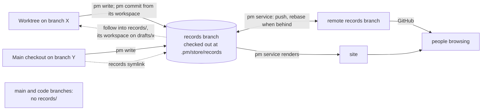

## Problem

> What are we solving, and why now?

Work items live in one git-ignored database per clone, the work store, so every worktree
and branch sees a write the moment it happens. Records (`records/**/*.md`)
are tracked files, so every branch has its own copy. When an agent works in a
worktree on a code branch, its `pm` writes land on that branch only, and the
two layers disagree.

Observed on 2026-10-03: a context-efficiency finding was committed on branch
`context-efficiency-1`, so the owner's checkout showed that sprint's Findings
as "None yet.", while the need citing the finding was visible everywhere.

## Goals and non-goals

> What must the design achieve, and what does it deliberately leave out?

**Goals:**

- One live records store per clone, independent of branch and worktree:
  every `pm` write is immediately visible to `pm show`, the site and the
  owner, wherever the writer is.
- Records keep full per-file git history.
- Code branches, `main` included, track nothing under `records/`; people
  read records on the site or on the `records` branch on GitHub.
- Agents keep reading records at `records/...` with ordinary file tools.

**Non-goals:**

- Moving records into the work store (Dolt).
- A copy of the records on `main`.

## Constraints and key facts

> Which facts, findings and constraints shaped the design? Only those that
> still hold; sprint records keep the findings as they happened.

- The work store (`<main checkout>/.pm/store/work`) is found from any
  worktree; records must be found the same way, without configuration.
- Agents may run sandboxed to their worktree: reads outside it are fine, but
  writes must go through `pm`, which commits them itself.
- Codex's workspace-write sandbox (codex-cli 0.131.0) keeps every git dir
  read-only, even inside a writable root, unless that git dir is itself a
  writable root; a root's own git dir stays read-only even when its parent
  is listed, so the store's `.git/worktrees/records` must be listed on its
  own. From a worktree, the store, the work store and `.pm/run` (the pm
  service's socket) are outside the workspace. `codex
  sandbox` and Codex sessions read the extra roots from
  `[sandbox_workspace_write] writable_roots` in `$CODEX_HOME/config.toml`.
- Claude Code resolves `records/` to the store, which is outside the
  worktree, so without more it asks before each write through the link (in
  auto mode a headless session is refused: "resolves through a symlink …
  outside the allowed working directories"). Listing the store in
  `permissions.additionalDirectories` lets it write, and a running session
  picks the setting up without a restart. A session started with `claude -w`
  is still refused, with "a different worktree": its isolation blocks every
  other git worktree, and the store is one, whatever the settings say.
- Concurrent `pm` writes from different worktrees must not lose or garble each
  other's changes.
- Hand-edited sections (Goal, Scope, Done when, the delivery report, design
  pages) are edited directly, not through a `pm` command.
- Task closes still name a code commit on any branch.
- A branch whose tree tracks `records/` (cut from a `main` that tracked a
  copy) replaces the link with that copy when it is checked out in a
  worktree without sparse checkout: git treats the ignored link as
  expendable. Merging `main` removes the tracked copy.
- Turning sparse checkout off in a worktree whose `HEAD` or index tracks
  anything under `records/` writes that copy over the link.
- Nothing pulls the store on its own: the push rebases onto `origin/records` only when the store has commits to push (Push, below), so a store with none stays behind another machine's pushes.

## Design

> What is it, in its final state? Free `###` subsections. Decisions and plans
> live in the project and sprint records.

*Reading:* every write lands in one store, the main checkout through its link and every other worktree through
its records workspace; people read it on the site or on the remote `records` branch; no code branch carries records.

### The store

A `records` branch holds all records, design pages included. It is checked out once per clone, as a
fixed worktree at `<main checkout>/.pm/store/records`, and it is the only place records
are written. When the remote has no `records` branch, `pm init` creates it: an
orphan commit holding the empty layout (`projects/`, `sprints/`, `days/`,
`design/`, `docs/`, `postmortems/`), pushed first, so a rejected push leaves
nothing local. A repo whose records were tracked on a code branch builds the branch by hand
with `git subtree split --prefix=records -b records`, so every file keeps its
past commits; pm has no command for it.

### Finding the store

`pm` locates the main checkout from any worktree with
`git rev-parse --git-common-dir`, which must be a `.git` directory inside a
main checkout, and uses its `.pm/store/records`. It fails when the store is missing or not a worktree on the
`records` branch; nothing falls back to a local `records/`.
`pm where records` prints the path; bare `pm where` lists every location
setup touches (pm's pin, the store and its ahead/behind against `origin/records`, this
checkout and its link, each `drafts/` branch whose worktree is gone with the design pages it still holds, the work
store, Codex's writable roots, the pm service, each push step's last outcome, the site) with its state.

### Reading

The main checkout has a git-ignored symlink `records -> <main checkout>/.pm/store/records`; every other worktree's
`records/` is its own records workspace, a worktree of the branch `drafts/<worktree's name>` that follows the
`records` branch ([Record drafts and publishing](record-drafts.md), Workspaces and Follow). Either way agents read
`records/...` with ordinary file tools. `/records` is in the repo's
`.gitignore`, so no code-branch commit can pick up the link or the store's
files, and no hook or CI check guards `records/`.

The site renders the records as published on the `records` branch, not the
working tree; the store's uncommitted edits are one draft, `store`, shown as a
version beside each page it changes ([Record drafts and publishing](record-drafts.md),
Published view and versions). The pm service looks for a change every second.
A record that does not parse fails only its draft's version.

Claude Code reaches the store from the main checkout through `permissions.additionalDirectories`, and writes a
worktree's workspace, which is inside the worktree, with no setting; Codex reaches the store through `writable_roots`
(Setup and sync, below). A `pm` command itself
(`pm commit`, `pm finding add`) runs outside Codex's sandbox through
`.codex/rules/pm.rules`, since the sandbox blocks the pm service's socket
([pm in Codex](../design/pm-in-codex.md), Sandbox).

| Worktree state | What setup and the checks do |
|---|---|
| `HEAD` and index track nothing under `records/`, sparse pattern `/*` `!/records/` from an earlier pm | `pm init` turns sparse checkout off and unsets `sparse.expectFilesOutsideOfPatterns`; `pm doctor` reports the pattern until then |
| `HEAD` or index tracks `records/` (a branch cut from a `main` that tracked a copy) | The sparse pattern stays, so the link survives; checked out without it, the tracked copy replaces the link. Merging `main` fixes it; `pm init`, `pm doctor` and `pm where` report it |
| No sparse checkout, nothing tracked under `records/` | Nothing to do |

### Writing

Every `pm` write takes an exclusive `flock` on the store directory as it
connects to the work store and holds it until the command ends, so concurrent
writes land as separate commits. It refuses a target file with uncommitted
changes (a hand edit or another session's edit in progress), since it builds
on `HEAD`'s text; it validates the records it touches against the `records`
branch's `HEAD` with its planned writes applied, so another session's
uncommitted file neither blocks it nor is depended on; then it writes the
files and commits exactly those paths. A `pm` write whose commit fails
restores the files it wrote and unstages them, and says so, so it leaves
nothing behind.

Hand edits are made through `records/` and committed with
`pm commit -m "…" <path>…`, under the same lock. From a worktree it commits from the workspace: it follows it first,
refuses a file with conflict markers or one the store has uncommitted edits to, writes the named journals into the
store and commits them, and keeps a named design page in the workspace's draft commit, tagged with its sprint, which
`pm sprint close` publishes ([Record drafts and publishing](record-drafts.md), Writes and journal publish, Publish at
sprint close); every other
`pm` write from a worktree follows its workspace after its commit. Either way it accepts only named paths
that have uncommitted changes (with none named it lists what is uncommitted and
commits nothing), checks that `HEAD` plus the named paths renders as a whole
record set against the work store, and commits only those paths, so another
session's edit in progress is never swept into the commit. In the shared store it does not check
who edited a named file. Store commits skip git hooks: `pm` has already
validated them, and code-branch hooks do not apply to records.

The Stop hook (`pm hook stop`) blocks a session's stop once when the store has
uncommitted files whose paths appear in that session's tool calls (a substring
match over the transcript's tool inputs), naming them with the `pm commit` and
revert commands; a path that only a still-running subagent's prompt names is
left out. That is the main checkout's check. In a worktree with a records workspace the hook blocks once on every
uncommitted file of that workspace instead, naming each and its conflict markers, with no transcript read: the
workspace is the worktree's own, so its edits are its sessions' ([Record drafts and publishing](record-drafts.md),
Workspaces).

### Retired pieces

`pm doctor` reports these where a repo still has them; `pm upgrade` (and `pm uninstall`) removes the tracked files
(and `.pm/hooks` once empty), `pm init` turns the sparse checkout off, and all three unset the hooks path:

| Piece | What it did |
|---|---|
| `.github/workflows/pm-records-copy.yml` | `git subtree merge --prefix=records` of the store into `main` on each push to `main` |
| `.github/workflows/pm-records-guard.yml` | Failed a pull request that edited `records/` |
| pm's section in `.pm/hooks/pre-commit` (`.beads/hooks/pre-commit` under Python pm) | Refused a code-branch commit that staged `records/`; `pm hook git-pre-commit`, which it runs, does nothing now, so a worktree on the new pin commits until the upgrade reaches the main checkout's hook file |
| pm's section in `.pm/hooks/post-checkout`, and the clone's `core.hooksPath` pointing at `.pm/hooks` | Ran the clone half of `pm init` in a new worktree on `git worktree add`; session start does it (below). A hooks path naming another directory, or a `.pm/hooks` holding hooks of the user's, is not pm's and stays. `pm hook git-post-checkout` does nothing now, for the hook files older pins still run |
| Per-worktree sparse checkout `/*` `!/records/` | Kept `main`'s tracked copy from replacing the link; `pm init` turns it off once the worktree tracks no `records/` |
| `records/` tracked on a branch | The copy itself; `pm doctor` names it, and the commit `pm upgrade` prints untracks it (`git rm -r -q --cached --sparse --ignore-unmatch records`), leaving the link |

### Setup and sync

A clone runs one command, `pm init`. Its clone half adds `/.pm/store/`, `/.pm/run/` and
`/records` to `.git/info/exclude`, creates the local `records` branch from
`origin/records`, checks it out at `.pm/store/records`, and makes the main checkout's link or this worktree's
records workspace (in place of an earlier pm's link, at that worktree's own setup); the
rest of `pm init` sets up the work store and the pm service
([Work store](work-store.md)). Each step runs only when it is missing, so
re-running the command changes nothing. If `$CODEX_HOME` (default `~/.codex`)
exists, it adds the clone's `.git`, the store, the store's git dir, the work
store and `.pm/run` to `writable_roots` in `$CODEX_HOME/config.toml`, so a
Codex session in any worktree can write and commit records and reach the
service's socket. Those paths are absolute and differ per machine, so they go
in the user's config rather than the repo, and the owner chose no manual
step over keeping that config untouched by repo tools. Setup parses the file,
refuses one it cannot parse, adds only the missing paths by
a minimal text edit (creating the table if absent) and refuses an edit whose
result does not parse to the old data plus those paths, so every other line and
comment stays byte for byte. Without `$CODEX_HOME` it says so and leaves
Codex alone. If Claude Code's config dir (`$CLAUDE_CONFIG_DIR`, default
`~/.claude`) exists, it also adds the store to
`permissions.additionalDirectories` in the main checkout's
`.claude/settings.local.json`, keeping the file's other settings: that
file is per worktree and git-ignored, so the absolute path stays out of
the repo, and it refuses a file it cannot parse. In any other worktree it takes the store out of that file, as the
workspace is inside the worktree.

The session-start hook runs `pm init --session-start` at every session start,
so every worktree an agent works in is set up whatever tool created it; that
run never restarts a running pm service. pm installs no git hook: a `post-checkout` hook that ran the clone half
in each new worktree was retired (owner decision, 2026-10-14), as it covered only a worktree made with a checkout
and used without an agent session, at the cost of owning the clone's `core.hooksPath` and a hook file rewritten on
every pin move. A worktree used without an agent session needs `pm init` there by hand. Setup makes every check
itself and changes nothing in a set-up worktree (about 1 s), so the hook runs it unconditionally rather than
guessing from the link whether it is needed; it gets 18 s, within the 28 s the state hook leaves
for init, `pm where` and `pm show` under the runtimes' 30 s hook limit. A git
`post-index-change` hook was tried and dropped: it fires on every index write, so it needed a
once-per-worktree marker and a time limit (owner decision, superseding the answer to need
yeeef-agents-9va.61.7). A link tracked on main cannot replace setup: a symlink's target is
fixed text, and the store sits at a different relative path from each worktree. `pm` itself
works even without the link, so `pm show` never notices one missing; session start therefore
also injects `pm where`, which states the link and every other location. The `records` branch is pushed
and pulled on its own, separate from code branches, as the work store syncs
at the remote's `refs/pm/work`; who pushes it is under Push.

### Push

`pm` writes stay local: they commit records but never push them. The pm
service's syncer runs one push every 10 minutes, the first 10 minutes after
the service starts, and `pm push` runs the same steps once: the work store's
sync, the day summary, then the records branch (owner decision, need
yeeef-agents-9va.30.8.1). The records step:

| Store against `origin/records`, after a fetch | What it does |
|---|---|
| Not ahead | Nothing, even when behind: it does not pull |
| Ahead, not behind | Pushes |
| Ahead and behind | Rebases onto `origin/records` under the store lock, then pushes outside the lock. Skipped until the next run while tracked records have uncommitted edits; a rebase that stops is aborted, leaving the store as it was |

Each step's outcome goes to a state file in `.pm/run/` and a line to a log
beside it. `pm where`, `pm service status` and the site flag a failed push, or
one overdue (no success for three intervals); `pm show` shows a failed one.

### Costs accepted

- A clone of `main` alone holds no records: reading them takes the site, the
  `records` branch on GitHub, or `pm init`.
- One setup command per clone.
- A record reaches `origin/records` up to one push interval (10 minutes)
  after its commit, so the `records` branch on GitHub and sessions on other
  devices see it that much later.
- A branch that still tracks `records/` loses the link when checked out in
  a worktree without sparse checkout, until it merges `main`.
- Setup edits the user's Codex config, and every Codex workspace-write
  session on the machine may then write the clone's `.git`, its stores and
  `.pm/run`, not only sessions in this repo.

## Alternatives considered

> What else was considered and not adopted, and why not?

| Alternative | Why not |
|---|---|
| Always write to the main checkout's `records/` | Collides with the owner's uncommitted work, and with whatever branch that checkout is on |
| Move records into the work store (Dolt) | Loses hand-editable Markdown and git tooling |
| A full copy of the store on `main`'s `records/`, merged in by a GitHub Action (`git subtree merge`) | No machine reads it: `pm`, the site and agents all read the store. Keeping it took four mechanisms (the copy Action, a PR guard, a pre-commit guard, a sparse checkout per worktree) to stop it drifting or replacing the link |
| Copy each PR's own record changes to `main` | The store mixes record writes from every worktree, so it cannot attribute them to a PR cleanly; this means cherry-picks, conflicts and drift |
| An empty orphan `records` branch with the files copied in | Loses each file's history |
| `pm` pushes after every write and `pm commit` (the earlier decision on need yeeef-agents-9va.30.2) | The owner kept `pm` light and local: no network step, timeout or retry in every write; the pm service already pushes on a schedule and bounds the delay |

## Prior art

> Optional. What existing work did we learn from, and what did we take?

None yet.

## Open questions

> What is still unresolved?

- Two machines at once: a store with nothing to push is never pulled (Push); an auto-pull would be needed.
- A write's `LOCK_EX` on the store waits while the pm service holds `LOCK_SH`, which it takes to re-read the records after a partial or failed load, across a work-store read and a whole render. A `pm task add` under the Python pm hung 2:16 in a likely case of this, unproven; whether the shared lock should cover the work-store read is open.
