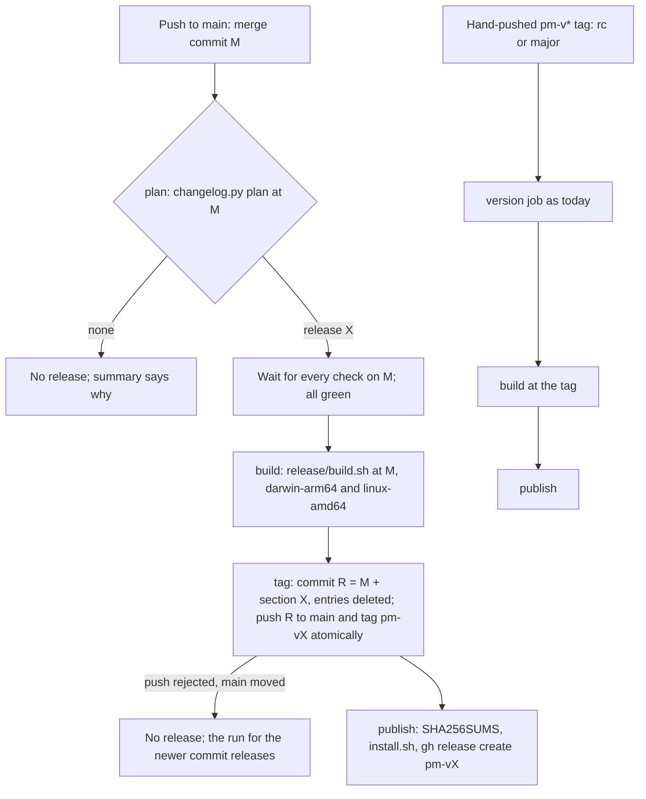

## Problem

> What are we solving, and why now?

- pm releases when someone remembers to. A release today is a hand-written "Release notes for pm X" PR (`release/changelog.py release X --summary …`, then hand edits), merged, then a tag pushed by hand. Nothing says when that happens.
- 0.8.0 was cut only when the owner asked, after the Codex work sat on main. The order of merges decided its content: the design-page gate merged 5 minutes after the 0.8.0 tag and is unreleased.
- So the release decision is implicit, falls to whoever remembers, and produces whatever main holds at that moment.
- This page sets the policy: what triggers a release, how its version is chosen, what blocks one, how release candidates and pin moves fit, and how CI runs it with no human step. It builds on [How a repo runs the right pm version](pm-versioning.md), which fixes the release form (a tag, never moved) and per-repo exact pins. The work that ships it is [sprint 116](../sprints/pm-harness-116.md).

## Goals and non-goals

> What must the design achieve, and what does it deliberately leave out?

**Goals**

- **No one has to remember.** A change that users can notice reaches a published release without a human step.
- **Nothing ships that the policy did not mean to ship.** A release holds exactly what main held at a commit the policy chose, and a half-finished feature can stop releases.
- **The version follows from the change.** The bump comes from the changelog entry files, by a rule a test holds.
- **Notes without hand edits.** The release section is assembled from the entry files as merged.
- **Tags never move.** A failed release leaves no tag, or a tag whose assets were never published.

**Non-goals**

- Moving other repos' pins. Each repo still moves its pin by its own PR, when it chooses.
- Changing the build (`release/build.sh`, the build jobs of the release workflow).
- 1.0 and major versions: a major is a hand-pushed tag.
- Conventional commits or any rule on commit messages.

## Constraints and key facts

> Which facts, findings and constraints shaped the design? Only those that
> still hold; sprint records keep the findings as they happened.

**The release form (fixed by [pm-versioning](pm-versioning.md)).**

- A release is a tag `pm-v<X>` on a main commit; `X` is in no source file. The workflow builds both targets natively (cgo), checks `pm version`, and publishes two tarballs, `SHA256SUMS` and `install.sh`.
- Launchers keep each pin's sha256 after the first download and fail hard on a differing one: a tag whose assets were downloaded must never move or be rebuilt.
- A repo pins one exact version. A pin move is a PR per repo (`pm upgrade --to X`). It rewrites `.pm/config.toml` and `.pm/hooks/post-checkout` always, and the hook entries in `.claude/settings.json` and `.codex/hooks.json` only when the release changed them: the entries carry no version.
- After a pin move, every worktree whose branch was cut before it is refused work-store commands until it rebases. The pm clone has 21 worktrees today.
- Each Go pin costs about 113 MB per machine under `~/.local/share/pm/pins/`; nothing prunes old pins.

**History, 0.2.0 to 0.8.0.**

::: result {title="Releases and what they asked of each repo"}
| Measure | Value | Source |
|---|---|---|
| Go releases | 10 (0.2.0 to 0.8.0), 2026-10-09 to 2026-10-13, plus 7 release candidates | tags |
| Release workflow runs, last 12 (0.2.0-rc.6 to 0.8.0) | 12 succeeded, 0 failed; 1.7 to 4.3 min each | `gh run list --workflow pm-release.yml` |
| Releases whose upgrade guide has a step beyond install and `pm upgrade` | 6 of 10 | CHANGELOG.md |
| Releases that rewrote hook entries | 2 of 10 (0.2.1, 0.8.0) | CHANGELOG.md |
| Releases that needed Codex hooks re-trusted | 1 of 10 (0.8.0) | CHANGELOG.md |
| Releases whose guide names `pm service restart` or `install` | 5 of 10 | CHANGELOG.md |
| PRs that added an entry file, from the 0.5.0 tag to main today | 11 (one of them added two files) | `git log -- changelog.d/` |
| Releases cut in that span | 4 (0.6.0, 0.7.0, 0.7.1, 0.8.0) | tags |
| Pin moves in the pm repo in that span | 2 (0.6.0, 0.7.1); it pins 0.7.1 today | `git log` |
:::

Reading: a release that asks a repo to re-trust Codex hooks is rare (1 in 10); the per-repo cost of a pin move is the PR and the stranded worktrees, and it is paid per move, not per release.

**What hand edits the release section needed.** `changelog.py release X --summary SUMMARY` re-run on each release's entry files, diffed against the section as released:

| Release | Hand edits | Lines differing |
|---|---|---|
| 0.7.1 | The summary only | 4 (2 are the date) |
| 0.7.0 | The summary; a step reference the renumbering broke ("see step 1" became step 3); one step reworded; one entry moved | 23 |
| 0.8.0 | The summary; two entry files of one PR described the same hook rewrite and Codex re-trust, so 8 generated steps were merged into 5 | 25 |

Reading: the summary is the one edit every release needed; the others come from batching several entries (overlapping steps) and from renumbering (a step number written in an entry).

**GitHub Actions.**

- An event caused by `GITHUB_TOKEN` starts no workflow run, except `workflow_dispatch` and `repository_dispatch`. A tag or a main commit pushed by the release job therefore triggers no other workflow: the build and the publish must run in the same workflow, or be dispatched.
- The repo's default workflow token is read-only; a job may raise it to `contents: write`. `main` has no branch protection and no ruleset today, so that token can push to `main`. No repository secret exists.
- A PR opened by `GITHUB_TOKEN` gets no CI run that is not approved by hand, and `make merge-ready` refuses a PR whose required checks did not run: a bot release PR needs a GitHub App or personal token.
- `make merge-ready` squash-merges only a head that contains `origin/main` and whose checks passed, so the merge commit's tree is the tree CI tested.

## Design

> What is it, in its final state? Free `###` subsections. Decisions and plans
> live in the project and sprint records.

**Recommended policy, pending the owner's decision (Open questions, 1): continuous delivery per merge.** Every push to main that leaves unreleased entry files in `changelog.d/` releases at once, unless a hold is in place. Publishing is not adoption: a release reaches a repo only when that repo moves its pin.

### Trigger

| Push to main | Result |
|---|---|
| Adds or leaves entry files in `changelog.d/`, no `release/hold`, main's CI on that commit green | Release `X` |
| No entry file (docs, CI, tests, a `no-changelog` PR) | No release |
| `release/hold` exists | No release; the run's summary names the hold and its reason |
| Main's CI on that commit failed | No release; the run fails, naming the failed checks |
| Main moved past the commit before the run starts | No release from this run; the run for the newer commit releases every entry |
| A pushed `pm-v*` tag that has no GitHub release | The run fails, naming the tag and the re-run that finishes it |

The decision is one function, `changelog.py plan`, which prints `release X` or `none: <reason>`, so `make test` covers every row.

### Version rule

`X` is the last release, the highest `pm-v*` tag without a pre-release suffix, bumped by the highest level any unreleased entry asks:

| Category in an entry | Bump while pm is 0.x |
|---|---|
| Breaking changes, Added, Deprecated, Removed | Minor |
| Changed, Fixed, Security | Patch |
| Major (1.0 and on) | Never automatic: a hand-pushed tag |

The highest level wins across entries, as in changie's `auto` kinds. `changelog.py next` prints `X`; the release job and a release candidate both use it.

### What blocks a release

- **Main is releasable after every merge.** A PR merges only when what it ships is complete for users. A feature in several PRs either lands as one PR (as the Codex work did), merges its parts into a feature branch that merges to main once, or lands parts that users cannot reach (no command, flag or hook wired) and that add no entry file.
- **The hold.** When a feature must land on main in parts that users can reach, its first PR adds `release/hold`, one line naming the feature and the PR that completes it; that PR deletes the file. While the file exists no release runs, fixes included. A fix that cannot wait is the owner's call: delete the hold and ship the partial feature, or wait. A file, not a label: it persists across merges, its removal is reviewed, and git keeps its history.
- **Main's CI.** The release waits for every check on the merge commit and requires all of them green. A merge through `make merge-ready` already ran CI on the same tree; the wait catches a merge made another way.

### Notes without a hand edit

- **One entry file per PR.** `changelog.py pr` refuses a PR that adds more than one. With one release per merge, a release holds one PR's entry, so no two entries' steps overlap.
- **The entry carries the summary.** An entry file opens with a summary paragraph, one to three sentences for users, before its first `###` heading; `changelog.py check` requires it. `changelog.py release X` with no `--summary` uses the entries' summaries, joined in name order.
- **Steps without numbers in prose.** `check` refuses a "step N" reference in an entry, since the release renumbers its steps after the two it writes (install `X`, `pm upgrade --to X`).
- The release commit writes `## [X] - <date>` into `CHANGELOG.md` and deletes the entry files, as `changelog.py release X` does today.

### Release candidates

- Unchanged: `pm-v<X>-rc.<n>` pushed by hand, on any commit, a PR's included; `X` from `changelog.py next` on that commit. The pusher's own credentials trigger the tag workflow.
- Needed only when a PR's build must be checked before it merges, or a repo must try the change before main has it. Every merge releases, so no candidate stands between main and a release.

### Pin moves

- Each repo moves its pin when it chooses, by its PR (`pm upgrade --to X`); nothing moves pins automatically. `pm doctor` already names a newer release.
- A move crosses every release between the old pin and `X`; its guide is the union of their upgrade guides. A repo re-trusts Codex hooks once per move that crosses a hook change, whatever the number of releases crossed.
- Recommended cadence: move when a release carries something the repo needs, or about weekly, and after merging or rebasing in-flight branches where possible, since each move strands worktrees cut before it.

### Automation

Reading: the build runs before any tag exists, so a failed build leaves nothing to clean up; the commit and the tag land in one atomic push, then the release is published.

| Job | Runs on | Token | Does |
|---|---|---|---|
| `plan` | push to main | read | Fails on an unpublished `pm-v*` tag; stops with no release when main moved, a hold exists or no entry file is left; else waits for M's checks and prints `X` |
| `build` (existing jobs) | `plan` gave `X`, or a tag push | read | `release/build.sh dist pm-v<X>` at M or the tag; checks `pm version` prints `X` |
| `tag` | push to main | `contents: write` | `changelog.py release X` at M, commit R as `github-actions[bot]`, assert R differs from M only in `CHANGELOG.md` and `changelog.d/`, `git push --atomic origin R:main pm-vX` |
| `publish` | after `tag`, or after a tag push's build | `contents: write` | As today's release job: `SHA256SUMS`, `install.sh`, `gh release create pm-vX --verify-tag`, notes from `changelog.py notes X` |

- One workflow file, `pm-release.yml`, with `push: branches: [main]` and `push: tags: [pm-v*]`; `concurrency: pm-release`, never cancelling a run in progress. A tag pushed by the `tag` job starts no second run.
- `GITHUB_TOKEN` suffices: no secret, no App. If `main` gets a ruleset, `github-actions` joins its bypass list.
- The binary is built from M and the tag names R. R changes only files that ship nothing (`SHIPPED` in `changelog.py`), and `tag` asserts it; the binary's embedded VCS revision is M.
- `make merge-ready` accepts a head that lacks only release commits of main (by `github-actions[bot]`, touching only `CHANGELOG.md` and deletions in `changelog.d/`), so a PR rebased between a merge and its release commit need not rebase again.
- `pm-release-notes.yml` stays: a fixed section on main re-renders a published release's notes.

### Failure handling

| Failure | State left | Recovery |
|---|---|---|
| Build fails | No commit, no tag | Fix on main by a PR; its merge releases everything unreleased |
| Push of R and the tag rejected | No commit, no tag | None needed: the newer commit's run releases |
| Publish fails after the push | R on main, tag `pm-vX`, no GitHub release, no asset ever downloaded | Re-run the failed job (same tag, same build artifacts); `plan` refuses every later release until it is done. Not a moved tag: no launcher holds a sha256 for `X` |
| A published release is broken | Release `X` stands | Fix forward: the fix's merge releases `X+0.0.1`; repos pinned to `X` move |

## Alternatives considered

> What else was considered and not adopted, and why not?

| Option | Releases, observed span (0.5.0 tag to now) | Owner step per release | Half-finished feature | Notes by hand | Extra CI need |
|---|---|---|---|---|---|
| **A. Per merge (recommended)** | 11 (0.6.0 to 0.11.0 by the version rule) | None | Hold file, or land complete | None (one entry per release) | None |
| B. Bot release PR | Owner-paced; not predictable | Merge the PR | Do not merge the release PR | None to some (batched entries) | App or personal token, so CI runs on the bot's PR |
| C. Daily train | 3 | None | Hold file | Batches recreate overlapping steps | A cron trigger |
| D. semantic-release | as A | None | Commit type, no hold | From commit messages | Conventional commits |
| E. Patch per merge, minors batched | as A for patches | Cutting each minor | As B or C | As B or C | Release branches |

### B. A release PR kept open by a bot (release-please, changesets)

- A workflow keeps "Release pm X" open, rewritten on every push to main; merging it releases.
- The merge is a human decision again. Under pm's rules the merge waits on the owner, which is how 0.8.0 waited. If agents merge it, it adds a PR per release and decides nothing.
- A PR opened with `GITHUB_TOKEN` runs no CI, so `make merge-ready` refuses it: it needs a GitHub App or personal token stored as a secret, which the repo does not have.
- The release PR's branch is rebased on every merge; its content still depends on merge order, as 0.8.0's did.
- It fits when a human must review each release's notes. pm's notes are written per PR, in the PR that is reviewed.

### C. Scheduled release trains

- A cron run (daily, or weekly) releases whatever is unreleased, with the same jobs as A and a `schedule` trigger.
- Fewer versions (3 instead of 11 over the observed span), the same pin-move cost, since repos move by choice.
- A fix waits up to a day. A batch of several PRs brings back the hand edits that 0.7.0 and 0.8.0 needed: overlapping steps across entries.
- The hold is still needed: a train of main ships a half-finished feature as A does.
- Worth it if the number of versions itself costs something, such as a reader of the release list or many pins kept per machine.

### D. semantic-release from commit messages

- Versions and notes from conventional commits (`fix:`, `feat:`, `!`). pm's squash titles are prose for users ("The pm service verifies the Cloudflare Access token …"), and its notes come from `changelog.d/` with upgrade guides, which commit messages cannot carry.
- A would keep its trigger and its version rule; the source stays the entry files, as changie and towncrier do with fragments.

### E. Patch releases per merge, minor releases batched

- A release is a snapshot of main. Once an Added entry is on main, a later Fixed merge cannot release as a patch without the Added code, unless patches come from a release branch with backports.
- Release branches double the merge path for one owner and a few repos; the minor still needs B's or C's trigger.

### Hand releases with a written rule (today, plus a rule)

- A rule such as "release every Friday" kept by hand. It is the state that produced 0.8.0's delay; the sprint's goal is that nobody has to remember.

## Prior art

> Optional. What existing work did we learn from, and what did we take?

| Source | How it works | What pm takes |
|---|---|---|
| [release-please](https://github.com/googleapis/release-please), [its action](https://github.com/googleapis/release-please-action) | A release PR kept current from conventional commits; merging it tags and publishes. Its docs: anything it creates with `GITHUB_TOKEN` triggers no workflow; CI on its PRs needs a personal token | B, rejected; the token fact |
| [changesets/action](https://github.com/changesets/action) | Changeset files per PR; a "Version Packages" PR consumes them; merging it publishes | Fragments per PR, as `changelog.d/`; not the PR |
| [semantic-release](https://github.com/semantic-release/semantic-release) | Releases on every push from commit types; highest bump wins | A's per-push trigger and highest-bump rule |
| [changie](https://changie.dev/config/) | Change fragments per kind; `auto: major/minor/patch` per kind; `changie next auto` takes the highest | The version rule from entry categories |
| [GitHub: triggering a workflow](https://docs.github.com/en/actions/how-tos/write-workflows/choose-when-workflows-run/trigger-a-workflow) | `GITHUB_TOKEN` events start no run, except `workflow_dispatch` and `repository_dispatch` | Build and publish in the same workflow |
| [GoReleaser: create the tag in the action](https://carlosbecker.com/posts/goreleaser-create-tag-action/) | Build first, create the tag only once the build passed, so a failure leaves no tag | Build before the tag |
| [GoReleaser nightlies](https://goreleaser.com/customization/nightlies/), [Bun canary](https://bun.com/docs/installation) | A pre-release build per commit or per night, beside stable releases | Not needed: every merge is a release, and pins choose |
| [gh releasing](https://github.com/cli/cli/blob/trunk/docs/releasing.md) | A maintainer runs `script/release vX.Y.Z`; the workflow needs approval; no fixed cadence; 12 releases from 2026-04-22 to 2026-09-30 | A human-cut release, the state pm leaves |
| [Deno release schedule](https://docs.deno.com/runtime/contributing/release_schedule/) | Minor every 12 weeks, patches weekly, canary per commit | C at a larger scale, for many users who do not pin |
| [golangci-lint versioning](https://golangci-lint.run/docs/product/roadmap/) | A minor may break a lint run; patches do not; users pin a minor. Releases irregular, patches days after a minor | Pins as the user's control, as pm's exact pins |
| [Feature toggles](https://martinfowler.com/articles/feature-toggles.html) | Unfinished code on trunk kept unreachable | The rule that partial parts land unreachable |

## Open questions

> What is still unresolved?

| # | Question | Options | Default |
|---|---|---|---|
| 1 | Per merge, a daily train, or an owner-merged release PR? | a. per merge; b. daily train; c. release PR | a, pending the owner's decision |
| 2 | How does a pin move that crosses several releases show their steps? | a. `pm upgrade --to X` prints every upgrade-guide step from the pin to `X`, from the releases' notes; b. the user reads each release | a |
| 3 | Does an old pin's 113 MB ever go? | a. `pm clean` prunes pins no clone on the machine uses; b. keep all | a, later |
| 4 | Must a hold expire? | a. `plan` warns after 3 days; b. no limit | a |
| 5 | Should pm's own repo move its pin after each release, to run what it ships? | a. by hand, as other repos; b. a PR per release by the release workflow | a |
