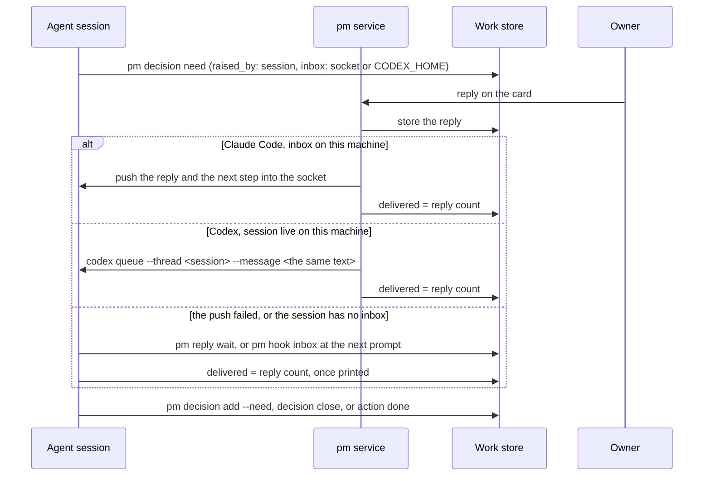

## Problem

> What are we solving, and why now?

An owner reply posted on the site (or with `pm reply add` at a shell) must reach the agent session that raised the request, in Claude Code and in Codex. The earlier design, a background `pm reply wait` poller started by a Claude Code hook that woke the session by exiting, lost replies in three ways:

| Failure | Cause |
|---|---|
| The raising command's output was piped through `grep`, so no waiter started | The hook learned which requests to watch from the command's printed text |
| Several requests raised in one command shared one waiter, which exited on the first reply | A waiter could wake the session only by exiting, and nothing restarted it |
| A second reply to one request had no waiter | Same: a waiter started only when a request was raised |

Root cause: the watched set was fixed at raise time, from printed text, and a waiter never came back after it exited. The design below moves delivery to the producer, the pm service, which knows the target the moment a reply is stored, and adds routes that work in a runtime with no inbox.

### The pieces

| Term | Meaning |
|---|---|
| Request | A need (decision, action or PR review) in the work store. Its `raised_by` holds the raising session's id, its inbox and the inbox's host |
| Reply | A comment of kind reply on an open request, from the site's form or `pm reply add` |
| Delivered | The need's count of replies that reached a session. A request has an undelivered reply while its replies outnumber it |
| Inbox | Where the service hands a session its reply: a Claude Code session's messaging socket, `$CLAUDE_CODE_MESSAGING_SOCKET`; a Codex session's CODEX_HOME, stored as `codex-queue:<CODEX_HOME>`, under which the service runs `codex queue` |
| Merge | A reviewed PR's merge commit on the remote's main, which the service delivers like a reply |

## Goals and non-goals

> What must the design achieve, and what does it deliberately leave out?

- **Goal:** both ways the owner answers keep working: a reply on the site, and an answer given in chat that the agent records and closes (see The two workflows).
- **Goal:** every reply reaches the session that asked at least once while that session runs, in Claude Code and in Codex, with no long-lived per-session process.
- **Goal:** a reply whose session is gone is never silently dropped. The next session sees it.
- **Goal:** the core (what is undelivered, what marks it delivered) is runtime-agnostic. Each route is a thin adapter on it.
- **Goal:** an idle session, Claude Code's or Codex's, starts a turn on the reply with nothing typed.
- **Non-goal:** exactly once. A reply may reach a session twice; it may never be lost.
- **Non-goal:** delivering into a session on another machine. Such a session finds the reply at its next start.

## Constraints and key facts

> Which facts, findings and constraints shaped the design? Only those that
> still hold; sprint records keep the findings as they happened.

- **The producer knows the target.** The service stores a site reply on a need, and the need stores the raising session (`raised_by`). So the place where the event happens can address the session.
- **Claude Code has a per-session inbox.** Since v2.1.224 every session binds a Unix-socket inbox, named in `$CLAUDE_CODE_MESSAGING_SOCKET`, exported to hooks and Bash commands (code.claude.com/docs/en/cross-session-messaging names "a script or hook to post into a session" as a use). An idle session starts a new turn with a message; a busy one reads it between tool calls.
  - `encoding/json` encodes a typed `type`/`message` object as one newline-terminated JSON message. JSON escaping and whitespace do not carry meaning; the receiver reads the decoded message fields.
  - The message line `{"type":"user","message":{"role":"user","content":"…"}}` is observed (a live test with 2.1.290, and the binary's own log hint), not documented. The socket's path is read from the variable, never built.
  - The socket closes a connection that sends no complete line within 30 s, so a writer connects only once its line is ready.
  - A session in bypassPermissions mode holds a message from an unverified sender until someone approves it, unless `crossSessionInbound: "accept"` is set or the first line is `{"type":"auth","token":$CLAUDE_CODE_MESSAGING_TOKEN}`. The token never goes into the work store, which syncs to the remote.
  - The session shows the message as coming from "another Claude session", so the text says it is the owner's reply relayed from the site.
- **Codex queues a message into a session from outside.** `codex queue --thread <UUID|name> --message <TEXT>` ("Queue a message for an existing session"; shipped in codex-cli 0.149.0, 2026-08-20, whose release notes also say "Queued messages now wake idle sessions reliably", github.com/openai/codex releases `rust-v0.149.0`) sends `thread/queue/add` to its own embedded app-server, which writes a durable item to `$CODEX_HOME`'s SQLite thread queue (codex-rs `tui/src/session_queue_commands.rs:27-78`). Every app-server, a TUI's embedded one included, polls that queue every 10 s and dispatches with `start_turn_if_idle`, also when a running turn ends and when the thread is next loaded (`ext/queue/src/service.rs:88-246`).
  - It prints `Queued message <id> for thread <UUID>.`; the service checks that the thread is the one asked for.
  - The thread is always the root session's UUID: a spawned subagent's thread is refused while it is not loaded, and a name resolves to the most recent session that has it.
  - Text only, not empty.
  - When a local app-server daemon answers on `$CODEX_HOME/app-server-control/app-server-control.sock`, a TUI attaches to it and an embedded queue call is refused (`session_queue_commands.rs:36-45`); the call then goes to the daemon with `--remote unix://<socket>`, decided by whether the socket answers before the call.
  - A review on openai/codex PR #39034 flagged a possible cross-process race that consumes one queue item twice: at worst a duplicate turn.
- **`codex exec resume` fails while the thread has a writer**, so the service cannot run a turn of its own on a live thread.
- **Codex inherits its launcher's environment**, `CLAUDE_CODE_MESSAGING_SOCKET` included: a Codex run started from a Claude Code session sees that session's socket.
- **A hook can add context to a prompt in both runtimes**: UserPromptSubmit's `additionalContext`, inside the hook's timeout.
- **A Stop hook block ends in `stop_hook_active`**: the continuation it forces stops with `stop_hook_active` set, and every Stop check lets that stop through ([Owner-request Stop hook](../design/owner-request-hook.md)).
- **A PR merge has no producer in pm.** GitHub is the source, so something must look; the service already runs for the owner to reply at all.

## Design

> What is it, in its final state? Free `###` subsections. Decisions and plans
> live in the project and sprint records.

### The two workflows

**1. The owner replies on the site.** The agent raised a need and carried on, or went idle. The owner answers on the request's card. The reply travels to the session by the routes below.

**2. The owner answers in chat.** The agent already has the answer: it records it (`pm decision add --need`, `pm decision close`, `pm action done`) and the close stamps pm's own answer comment at the close. That comment is no reply to deliver, so nothing is undelivered and the close is never refused.

"Undelivered" counts only reply comments made before the need closed, against the need's delivered count; pm's own and agents' comments never count.

### Routes by runtime

| Route | When | Claude Code | Codex |
|---|---|---|---|
| Push into the inbox | The moment the reply is stored, then on every sweep | yes, into the socket | yes, with `codex queue`; an idle TUI starts a turn on it |
| `pm reply wait <id>` | Within a turn: the agent blocks on it after raising the need | yes | yes |
| `pm hook inbox` | UserPromptSubmit: the session's next prompt | yes (finds nothing a push delivered) | yes |
| `pm show` flag, `pm reply read` | Session start and any later look; the next session if this one ended | yes | yes |

Reading: every route reads the same undelivered set and writes the same delivered count, so they differ only in when the session sees the reply.

The raising command's output names the session's route: with a socket, that the service pushes the reply; with a CODEX_HOME, that it queues the reply into the Codex session, which starts a turn with it when idle; either way `pm reply wait <id>` waits for it within the turn. Without an inbox, to wait with `pm reply wait <id>` (in the background where the runtime allows), else the reply arrives at the next prompt.

### Raising: which session, which inbox

`pm decision need` and `pm action need` (a PR review too) store `raised_by`: the session ([Session claims](../design/session-claims.md), Session resolution), its inbox by its runtime, and the machine's hostname. A Claude Code session's inbox is `$CLAUDE_CODE_MESSAGING_SOCKET` (never the token); a Codex session's is its CODEX_HOME (`$CODEX_HOME`, else `~/.codex`, made absolute), stored as `codex-queue:<CODEX_HOME>` in the same column, so the work store's schema is unchanged and an older pm reads it as a socket that is not there.

- A Codex session never stores the Claude Code socket it inherits: a push there would land in the Claude Code session that started it.
- A resumed Claude Code session keeps its id but binds a new socket. The session-start hook runs `pm show --refresh-inbox`, which points the session's open needs at its current inbox and host; run from a Codex hook, it points them at the session's CODEX_HOME, replacing a socket an earlier pm stored. A session with no inbox clears the one its needs carry.

### Push

The service's writer makes every write one at a time. After it stores a reply, it pushes the need's undelivered replies (and an unreported merge) into `raised_by.inbox`:

| Step | Rule |
|---|---|
| Host | Push only when `raised_by.host` is this machine; otherwise "not running: the session's inbox is on <host>" |
| Connect | `PushTimeout` 5 s; a missing socket or a refused connection means the session is not running |
| Write | One line, as above, with the reply text, its UTC stamps and the next command (`pm decision add --need …` or `pm decision close …`; for an action, `pm action done …`) |
| Mark | Delivered is set only once the line is written. The store is not held across the push |

For a Codex inbox the push is a `codex queue` call:

| Step | Rule |
|---|---|
| Host | As for a socket: only on the machine that stored the inbox |
| Live | The session's root rollout under the stored CODEX_HOME changed within 30 minutes; else "not running: the session that asked has ended", left undelivered as a dead socket is |
| codex | `codex` on the service's PATH, at 0.149.0 or later (`codex --version`, read once per service run); else "no codex: …", undelivered, and `pm doctor` names it for a repo with Codex hooks |
| Call | `codex queue --thread <root session UUID> --message <the same text a socket push writes>`, with `CODEX_HOME` the stored one, in that directory, `--remote unix://<socket>` when the home's control socket answers; bounded at 10 s, the process group killed at the timeout |
| Mark | Delivered is set once codex exits 0 saying it queued the message for that thread |

Measured (`make test-live-parity`, an idle interactive session in a pty, nothing typed): a Codex TUI started a turn on the reply 6.1 s after `pm reply add`; a Claude Code TUI 1.0 s after it, by push.

A reply any command stored (`pm reply add` at a shell) is pushed as soon as the work store moves: the service looks at the store's change mark every `ServeCheck` (1 s), and a moved mark queues a sweep.

### Sweep

A sweep pushes again what an open need's session has not received: a failed push, or a crash between storing a reply and pushing it. It runs at start, every `MergePoll` (60 s) after the merge watch, and whenever the store moves. A need whose inbox socket is missing costs one `stat`; one whose push found the session not running is skipped until its socket path, inode or mtime changes, or, for a Codex inbox, until the session's rollouts change. It logs only a change.

### `pm reply wait <id>`

A blocking command, runtime-neutral: it reads the need every `ReplyPoll` (2 s) until `--timeout` (default 30 m), then prints:

1. What has not reached any session (replies and a merge), marked delivered, as `pm reply read` does; else
2. The replies stamped at or after the second the wait began, which a push or `pm hook inbox` delivered meanwhile; these stay as they are.

A reply delivered before the wait is no new reply: an agent that waits again after "not yet" waits for the next one. It refuses an id that is no need, a need that closes with no new reply, and, at the timeout, says the need is still open and how to wait again.

### `pm hook inbox`

The UserPromptSubmit hook in both runtimes (10 s timeout). It reads the session's open needs (the input's `session_id`) and hands over each undelivered reply and merge as `additionalContext`, worded as the push words it:

- **Print, then mark.** A reply is marked delivered only once its text is printed. The marks (one write per need) all run within one 5 s budget, each write waiting for the store's write lock at most the time left; what is not marked by then stays undelivered and comes again at the next prompt.
- **Fails open.** On its own error it says why on stderr and lets the prompt go on, handing nothing over.
- **Not at Stop.** An inbox block at Stop forces a continuation that ends with `stop_hook_active`, which lets `pm hook stop` and the owner-request check through on the very turn that acts on the reply. A mid-turn reply reaches a Claude Code session by push, and a Codex session through `pm reply wait` or its next prompt.

### Safety net: `pm show` and the next session

Session start injects `pm show`, which flags every open request holding an undelivered reply or merge (`[undelivered reply: pm reply read ID]`), so a reply whose session ended reaches the next session working on that project. `pm reply read [ID…]` prints undelivered replies and merges (without ids, this session's open requests; with ids, those, closed ones too) and marks them delivered; it does not wait.

Closing a request through pm (`pm decision add --need`, `pm decision close`, `pm action done`) refuses while it holds an undelivered reply, so pm never buries one under a close.

### Merges of reviewed PRs

At start and every `MergePoll` (60 s) the service checks each open review's PR: `gh pr view`, then `git fetch` and whether the merge commit is an ancestor of the remote's main (a PR merged into a stacked base is not). Each call has a 60 s timeout; a failing look is logged and retried at the next tick. A merge on main is stored on the review and delivered through the same routes as a reply, naming `pm action done` and the `git pull --ff-only` that updates the main checkout.

### Duplicates and loss

| Case | Outcome |
|---|---|
| Push accepted, mark write fails | Pushed again by the next sweep: a duplicate |
| Codex consumes one queued item twice (a race a codex review flagged) | A duplicate turn |
| `pm hook inbox` printed, mark fails or runs out of budget | Handed over again at the next prompt: a duplicate |
| `pm hook inbox` cannot print | Not marked: handed over at the next prompt |
| Session ended | Stays undelivered; `pm show` flags it for the next session |

Every failure leaves the reply undelivered or delivers it twice; none marks a reply delivered that no session saw.

## Alternatives considered

> What else was considered and not adopted, and why not?

| Option | Why not |
|---|---|
| Per-request poller, ids parsed from the raising command's output | Lost replies three ways (Problem) |
| Per-session poller restarted on every Bash call and at turn end (PostToolUse and Stop `asyncRewake` hooks) | Works, but ties delivery to Claude Code's hook lifecycle, relies on undocumented `asyncRewake` on Stop, and starts background processes after every Bash call |
| Per-request poller started by `pm`, pushing into the inbox until the request closes | One process per request with lifecycle rules (stop with the session, restart after a reboot, never two per request), for no guarantee push lacks |
| Claude Code channels (an MCP server pushes `notifications/claude/channel`) | Research preview; a hidden dev flag with an interactive confirmation in every session; ignored under `-p` |
| Explicit acknowledgement as the only mark (`pm reply read`) | The agent must remember a command; "accepted into the inbox" or "printed into the prompt's context" is close enough, and `pm show` covers the rest |
| `codex exec resume <thread>` from the service | Fails while the thread has a writer, and starts agent runs nobody asked for |
| A shared Codex app-server (`turn/start`) | Reaches only TUIs started after it on the default socket; pm would run Codex's server |
| Async hooks that rewake the session | Measured in Codex: an async hook cannot start a turn |
| A blocking Stop hook that waits for the reply | Holds the turn open (the session never goes idle) for as long as the owner takes, within the hook's timeout, and keeps the stop checks waiting behind it |
| An MCP tool that long-polls for the reply | A blocking call within a turn, as `pm reply wait` is, plus an MCP server per session; it cannot wake an idle session |
| `pm hook inbox` at Stop as well | Disables the stop checks for the turn that acts on the reply (`stop_hook_active`) |
| Push into the inbox a Codex session inherits | Lands in the Claude Code session that started Codex |

## Prior art

> Optional. What existing work did we learn from, and what did we take?

Webhooks and push notifications: the producer delivers, and the consumer keeps a durable record of what it has seen. We took push on the event, plus a durable "undelivered" count in the work store as the catch-up path for every other route.

## Open questions

> What is still unresolved?

- The inbox message line is observed, not documented. A Claude Code change could break it; a push failure then shows on the card and in `pm show`, and `pm hook inbox` still hands the reply over at the next prompt.
- `codex queue` is observed against codex-cli 0.154.0 and its source, and documented only by its help and release notes. A Codex change could break it; the outcome then shows on the card and in `pm show`, and `pm hook inbox` still hands the reply over at the next prompt.
- Not recorded: a push into a busy interactive session, and into a remote or bridge session.
