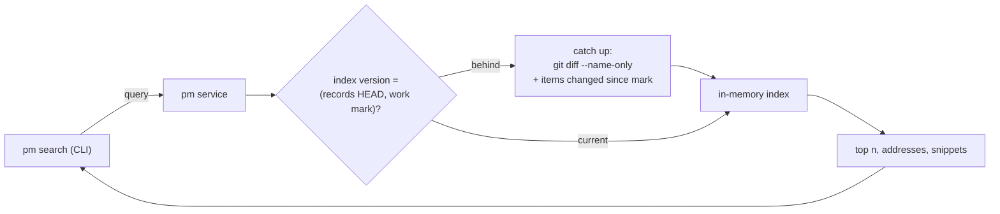

## Problem

> What are we solving, and why now?

Part of the [pm search](pm-search.md) design. This page is an RFC: it is the target design, and today's scan is its first stage. Two questions decide whether `pm search` is worth having and how it has to grow.

- **Is it better than `rg`?** An agent already has `rg records/`. PR #112's first ranking (a unit must hold every word) lost to `rg` on recall. Retrieval model 2 (stage 1, built in sprint 129 on PR #112, which is held until the gate passes) beats that ranking and `rg` by match count, and ties `rg` newest first: best of 3 queries, recall@10 .705 against .692, a difference whose 95 % CI spans 0 (pm-harness-129 Findings). It reads fewer tokens to the first relevant record: a median of 144 against 2,447 for `rg -n` lines of the same files. So the gate against `rg` is not met yet.
- **Does it stay fast?** Every run rebuilds the index from a full scan. The scan takes 0.11 s at today's 2.1 MB, 0.96 s at 10×, and 15 s at 100× on one core. At the measured growth rate, the store reaches about 24× in a year. That is a linear extrapolation from 16 days of history.

## Goals and non-goals

> What must the design achieve, and what does it deliberately leave out?

**Goals**

- Beat `rg` on a fixed retrieval eval (recall@10 and MRR, paired bootstrap CI above 0) at a lower token cost, and keep it beating `rg` as ranking changes. The eval gates every ranking change.
- p50 under 0.3 s and p99 under 1 s end to end for `pm search`, at up to 100× today's corpus.
- Exact: an index answer equals a full scan of the same records commit and work-store state, byte for byte. The scan stays as the reference implementation and the test oracle.
- Read your writes: a record committed or an item written before the query is in its answer.
- Bounded resources: under 300 MB of resident memory and 100 MB on disk at 100×.
- Every stage ships on its own, behind a measured trigger.

**Non-goals**

- Search across clones or repos, and a hosted search service.
- Searching code, the site's pages, or Git history.
- Choosing an embedding model or provider. Stage 5 states what it would need.

## Constraints and key facts

> What is fixed, and what facts does the design rest on?

Measured on 2026-10-17 on a 32-core, 62 GB Linux machine with NVMe, with optimized Go 1.26 builds (pm-harness-128 Findings). The synthetic corpora replicate the store and grow the vocabulary by Heaps' law fitted on the store (K = 9.43, β = 0.517, R² = 0.995).

::: result {title="Corpus at scale"}
| Corpus | Markdown | Units | Tokens | Vocabulary | Items |
|---|---|---|---|---|---|
| 1× (today) | 2.1 MB | 2,555 | 0.40 M | 7,703 | 966 |
| 10× | 23 MB | 25,550 | 4.0 M | 25,189 | 9,660 |
| 100× | 223 MB | 255,500 | 40 M | 82,735 | 96,600 |
:::

Growth over the last 8 days: 133 KB of Markdown, 95 units and 45 items per day. At that rate the store is about 24× today's size in a year (extrapolated).

::: result {title="Full scan (today's design), one query, warm cache"}
| Corpus | 1 core | 32 cores | Peak RSS |
|---|---|---|---|
| 1× | 0.11 s | 0.04 s | 41 MB |
| 10× | 0.96 s | 0.22 s | 297 MB |
| 100× | 15.0 s | 2.2 s | 2.9 GB |
:::

The scan grows faster than the corpus: `records.ProjectOf` rebuilds the list of project records once per record. At 100× this is 6.2 s of the 15 s.

::: result {title="In-memory inverted index"}
| Corpus | Build, 1 / 32 cores | Heap | On disk (varint) | Load, cold | Query p50 / p99 (content terms, top 10) | Update one record |
|---|---|---|---|---|---|---|
| 1× | 19 / 6 ms | 3.9 MB | 0.6 MB | 6 ms | 0.6 / 2.0 µs | 0.4 ms |
| 10× | 171 / 26 ms | 21 MB | 5.8 MB | 31 ms | 2.4 / 7.4 µs | 1.4 ms |
| 100× | 1.78 s / 0.22 s | 188 MB | 56 MB | 0.24 s | 15 / 64 µs | 12 ms |
:::

The index gave the same counts and the same top 10 as the scan on every query compared (110 queries). Build times exclude reading and tokenizing.

| Fact | Consequence |
|---|---|
| Every pm command already reaches the work store through the pm service, a long-running process per clone | The index lives in the service, which already pays the store's read |
| The service tracks the records store's HEAD as a stamp and the work store's head as a change mark (`HASHOF('main')`), and reloads the site when either moves | The index uses the same pair as its version |
| `git diff --name-only A B` between commits a day apart takes 1.6 ms (4.8 ms on a 100× tree) | Catching up on the records store is cheap |
| An AND query that prints its total count must walk the whole intersection | WAND and MaxScore save nothing for today's semantics; a top-k heap does (2–21×) |
| SQLite FTS5 (pure Go) at 10×: queries take 187 µs p50, the database is 50 MB, and its tokenizer differs | About 80× slower than the in-memory index and 9× larger, with different hits |
| go-mysql-server's FULLTEXT has natural-language mode only (OR, MySQL tf-idf, no BM25, no boolean mode, no stemming), and the records are not in Dolt | Not a fit |

## Design

> How does it work? Use ### subsections, mermaid diagrams, tables, figures.

### Stages

Each stage ships alone. The trigger is a measured condition, not a date.

| Stage | What | Trigger | Cost at 10× / 100× |
|---|---|---|---|
| 0 (PR #112, sprint 126) | Full scan per query; a unit must hold every term; BM25 over units | — | 0.96 s / 15 s on one core |
| 1 (sprint 129, on PR #112) | Retrieval model 2: rank records, point at the best unit (below) | The eval showed units and AND lose recall to whole-record OR | Same as the scan |
| 2 | Scan fixes: compute `ProjectOf`'s project list once; scan files and units in parallel | p50 over 0.3 s, or the corpus past 5× (about 10 MB) | Expected 0.2 s / 2.2 s on 32 cores (measured with the parallel scan; the `ProjectOf` fix is not yet measured) |
| 3 | In-memory index in the pm service, versioned by (records HEAD, work mark), with catch-up at query time | p50 over 0.3 s after stage 2, or the corpus past 10× (about 21 MB; about 20 weeks away at the measured rate) | Under 25 MB / 190 MB of heap; query under 0.1 ms |
| 4 | Snapshot on disk and append-only updates (segments with tombstones) | Service start over 1 s, or an update p50 over 10 ms (about 100×) | 6 MB / 56 MB on disk; start 31 ms / 0.24 s |
| 5 | Hybrid lexical and semantic ranking | After stage 1, vocabulary-mismatch misses stay above 10% of the eval's misses | About 31 MB / 0.78 GB of float32 vectors at 768 dimensions (estimated) |

### Retrieval model 2

Sprint 128's eval measured the parts separately: BM25 over whole records with OR had the best recall, and units are what keep the output short. Model 2 keeps both. The [pm search](pm-search.md) page has its formulas and output.

1. **Rank records and items, not units.** A record is one document for BM25: its title once, then each unit's heading and body. An item is its title, description and close reason. The query matches **any** term, so the score orders by how many query terms a record holds and how rare they are, and a record holding all of them is not lost because they fall in different sections.
2. **Normalize each set by its own mean length.** The document frequencies count records and items together; avgdl is the records' mean for a record and the items' for an item. Against one mean, the short items took 40 % of the top-10 lines, and best-of-3 recall@10 was .610 against .705.
3. **Point at the best unit.** For each hit, the address is its unit, a section or a decision, with the highest BM25 score for the query, using the corpus's unit statistics. That keeps the line's `pm show --record … --section …` address and its short snippet.
4. **Header.** It gives `<a> records hold all of: <terms>; <b> hold some`. The count of records holding some terms is the OR result's size, which no longer needs every hit scored: top-k with MaxScore or block-max WAND applies (Turtle and Flood 1995; Ding and Suel 2011).
5. **Phrase and path terms** stay a filter on the record's text.

Model 2 is built on PR #112 (sprint 129). On the eval it beats stage 0, and it does not beat the best `rg` variant: the gate's second half fails (below), so the PR stays held.

### The index (stage 3)

The service answers from its index, catching up synchronously first, so every answer reflects the stores as they are at the moment of the query.

- **Version.** The index records the records commit and the work mark it was built at. A query reads the current pair, which the service already tracks for the site. If the index is behind, the service applies the change before it answers. So an answer always equals a scan at that pair, and a write that finished before the query is in its answer.
- **Records catch-up.** `git diff --name-only <indexed> <HEAD>` lists the changed records (1.6 ms). Each one's units are removed and re-added (0.4 ms per record at 1×, 12 ms at 100×). A rename is a delete plus an add.
- **Work-store catch-up.** The items written since the indexed mark come from Dolt's diff between the two commits (`dolt_diff`); their units are replaced. Not measured. Re-reading every item instead takes about 0.05 s at 1×.
- **Global statistics.** N, the average length and each term's df are kept as counters and updated with every change, so idf is exact after every update.
- **Structures.** A term dictionary (a sorted array, binary-searched), postings as (unit id, tf) sorted by id, unit lengths, and a unit table (kind, record, heading, date, state id). The unit text for snippets and phrase filters is read from the record files, which the OS caches. Items' text stays in the store.
- **Query.** Model 0's semantics: intersect from the shortest list, with galloping, then a top-k heap, so the count costs the intersection and not a sort. Model 2: MaxScore over the OR union, then best-unit selection over the top records' units.
- **Drafts.** A worktree's records workspace is an overlay. The CLI sends the workspace's changed record paths with the query, and the service scores those records from their files in place of the published ones, using the published statistics. A workspace holds a few records, so this costs a few milliseconds.
- **Failure.** Search goes through the service like every pm command; with the service down, pm refuses and names `pm service restart`. An index that fails to catch up (a corrupt diff, a missing commit) is rebuilt from a full scan, which is the reference. That rebuild changes no answer, only latency. The rebuild is logged.
- **Concurrency.** Queries hold a read lock; catch-up takes the write lock. Updates are small, under 12 ms at 100×.

### Persistence (stage 4)

- **Snapshot.** At shutdown, and after every 1,000 updates, the service writes the index to `.pm/run/search.idx`: a header with the version pair, then the unit table, then the sorted terms with varint-delta postings (about 2.07 bytes per posting). At start it loads the snapshot and catches up from its version. A snapshot written by another format version, or one whose commit is gone, is discarded and rebuilt.
- **Segments.** Above about 10 ms per update, updates go to a small in-memory segment, and deleted units become tombstones. A background merge folds them into the main segment, as Lucene does. Queries read both segments and skip tombstones.
- **mmap.** A fixed-width posting format can be mapped instead of decoded, so start costs the dictionary alone. This trades about 3× the disk (8 bytes per posting) for start time. Adopt it only if a measured start over 1 s calls for it.

### Hybrid semantic ranking (stage 5)

- **When.** Only if the eval shows misses that come from vocabulary mismatch: no lexical system finds "acceptance evidence", for example. And only once model 2 is in, since it already recovers terms that sit in different sections.
- **What.** One vector per unit, kept beside the index and updated by the same catch-up. Reciprocal rank fusion (Cormack, Clarke and Büttcher 2009) of the lexical and vector rankings. The units are fused to records as in model 2.
- **Cost.** It needs an embedding model run locally or through an API on every changed unit, which brings a dependency, latency on writes, and nondeterminism across model versions. The vectors cost units × dimensions × 4 bytes: about 7.8 MB at 1×, 78 MB at 10× and 0.78 GB at 100× at 768 dimensions (estimated). A flat scan of 255k vectors is about 196 M multiply-adds per query, tens of milliseconds on one core (estimated). An approximate index (HNSW) is needed only beyond that.

### Evaluation

The eval decides every ranking stage, and it is what "beats `rg`" means.

**Offline retrieval eval** (stage gate, in `make test-live`'s style: run on demand, not in CI):

- **Harness.** `tests/search_eval/eval.py`, run by `make search-eval` with the `pm search` builds to compare as `LABEL=REV`; its docstring is the method. It builds `internal/search` at each revision and calls it on each as-of corpus.
- **Labels.** The records' own citations, at record granularity. A sprint's Goal and Scope cite earlier records by a Markdown link, a record name (`pm-harness-12`), an item id (a task's id cites its sprint), or `sprint N` (in its own project unless a project name precedes it); those are its relevant set. Targets created at or after the sprint opened, and self-references, are dropped. A design page counts as created when the first sprint that links it opened, since the records branch starts with a bulk move. Two sets, at records commit 41db306c:
  - **strict:** 73 sprints, 95 targets (83 sprints, 11 design pages, 1 doc);
  - **extended:** plus the design pages the sprint lists that existed when it opened, giving 111 sprints and 260 targets.
- **Queries.** A model writes 3 keyword queries of 1–4 words from the sprint's title and the first sentence of its Goal, with the links removed. A second set uses the title's content words.
- **As-of corpus.** Each sprint is searched against the records created before it opened, without its own record, and the work items created before it opened.
- **Systems.** `pm search`, plus `rg` as an agent uses it: AND of all terms ordered by match count, OR ordered by match count, and AND newest first; and BM25 over whole records with OR as a reference.
- **Metrics.** recall@5, recall@10, MRR, nDCG@10, the zero-result rate, and the tokens read up to the first relevant record. A record counts once, at its first line; an item's line is never relevant. Single query, best of 3, and the union. Paired bootstrap 95% CIs over sprints on the differences.
- **Gate.** A ranking change ships when its recall@10 and MRR CIs against the previous model do not fall below 0, and against the best `rg` variant lie above 0 on the strict set for best-of-3 queries.
- **Frozen inputs.** The labels, queries, items and corpus commit are frozen and checked in beside the harness, so runs compare.

::: result {title="Strict labels, 73 sprints, 95 targets (pm-harness-129 Findings)"}
| Queries | Stage 0 R@10 / MRR | Model 2 R@10 / MRR | Best `rg` R@10 / MRR | Model 2 − stage 0, R@10 | Model 2 − best `rg`, R@10; MRR | Whole-record BM25 OR R@10 |
|---|---|---|---|---|---|---|
| single model query | .282 / .203 | .507 / .302 | .427 / .299 (AND newest first) | +0.225 [+0.175, +0.279] | +0.080 [+0.007, +0.153]; +0.003 [−0.054, +0.060] | .521 |
| best of 3 | .509 / .417 | .705 / .531 | .692 / .505 (AND newest first) | +0.196 [+0.116, +0.285] | +0.014 [−0.089, +0.116]; +0.026 [−0.079, +0.133] | .767 |
| title words | .210 / .199 | .578 / .388 | .349 / .191 (OR by count) | +0.368 [+0.265, +0.473] | +0.228 [+0.103, +0.358]; +0.197 [+0.092, +0.300] | .591 |
:::

Model 2 passes the gate against stage 0 and fails it against `rg` AND newest first, whose CI on best-of-3 recall@10 spans 0; whole-record BM25 OR would fail it too (+0.075 [−0.021, +0.178]). Most strict targets are the latest sprints: of 83 sprint targets, the median is the 5th newest sprint record. On the extended labels (111 sprints, 260 targets) model 2 ties the best `rg`, OR by match count: best of 3 recall@10 .708 against .707, MRR .591 against .506 (+0.085 [+0.010, +0.160]). Stage 0 reproduces sprint 128's numbers within its CIs (.282 [.214, .355] against .314 single, `rg` AND by count .326 [.251, .406] against .301); this harness's label sets are larger (73/95 against 68/87) because its extractor also reads item ids and project-qualified `sprint N`.

**Live agent eval** (designed here, not run). It measures what the offline eval cannot: whether an agent searches at all, and what it does with the hits.

- **Task.** Re-frame a past sprint. In a scratch clone whose records store is checked out at the commit before the sprint opened, an agent gets the owner's request as recorded, and writes the sprint frame and its Design pages.
- **Arms.**
  - **A:** `rg` and `pm show` only.
  - **B:** A plus `pm search` and the `prime.md` clause.
  - **C:** A plus a `prime.md` clause that tells the agent to grep the records for prior decisions before it writes the frame. C against A measures the reminder to search; B against C measures the tool's ranking (pm-harness project decision, 2026-10-25).
- **Scores.**
  - the share of the sprint's actual cited records that the agent's frame cites or lists;
  - the tokens and turns spent before the frame is written;
  - a model judge's check that the frame contradicts no decision in force at that commit.
- **Size.** 30 sprints × 3 arms × 3 runs = 270 sessions; paired by sprint.

## Alternatives considered

> What else did we weigh, and why not?

| Alternative | Why not |
|---|---|
| SQLite FTS5 (modernc, pure Go) | It works and gives ACID updates for free. But it is about 80× slower per query and about 9× larger on disk than the in-memory index at 10×, and its tokenizer and ranking differ from pm's. The scan could no longer be the oracle |
| Bleve | A large dependency with its own analyzers and storage, for a corpus whose 100× index fits in 188 MB of heap; not benchmarked |
| Dolt / go-mysql-server FULLTEXT | No BM25, no boolean or required terms, no stemming; and the records live in git, not Dolt |
| An index file the CLI loads per query, with no service | 0.24 s to load at 100× on every query, and every writer has to update the file; the service already exists and already tracks both versions |
| A filesystem watcher to update the index | Misses events across worktrees and git operations; the version check at query time is exact and costs 1–5 ms |
| Keep scanning, but in parallel only | 2.2 s and 3.3 GB at 100×: it misses the latency goal and the memory bound |
| Embeddings first | Adds a model dependency and nondeterminism. The measured loss is in ranking and AND semantics, which lexical model 2 addresses |

## Prior art

> Optional: published work or other systems this design learned from.

- Lucene and Tantivy: immutable segments, tombstones, and background merges (stage 4).
- H. Turtle and J. Flood, "Query evaluation: strategies and optimizations", 1995 (MaxScore); A. Broder et al., "Efficient query evaluation using a two-level retrieval process", 2003 (WAND); S. Ding and T. Suel, "Faster top-k document retrieval using block-max indexes", 2011.
- G. Cormack, C. Clarke and S. Büttcher, "Reciprocal rank fusion outperforms Condorcet and individual rank learning methods", 2009 (stage 5).
- H. S. Heaps, *Information Retrieval: Computational and Theoretical Aspects*, 1978: vocabulary growth, used to scale the corpus.
- zoekt (trigram code search) and GitHub's code search: an index kept beside the source of truth, versioned by commit.

## Open questions

> What is not decided yet?

- Model 2 does not beat `rg` AND newest first on the strict labels, whose targets are mostly the latest sprints. Whether a recency signal belongs in the ranking (it is not lexical, and would need its own eval), whether the gate should weigh the extended labels, or whether the live agent eval decides it.
- Model 2's best-unit pointer is not yet evaluated: the eval scores records. A unit-level label set (the section that holds the cited fact) would test it.
- How catch-up reads items changed between two Dolt commits through the work store's client (`dolt_diff`), and what it costs.
