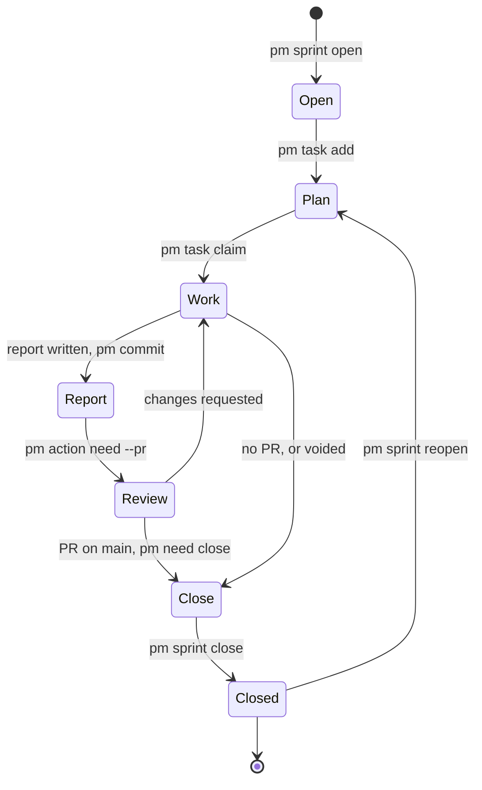

## Problem

> What are we solving, and why now?

Part of the [Project management harness](pm-harness.md) design. A sprint
passes through Beads, the records store, a code branch, a GitHub PR and the
owner's review before it closes. Each step needs one obvious command and one
place that shows where the sprint stands, or agents invent their own state
and the owner cannot tell which sprints wait on them. This page is the
end-to-end flow; the sprint record's sections are under
[Record layer](record-layer.md).

## Goals and non-goals

> What must the design achieve, and what does it deliberately leave out?

**Goals**

- One `pm` command per lifecycle step that touches both Beads and a record.
- Every state of a sprint is visible from Beads and the sprint page; no
  record holds hand-made status.
- A sprint closes only once its work is on main, with the merge commit in
  its report.
- Owner input never stops the work: needs are raised and work continues.

**Non-goals**

- `pm` reading a PR's merge state from GitHub; the agent carries the merge evidence.
- A model judging whether a design page's text matches the code; the gate
  checks only that the page was edited or waived.
- Enforcing how code is branched or reviewed beyond the review action.

## Constraints and key facts

> Which facts, findings and constraints shaped the design? Only those that
> still hold; sprint records keep the findings as they happened.

- A sprint closes only once its PR is on main; a PR merged into a stacked
  base does not count.
- `pm` never asks GitHub whether a PR merged: the review action's close
  reason ("merged as <sha>") is the merge evidence. It asks `gh` for two
  things only: a GitHub PR's base branch when a review is raised, and the
  files a PR changes while some design page has `covers:` (Design pages
  follow the code).
- A stacked PR (its base another PR's branch) merges into that branch, not
  main, so a review raised on it could never close as merged; one closed
  anyway before its work reached main held its sprint's close (pm-codex
  sprint 2).
- A rule in prose does not keep design pages current: pm-codex sprint 1
  changed reply delivery, session claims and the owner-request hook without
  editing their pages, although `prime.md` said to.
- Records live in the `records` branch store, shared by every worktree; each
  `pm` write commits there, never on a code branch.
- The scheduled `pm push` publishes Beads data and records every 10 minutes;
  sessions push neither.
- Hooks, rules and `~/.claude` links read the main checkout, so it must
  follow `origin/main` after a merge.

## Design

> What is it, in its final state? Free `###` subsections. Decisions and plans
> live in the project and sprint records.

A sprint moves through six stages to closed; review can send it back to work,
a sprint without a PR goes from work straight to close, and a reopen sends a
closed sprint back to plan.

### Open

`pm sprint open --title … <project>` reads Goal, Scope (**In** and **Out**)
and Done when from its body (`--text-file - <<'EOF'`), creates the Beads epic and the sprint record, and
commits the record on the records branch. It then prints the project's design pages, so the frame's Design pages section starts from them ([Work context](work-context.md)).

### Plan

`pm task add` creates tasks under the epic. Sub-tasks (`bd create --parent`)
and dependencies (`bd dep add`) are plain `bd`. A scope change is a sprint
decision, not a renamed task or rewritten description.

### Work

`pm task claim` records the claiming session and refuses a task another live
session holds. Code goes on a branch off main. Findings go in with
`pm finding add`, decisions with `pm decision add`. Owner input is raised as
a need (`pm decision need` or `pm action need`), or asked with the runtime's ask
tool, which pm raises as a question need, and work continues on other
ready tasks meanwhile. `pm task close` stamps the commit in its reason; a task
that will not be done closes with `pm task close --dropped` and its reason.

### Report

Before review, the agent writes the full delivery report by hand in the
store and commits it with `pm commit`: Outcome (done, partial or voided plus
one sentence, optional bullets) and Against "Done when" (each item met or
not, with evidence). The report carries no draft marker; the open review
action is what says the sprint is not closed.

### Review

The agent opens the PR and raises the review with
`pm action need --pr URL --sprint ID --focus …`, which refuses a sprint
whose report is not written, a GitHub PR whose base is not the main branch
(raise the review on the PR that reaches main, or retarget this one with
`gh pr edit <url> --base main`), or a PR the design-page gate holds (below).
A URL that is not a GitHub pull request skips the base check.
The review's text links each design page covering the changed code. The review is an action under the sprint and
blocks its close. The sprint page renders the sprint's own open needs in the
generated "Sessions ask you", "Decisions await you" and "Actions await you"
sections; the review
card (PR link, focus, reply box) is what shows the sprint awaits a merge. The
pm service pushes an owner reply, and the PR's merge to main, into the session
that raised the review ([Reply delivery](reply-delivery.md)); the message for
a merged review tells the agent to fast-forward the main checkout with
`git -C <main checkout> pull --ff-only origin main`.

### Close

The agent confirms the merge commit is on `origin/main`, closes the review
with `pm need close <review> --reason "merged as <sha>"`, and edits the
report by hand only if review changed the work. Open tasks are closed or
moved (`pm task move`) first. `pm sprint close <id>` then requires every task
closed and each review closed as merged (a dismissed one, a replaced PR's or a [TEST] review, is skipped), appends "Merged as <sha> (PR #N)." to the
Outcome, commits the record on the records branch and closes the epic. It
runs the design-page gate again on each review's PR, since a PR can change
after its review was raised; with `--merged SHA` it runs it on `--pr`'s files,
or without `--pr` on the files a merge commit brought against its first
parent. A commit with one parent (a squash or rebase merge, a direct commit)
does not say where its delivery starts, so there it refuses and asks for
`--pr`. Then it publishes the design pages drafted for the sprint, from every
worktree of the clone and every other clone's draft ref, fetched first, in the same records commit as the stamp, once the covers patterns
they add hold on the remote's main (Covers hold on main at the close, below;
[Record drafts and publishing](record-drafts.md), Publish at sprint close);
`--discard <slug> --reason "…"` drops a page's drafts instead and records the
reason as `pm design unchanged` does. A sprint with no PR, or a voided one,
closes without a review or a stamp, and publishes its pages the same way.

A review closed without "merged as <sha>" (its PR merged into a stacked
base, which later reached main inside another merge) is restamped with the
same command, `pm need close <review> --reason "merged as <sha>"`: the sha
must be on the remote's main, checked as `--merged` checks it, and the old
reason stays after the new one ("…; first closed as: <old>"). A review
already closed as merged, a dismissed one and any other closed action are
refused.

### Reopen

`pm sprint reopen <id>` and `pm project reopen <name>` set a closed sprint or
project open again, for the owner's "reopen it", so the history stays in one
record instead of a continuation project. The body is the reason, two lines
or more, as `pm sprint move` and `pm sprint edit` take it. The work store is
written first (`Store.Reopen`: open, no close reason, resolution, closing
session or close time); then one records commit puts the close-time section,
the sprint's Delivery report or the project's Outcome, back to the new
record's text, each part "Not closed yet.", and adds the reopen to the
record's Decisions with the close reason it had: source agent, or owner with
`--confirmed`. A failed records step closes the item again with its old
reason, resolution and closer, at a new close time. The next close so needs a fresh report or Outcome, written against
the reopened scope; the old text stays in git history.

| Refusal | Why |
|---|---|
| The item is open | Only a closed item is reopened |
| A sprint whose project is closed | An open sprint under a closed project breaks the project close's rule; the refusal names `pm project reopen <project>` |
| A one-line reason | The reason is a decision body |

A reopened project's sprints stay closed, and a reopened sprint's tasks stay
closed: new work is a new sprint or task. A reopen on one clone merges whole
against the other clone's unchanged close, since each field changed on one
side only ([Work store](work-store.md), merge rules).

### Design pages follow the code

A design page names the code its area is about in its header, `covers:`
(see [Record layer](record-layer.md)). The gate takes the files the PR
changes from GitHub's pull request files API (`gh api --paginate`, every
page, a renamed file's old path as well as its new one; a PR URL that is not
GitHub's is refused, since its files cannot be read) and, for each design page whose covers match one,
passes the page when one of the sprints the PR delivers either:

| Way out | What it takes | What the gate reads |
|---|---|---|
| Updated | The page brought to the new state in a worktree's records workspace, committed with `pm commit` (a draft tagged with the sprint), and linked in the sprint record's Design pages | A draft of the page in this clone tagged with the sprint, or a commit to the page on the records branch since the sprint's epic was created (the close's publish is one), and a `../design/<slug>.md` link in Design pages |
| Waived | `pm design unchanged <slug> --sprint ID --reason "…"`, or `pm sprint close --discard <slug> --reason "…"` | A sprint decision of source agent whose first line is "The design page <slug> stays as it is for this sprint's code changes." and whose second is the reason |

Otherwise it refuses, naming each page, a file it covers and both ways out.
With no page carrying `covers:` there is nothing to gate and `gh` is not
asked. The waiver is a decision in the sprint record, not a work-store field:
decisions live in records, and the owner reads it on the sprint page next to
the PR.

### Covers hold on main at the close

A design page publishes only at its sprint's close, once the sprint's PRs are
on main, so a published page's covers name files main has. `pm check` fails
on a published page's pattern that matches no file on the remote's main (its
remote-tracking branch, fetched first when a pattern matches nothing there,
as it may be behind), and in a worktree on a draft page's pattern that
matches no file the worktree tracks ([Record layer](record-layer.md)). A
published pattern main lacks while a draft of the page in the clone no longer
holds it (a merged PR removed the file before its sprint closed) is listed
as waiting on that sprint's close instead.

`pm sprint close`, in both forms, holds every pattern of a page it publishes
to the remote's main, fetched: one that matches no file there refuses the close,
naming page and pattern and the two ways out, fix the pattern in the
workspace that drafts the page and commit it, or merge the PR that adds the
file first. A pattern a draft keeps after main lost its file is held too, so
the close never publishes one that `pm check` then fails on. The draft's sprint tag says whose
each edit is, so no time window or records commit date decides it.

## Alternatives considered

> What else was considered and not adopted, and why not?

- **A waiting list in `pm check`, and a close holding the patterns a sprint
  added since it opened by records commit author dates:** needed while a page
  published at `pm commit`, before its code merged, when a hard `pm check`
  failed every session while other sessions' branches were in flight (27
  patterns on main at once); two open sprints editing one page's covers held
  each other's pending patterns. Retired with publish at the close, whose
  draft tag attributes each edit to its sprint.
- **Holding only the patterns a page the close publishes adds:** a draft that
  keeps a pattern whose file a merged PR removed would publish it, and
  `pm check` would then fail every session on it.
- **Attributing each records commit to a session or a sprint:** records
  commits carry neither, a subagent shares its parent's session (one session
  runs several sprints at once), and the owner commits with none. Design
  pages get it from their draft commit's sprint tag instead
  ([Record drafts and publishing](record-drafts.md)), which `pm commit` takes
  from the sprint that links the page.

- **A draft paragraph in the report** (`Draft until its PR merges.`, shown
  as a "Draft — closes when PR #N merges" banner): it duplicated the open
  review action's state and cost two hand steps per sprint (delete the line,
  commit), and the forced post-merge edit never made anyone re-check
  evidence.
- **A `Draft:` prefix before the verdict:** older `pm` rejects an Outcome
  that does not start with done, partial or voided.
- **`pm` checking GitHub at close:** adds a `gh` dependency to every close;
  the review's close reason already carries the evidence. The design-page
  gate asks `gh` for a PR's files only, and only where pages have `covers:`;
  raising a review asks it for the PR's base.
- **Reopening a review closed too early, then closing it again:** the work
  store has no reopen, and a reopened review would block the sprint again
  for no new evidence; a restamp changes only the reason.
- **Warning on a stacked PR instead of refusing:** the review would still
  close before its work reached main, the case the restamp repairs.
- **The design-page rule in prose only** (`prime.md`: edit the page to the
  new state): broken in pm-codex sprint 1; the gate makes it structural.
- **The waiver in the work store:** a decision with its reason is what the
  record layer holds; a work-store field would be a second home for it.
- **`pm` pulling the main checkout itself:** the agent runs a `--ff-only`
  pull instead, so a diverged checkout refuses visibly.

## Prior art

> Optional. What existing work did we learn from, and what did we take?

None yet.

## Open questions

> What is still unresolved?

None yet.
