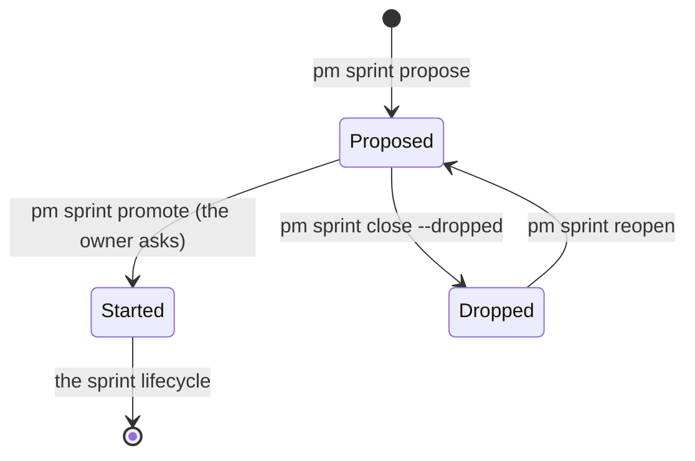

## Problem

> What are we solving, and why now?

An agent working one task often sees something else in the repo worth fixing: a flaky test, a dead path, a check that would have caught a bug. Today it has two outlets, both poor:

- Chat: the finding dies with the session.
- `pm sprint open`: the invariants let an agent open a sprint only for work the owner asked for, so an unasked sprint would be work nobody chose.

The owner decided (pm-quality project decisions, sprint 45 decisions):

- Agents raise repo improvements as sprint proposals, the one mechanism for it; `pm feedback` stays for pm itself.
- A proposal is an open sprint marked proposed, collected in one collapsed Proposed section on the site. It becomes ordinary work only by an explicit `pm sprint promote`, run when the owner asks; until then it takes no task (sprint 45 decision).
- `pm show` lists no proposals; only the site does.

## Goals and non-goals

> What must the design achieve, and what does it deliberately leave out?

**Goals**

- One command writes a proposal under a project: the frame (Goal, Scope, Done when) and the evidence the agent saw.
- A proposal stays out of the agents' view of the work: `pm show` and `pm task ready` never list one. The site groups proposals in one collapsed section.
- Promoting a proposal is one explicit command; tasks go under it only after that. Dropping one is the ordinary close of not-done work, with a reason.
- An older pm that does not know proposals still reads the store, and shows a proposal as an open sprint.
- Every command that takes an item id is classed for a proposal, and a test holds each new command to it.

**Non-goals**

- An owner verdict: no accept command, no site form, no `/reply` change.
- Listing proposals in `pm show` at any level, in text or `--json`.
- Ranking or priority of proposals.
- Turning `pm feedback` entries into proposals, repo feedback docs, asking for proposals at session end (the sprint's Out list).

## Constraints and key facts

> Which facts, findings and constraints shaped the design? Only those that
> still hold; sprint records keep the findings as they happened.

| Fact | Where | Consequence |
|---|---|---|
| `status` is `open` or `closed`, a `VARCHAR(6)` with a CHECK. A new value is a schema migration, and an older pm refuses a store or remote at a higher version | `internal/work/schema.go`; [Work store](work-store.md), Storage | A new status forces every clone to upgrade before it syncs |
| `labels` is a table of rows, `(item_id, label)`. A merge is three-way per entry, so two clones never conflict on it | Work store, Data model | A label mark merges like any other add, with no migration |
| Labels are set at create (`work.New.Labels`); the store has no label edit | `internal/work/store.go` | A mark set at propose needs no new write path |
| The work-store page and `item.Item` say "pm's logic reads no label" | Work store, Fields; `internal/item/item.go` | That line changes to name the one label pm reads, `proposal` |
| `ready(i)` requires a task, so a sprint with no task offers nothing | `internal/work/ready.go` | A proposal, which takes no task, never shows in `pm task ready` |
| `work.Check` runs on every write and on every merged store | `internal/work/check.go` | A rule across items (no task under a proposal) would fail a merge that two clones made between them. Such rules stay CLI refusals |
| Several sprint-taking commands check `Status == work.Closed` in their own code: `finding.go`, `design.go`, `request.go`, `sprint.go` (close), `move.go` (three places). `openSprint` serves only `task add` and `task move` | `internal/cli` | Classing a proposal in `openSprint` alone would miss most commands, so the test walks the command tree instead |
| `pm project close` refuses while a child is not closed | `internal/cli/project.go` | A pending proposal holds the project open, with no change |
| A closed sprint's record may keep "Not closed yet."; only `pm sprint close` without `--dropped` requires a report | `internal/cli/sprint.go` | A dropped proposal needs no report |
| The Naming grammar: `open` creates a container, `close` closes one, `--dropped` closes as not done | [pm CLI](pm-cli.md), Naming | `propose` is one new create verb; a drop reuses `close --dropped` |
| The rules' hook chunks are capped at 10,000 characters; the How chunk is 6,621 | `CAP` in `tests/conftest.py`; `prime.md` | The rule has room, and stays short |

## Design

> What is it, in its final state? Free `###` subsections. Decisions and plans
> live in the project and sprint records.

A proposal is an open sprint with the label `proposal`. `pm sprint promote` deletes the label and starts it; from then on it is an ordinary sprint ([Sprint lifecycle](sprint-lifecycle.md)). Until then `pm task add --sprint` and `pm task move --to` refuse it. Dropping it closes it as not done; reopening a dropped one makes it a proposal again.

| Term | Meaning |
|---|---|
| Proposal | An open sprint labelled `proposal` |
| Promoted sprint | A sprint `pm sprint promote` made ordinary: no label, and the note `pm sprint promote` that dates its start |
| Dropped proposal | A closed sprint labelled `proposal` |

### Representation: a label, and a derived state

| Part | Design |
|---|---|
| Mark | the label `proposal`, set by `pm sprint propose` through `work.New.Labels`; deleted by `pm sprint promote` |
| State | read from the label: `item.IsProposal(s) = s.type = sprint ∧ "proposal" ∈ s.labels` (`Items.Proposal` adds open). Open gives a proposal and closed a dropped proposal. `site.State` names them `proposed` and `dropped` |
| Start | `pm sprint promote <id>`, one write (`Store.Promote`): the label row deleted and a note comment `pm sprint promote` by the promoting session (or `owner`), dated by the store. The note dates the start on the day page (`item.Promoted`) and keeps a promoted sprint's create date reading "proposed". Refuses a sprint that is not an open proposal |
| Number and record | minted at propose, as `pm sprint open` mints them, so the record is `records/sprints/<project>-<n>.md` from the start. A dropped proposal keeps its number, as a moved sprint's old number stays used |
| Merge | nothing new: `labels` merges per entry, so a promote's delete on one clone survives a merge with a clone that left the row as it was; the note is a comment row, merged by union. A proposal promoted on one clone and dropped on the other merges to a closed sprint without the label: a closed sprint, which a reopen can restore |
| Invariants | none added to `work.Check`; the rules below are CLI refusals |
| Older pm | reads the label and ignores it, so it lists a proposal in `pm show` as an open sprint, and its `pm task add` puts a task under one. Accepted: nothing breaks; the older pm just does not hide proposals, and the new pm still shows the sprint as a proposal until it is promoted |

### Commands

| Command | Effect | Refuses |
|---|---|---|
| `pm sprint propose <project> --title "…"`; body `## Goal`, `## Scope`, `## Done when`, `## Evidence` | Creates the sprint with the label `proposal`, writes the record and commits it. The frame goes in as `pm sprint open` writes it; the Evidence becomes the first Findings entry: `- Proposal evidence:`, then the Evidence on its own lines, every line indented, so a fence or a list stays in the bullet (`records.SprintText`). The output then lists the project's other proposals and open sprints, each with its id, title and the first sentence of its goal, and says how to drop this one as a duplicate | as `pm sprint open` (a missing or empty frame section, a Scope without **In:** and **Out:**, a closed project); a missing or empty `## Evidence` |
| `pm sprint close <sprint_id> --dropped --reason "…"` | On a proposal: closes it `dismissed` with the reason; no records write, no report, no design-page publish. So it refuses while a need under it is open (naming `pm need close <id> --dropped`) and while a design-page draft is tagged with it, which no later close would publish: put the page back as the records branch has it and `pm commit --sprint <id>` it, which leaves no draft | `--dropped` on a sprint that is not a proposal (a sprint that ran closes with its report, `voided` when a finding voided it); a proposal without `--dropped` (the refusal names it) |
| `pm sprint promote <sprint_id>` | On an open proposal: deletes the label and leaves the dated note; an ordinary sprint from then on. Run only when the owner asks | a sprint that is not a proposal, a closed (dropped) one |
| `pm sprint reopen <sprint_id>` | On a dropped proposal: open again, so a proposal again; the records step as for any reopen | as today |

**No `--confirmed`.** A drop can be undone (a reopen) and keeps its reason, so the rule text says when an agent drops a proposal, with no flag: its own duplicate, or when the owner asked. Promoting one needs no flag either: the rule says to promote a proposal only when the owner asks.

**Evidence as a body section, not a flag.** Evidence is what the agent saw: a command and its output, a file and line, a number. A flag is one line in single quotes, which breaks on an apostrophe or pasted output. The heredoc body takes it whole, beside the frame it supports.

**The duplicate list in the write's output.** This is the only place an agent sees the other proposals, since `pm show` lists none. An agent that finds its proposal covered drops it with `--dropped --reason "duplicate of …"`. A list on a separate call gets skipped in a hurry, and refusing until a flag is passed adds ceremony to every call. A dropped duplicate costs one sprint number.

**Grammar.** The Naming table gains `propose`, which creates a sprint for the owner to promote (`sprint propose`), and `promote`, which makes one ordinary (`sprint promote`). `TestEveryCommandFollowsTheNamingGrammar` accepts `propose` for the sprint noun only.

### Every command on a proposal

A proposal is an open sprint, so a command that takes one is allowed unless the table says otherwise.

| Command | On a proposal |
|---|---|
| `pm task add --sprint`, `pm task move --to` | refused, naming `pm sprint promote <id>` |
| `pm sprint promote` | promotes it |
| `pm sprint close` | `--dropped` only |
| `pm action need --pr` naming it | refused: "sprint <id> is a proposal, not promoted; it has no work to review" |
| `pm finding add --sprint`, `pm decision add --sprint`, `pm decision need --sprint`, `pm action need --sprint`, `pm design unchanged --sprint`, `pm doc new --sprint`, `pm postmortem new --sprint`, `pm feedback add --sprint\|--task`, `pm sprint edit`, `pm sprint move`, `pm commit` of its record (`--sprint` included) | allowed: refining a proposal's frame and evidence does not promote it |
| `pm sprint reopen` | refused while open, as for any sprint; a dropped proposal reopens as a proposal |
| `pm show --sprint ID`, `pm show ID`, `pm record link`, `pm task ready --sprint` | allowed: they show it by id, so an agent asked to promote one can read it: `pm show --sprint` with state `proposed`, `pm show ID` with `labels: proposal`; `pm task ready` offers nothing |
| an argument that takes a task, a need or a reply (`--task`, `task_id`, `need_id`, `pm decision add --need`, `pm task edit`, `pm task release`, `pm reply add\|read`) | refused, as for any sprint: a proposal is not a task or a need |
| `pm dep add` (either side), `pm dep rm`, `pm comment add` | allowed. As an open sprint, a proposal counts as an open blocker, and the site shows it as one |
| `pm project close` | refused while a proposal is open, by the existing refusal, which then also names `pm sprint close <id> --dropped` |

The class mechanism, one table and two checks. `internal/cli/testdata/proposal_commands.json` holds a case per item-id argument (a scope flag, `--on`, task move's `--to`, a positional id, `comment add`'s target): the command line with a proposal's id in that argument and its expected outcome (allowed, promotes, drops, refused, and a text it must print). `TestEveryItemIDArgumentIsClassedForAProposal` walks the command tree, the work-store commands and their forms included, and fails on an id argument with no case or a case naming no argument. `tests/test_proposals.py` runs every case against a fresh proposal in a real store: allowed leaves it a proposal, promotes deletes its label and puts it in `pm show`, drops closes it as dismissed, refused fails and leaves it as it was. `pm record link` needs the site served, so its case runs in an integration test.

### `pm show`, `pm task ready` and the day page

| Place | On a proposal |
|---|---|
| `pm show`, `pm show --project` | nothing: neither the open sprints, nor their counts, nor any proposals line includes one |
| `--json` at those levels | nothing: `sprints` leaves proposals out, and there is no `proposals` key |
| `pm show --sprint ID` | the sprint, with state `proposed`, its frame and the Evidence finding |
| `pm show ID` | the item, with `labels: proposal` |
| `pm task ready` | unchanged: a proposal takes no task |
| Day page | PROPOSED in place of OPENED on its create date; STARTED on the date of its promote note; DROPPED with the reason on the date it was dropped. The summary's input (`pm day summarize`) reads "sprint proposed", "sprint started" and "proposal dropped (<reason>)" from the same rows (`internal/site/activity.go`) |

A promoted sprint is an ordinary sprint everywhere, `pm show` included; only its create date still reads PROPOSED.

### Site

| Page | On a proposal |
|---|---|
| Overview, each project | the Sprints list leaves proposals out. Below it, one `

Proposed (N)
` with a row per proposal: pill PROPOSED, the title linking to its page, the goal's first sentence |
| Project page | the Progress graph and sprint table leave proposals out; the same collapsed section follows the table |
| Sprint page | pill PROPOSED; the record as written |
| Dropped proposals | among the closed sprints, with pill DROPPED (as for a dropped task) and "dropped: <reason>" in place of the task count (overview) or the Outcome (project page's table); left out of the graph, as it has no task |

`site.State` gains `proposed` for a proposal and `dropped` for a dropped one. There is no form and no POST.

### prime.md and --help

The rule goes in How, after "open a sprint" (about 430 characters):

> - propose a sprint: for something the repo needs outside your task, once you can name the fix and its check, `pm sprint propose <project> --title "…"`; body: the frame plus `## Evidence`, what you saw. If its output lists a sprint that covers yours, drop yours: `pm sprint close <id> --dropped --reason "duplicate of …"`. Promote one with `pm sprint promote <id>` only when the owner asks; tasks go under it after that.

The feedback line becomes "Report where pm itself got in your way: `pm feedback add …`; what the repo needs is a sprint proposal."

| `--help` | Change |
|---|---|
| `pm sprint propose` | new |
| `pm sprint close` | `--dropped` on a proposal |
| `pm sprint reopen` | a dropped proposal is a proposal again |
| `pm sprint`, `pm --help` | the new verb |
| `pm show` | proposals are left out; `--sprint ID` and `ID` show one by id |
| `pm feedback add` | for pm itself; what the repo needs is a sprint proposal |

`internal/cli/testdata/help.golden` is rewritten with `-update`. The refusals `prime.md` names are asserted in `tests/test_pm.py`.

### Tests and the live check

| Where | What it holds | Marker |
|---|---|---|
| `internal/cli` | the cases held to the command tree (`proposal_test.go`); the Naming grammar with `propose`; `help.golden` | Go |
| `internal/item` | the state from the label (open, closed, no label, a task labelled); `Promoted` from the note | Go |
| `internal/site` | `testdata/constructs` gains a proposal, a started one and a dropped one: the collapsed section and the pills; golden pages rewritten with `-update`; the day's rows in the summary's input (`activity_test.go`) | Go |
| `tests/test_proposals.py` | propose writes the record and the labelled sprint; its refusals; the duplicate list in its output; `pm show`, `--project` and `--json` leave it out, and `pm show --sprint` shows it; `pm task ready` offers nothing; `pm task add` refused until `pm sprint promote`, which deletes the label, leaves the note and puts it in `pm show`; a drop keeps its reason; `close` without `--dropped`, and `--dropped` on a promoted sprint, refused; reopen of a dropped one; `pm project close` refused while one is open; every case of the class table | light, through the `repo` helpers; the `pm record link` case integration |
| `tests/test_hooks.py` | the rule chunks fit the cap | light |

Live check, in a scratch clone of a scratch origin under a temp `HOME` and `CODEX_HOME`: propose two `[TEST]` sprints. Open the overview at the service's port and see both in the collapsed Proposed section only, and neither in `pm show`. Add a task to one and see it move to the Sprints list and into `pm show`. Drop the other and see it as DROPPED with its reason. The commands, output and numbers go in the sprint's Findings.

## Alternatives considered

> What else was considered and not adopted, and why not?

| Option | Cost | Taken |
|---|---|---|
| The label `proposal`, with the state derived from it and the tasks | No migration, no new write, merges per row; pm reads one label | Yes |
| A new status `proposed` | Migration 5 (widen the column, replace the CHECK); every clone upgraded before it syncs; about 90 status checks that read `!= Closed` as open, each to audit | No |
| A need kind `proposal` whose answer opens the sprint | The same migration, and an owner verdict the owner decided against | No |
| A record-only draft (a sprint record with no item, or a doc) | The state would live in a record, which by rule holds no status | No |
| An owner accept, on the site through `/reply` or by `pm sprint accept` | A site write path and a wait, for little gain (owner decision) | No |
| Proposals in `pm show`: a count, a list, a `proposals` key | Puts work nobody chose in every session's start context (owner decision) | No: the site and the propose output only |
| A start by the first task, the state derived from the label and the tasks | No explicit go-ahead: any task an agent adds starts the work (owner decision: an explicit promote); a start by a moved task has no date of its own in the store | No: `pm sprint promote` |
| Cross-item rules in `work.Check` (a proposal has no task) | A merge that two clones made between them would fail on every clone | No: CLI refusals |
| `pm sprint dismiss` | A close verb other than `close`, against the Naming grammar | No |
| `--confirmed` on a drop | A flag for an act that a reopen undoes and whose reason is kept | No |
| Evidence as `--evidence '…'` | One line in single quotes cannot hold pasted output | No |
| The duplicate list before the write, on a dry run or behind a refusal | A step agents skip, or a flag on every call | No |

## Prior art

> Optional. What existing work did we learn from, and what did we take?

- Linear's Triage inbox and GitHub's triage labels: work raised by anyone sits apart from the backlog. Taken: a separate group the owner can browse. Not taken: a triage step that must be answered.

## Open questions

> What is still unresolved?

None yet.
