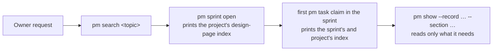

## Problem

> What are we solving, and why now?

Part of the [Agent lifecycle](agent-lifecycle.md) design: the step before a session frames a sprint or starts a task. An agent drills down one project from the top (`pm show` → `--project` → `--sprint` → `--section`), and nothing points it sideways: at the design pages that hold the current state of the code it is about to touch, or at earlier sprints, decisions and docs on the same topic in any project. It finds those only if it thinks to grep `records/`, and the design-page check that does exist (`covers:`) runs at the end, at `pm action need --pr` and `pm sprint close`, not at the start.

- The store holds 24 design pages, 175 sprint records, 22 docs, 2 postmortems and 429 `::: decision` blocks: 2.0 MB of Markdown (2026-10-15).
- `pm show --project` prints the last 3 decisions, built from the project record and every sprint record of the project.
- Printing every decision is not an answer: pm-harness alone has 100 project-level decisions, about 46 KB, and nothing marks one superseded, so "the decisions still in force" cannot be computed.

## Goals and non-goals

> What must the design achieve, and what does it deliberately leave out?

**Goals**

- A session that starts work in a sprint is shown, once, which design pages hold the area's current state: a title and a link each, a few hundred bytes.
- An agent can find earlier sprints, decisions, design sections, docs, postmortems and work items on a topic in one command whose output is capped and points at the unit to read next.
- The procedure (search before framing, read the listed pages before starting) is in `prime.md`, at the steps that run it.

**Non-goals**

- Pushing record bodies or decisions into the context unasked: the index lists, search ranks; reading stays the agent's call.
- Semantic or embedding search, and any persistent index or service-side state.
- Marking decisions superseded. It would make "decisions in force" computable; it is its own design question (Open questions).
- Searching code: `rg` serves it.

## Constraints and key facts

> What is fixed, and what facts does the design rest on?

| Fact | Consequence |
|---|---|
| The work store keeps no claim history: an item holds its current holder and `closed_by`, and `Close` clears the holder | "First claim of this session in this sprint" is computed from the sprint's tasks: none held by this session and none closed by it. A task the session claimed and then lost to a takeover leaves no trace, so the index may show twice; it never fails to show |
| A new sprint's Design pages section holds "None yet." | At `pm sprint open` the index comes from the project record's Design pages |
| A Design pages section is a list of `[Title](../design/<slug>.md)` links; `records.DesignLinks` returns the slugs | The index reuses it; no new record syntax |
| `records.SectionRanges` splits `##` and `###` at any level and skips fences; `records.Decisions` returns `::: decision` blocks with `source`, `date`, `until`; `records.Words` tokenizes | Search units come from the existing parser |
| 2.0 MB of records; `pm show` already reads the whole store per run | Expected: a scan per query fits in a CLI run without an index. The sprint measures it |
| Hook rules run in chunks under a size cap (`tests/test_hooks.py`) | The `prime.md` change is two clauses on existing bullets, not a section |
| Session ids come from `currentSession()`; a subagent shares its parent's | A subagent's claim counts as its session's; it sees the index only if the parent has not claimed in the sprint, and the parent's brief carries it otherwise |

## Design

> How does it work? Use ### subsections, mermaid diagrams, tables, figures.



Search before the frame exists; the index at the two points where work starts; reading one section at a time after both.

### Design-page index

Printed after the existing output line of:

- `pm sprint open`: the project record's Design pages.
- `pm task claim`, when no other task of the task's sprint is held by or was closed by this session: the sprint's Design pages, then the project's, without repeats. A task directly under a project uses the project's.

```text
claimed pm-c72a.4.3 for session 1f2e… at 2026-10-15T21:40Z
design pages (read the ones your task touches):
  record-drafts   Record drafts             https://pm.yeeefs.com/design/record-drafts.html
  records-store   Records store             https://pm.yeeefs.com/design/records-store.html
prior work: pm search <topic>
```

The output shape; the ids and the session are illustrative.

- One line per page: slug, title, link (`showSiteURL` + the record's `Out()`, as `pm show` builds it). The slug is what `pm show --record` takes.
- No page listed: the block is the one `prior work` line.
- A slug that names no design record is printed as `missing` on its line; `pm check` already reports it.
- Read failures of the records store refuse nothing: the claim is done; the block is replaced by one line naming the error.

### pm search

`pm search <terms…> [--kind K]… [--project NAME] [-n N]` ranks units of the records store and the work store and prints one line per hit, best first, default `-n 10`.

| Source | Unit | Kind |
|---|---|---|
| Sprint record | each `##` section; each `::: decision` block of Decisions on its own | `sprint`, `decision` |
| Project record | each `##` section; each `::: decision` block | `project`, `decision` |
| Design page | each `###` under Design; each other `##` | `design` |
| Doc, postmortem | each `##` section; the whole text when it has none | `doc`, `postmortem` |
| Work store | a task's or need's title with its close reason, dropped items included | `task`, `need` |

- **Ranking**: BM25 (k1 = 1.2, b = 0.75) over `records.Words` tokens, lower-cased; a unit's heading and title count in its text. Exact and deterministic: equal scores order by date, newest first.
- **Line**: `kind  where  date  state  link  "snippet"`. `where` is what `pm show --record … --section …` or `pm show <id>` takes; `state` is the work store's (`done`, `dropped`, `running`) for sprints, tasks and needs; the snippet is the first sentence of the unit holding a term, cut at 100 characters.
- **Scope**: the shared store `env.records` reads; the work store through the service, as every command. No index file: every run scans.
- **No hit**: `no match for <terms>; try other words` and exit 0. The procedure says to try two or three wordings before concluding there is no prior work.

```text
$ pm search claim history
decision  pm-harness-112  2026-09-30  done     https://…/sprints/pm-harness-112.html  "Claims keep only the current holder; history is the …"
design    session-claims#Claiming  2026-10-02  -  https://…/design/session-claims.html  "A claim records who holds the task and when; …"
task      yeeef-agents-9va.88.2  2026-09-12  dropped  -  "Record every claim in an events table"
```

The output shape; these hits are illustrative, not from the store.

### Procedure

`prime.md` gains two clauses on existing bullets:

- open a sprint: before writing the frame, `pm search` its topic and read what it finds; list the design pages the frame touches in Design pages.
- claim a task: the first claim in a sprint prints the design pages; read the ones the task touches before changing their code.

## Alternatives considered

> What else did we weigh, and why not?

| Alternative | Why not |
|---|---|
| Print every project decision at claim or sprint open | 46 KB for pm-harness, repeated per claim; most no longer govern and none is marked superseded |
| Print the index on every claim | Repeats the same block for every task of a sprint in one session |
| A claim history table to make "first claim" exact | New schema and sync for a cosmetic repeat; the computed rule shows the index at least once |
| A UserPromptSubmit hook that injects records relevant to the prompt | Needs relevance judgement each turn, spends context in every session, competes for the hook size cap |
| Embedding or semantic search | Adds a model or a dependency and nondeterminism to a 2 MB corpus that keyword search covers; two or three wordings cover synonyms |
| Leave it to `grep records/` | Returns lines, not units; no status, date or link; misses work-store titles and dropped tasks |

## Prior art

> Optional: published work or other systems this design learned from.

- BM25 (Robertson and Zaragoza, "The Probabilistic Relevance Framework: BM25 and Beyond", 2009): the ranking function of Lucene and SQLite FTS5.
- Architecture decision records and their indexes (`adr-tools`): decisions read by searching a log, with superseded ones marked.

## Open questions

> What is not decided yet?

- Marking a decision superseded (an attribute on the block, or a `pm decision supersede` command), so that `pm show --project` and search can hide or flag stale ones.
- Whether search reads a worktree's drafts workspace as well as the shared store, once per-worktree records workspaces ship ([Record drafts](record-drafts.md)).
