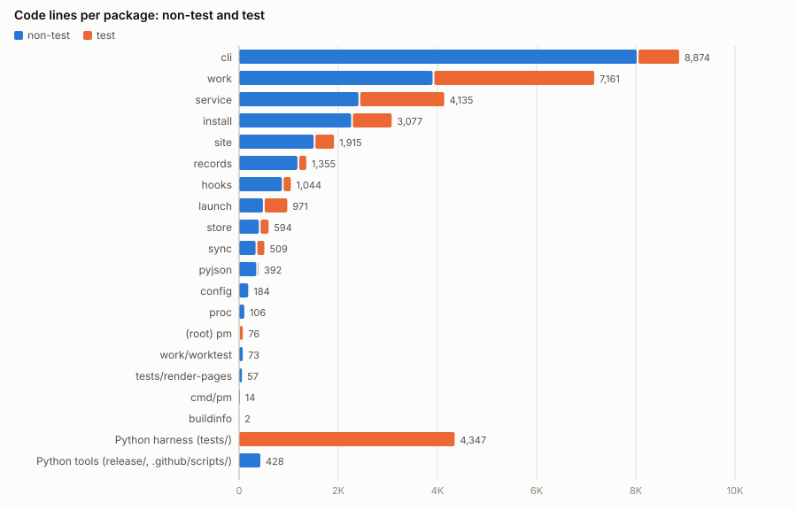
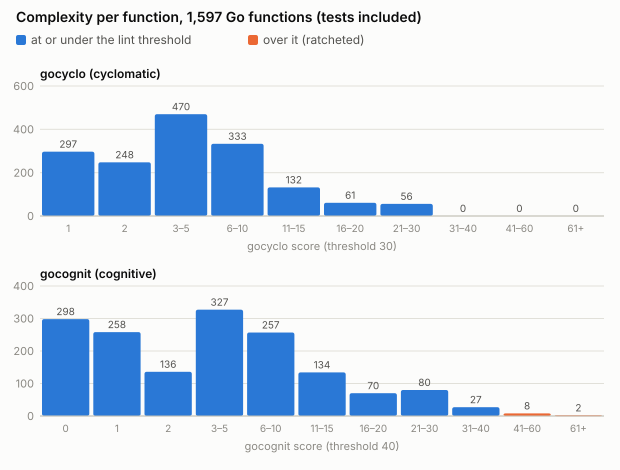
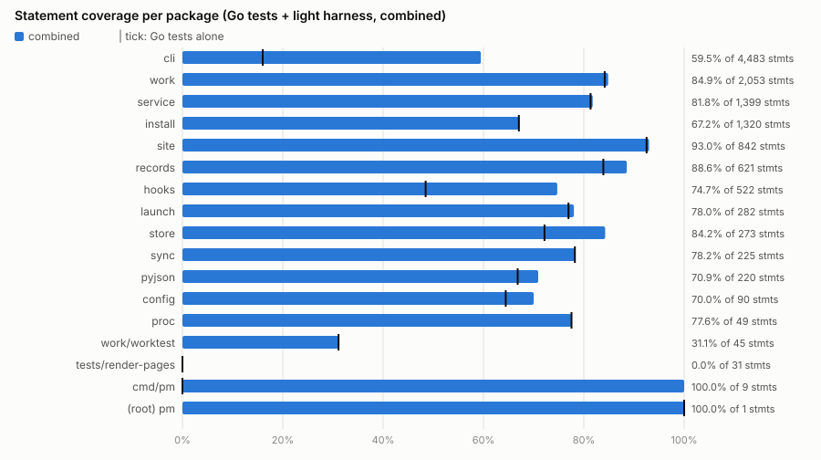
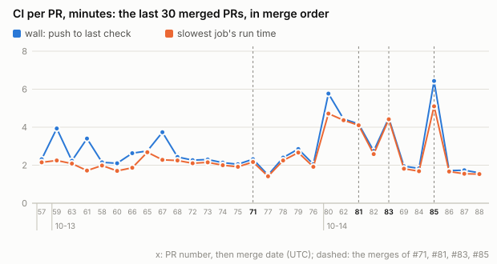
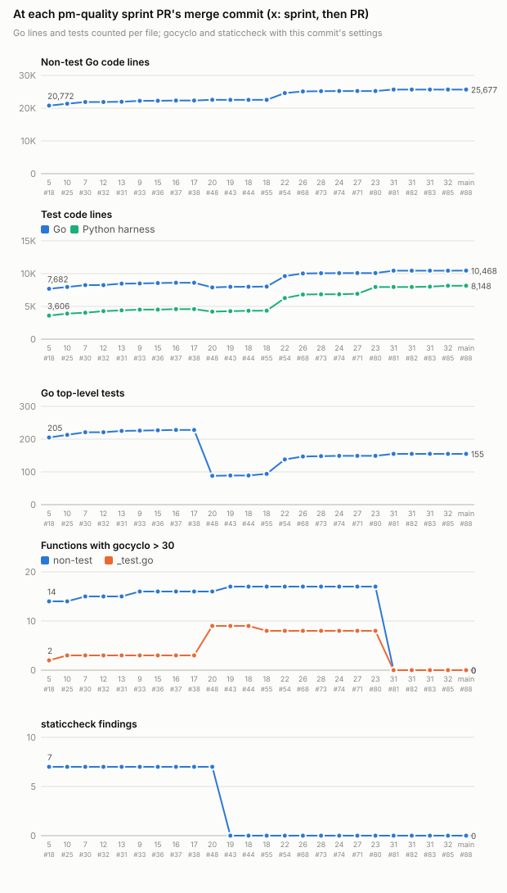

# pm code and test metrics

The reference for how healthy pm's code is: size, complexity, lint, tests, CI and the trend across the pm-quality sprints, each as a table, a one-line reading and a figure where it adds something.

- **Commit measured:** `8ad2720` on origin/main, "The site's golden tests fail on a path they cannot make relative (#88)", committed 2026-10-14 12:31 UTC.
- **Measured:** 2026-10-14, 20:12–20:26 UTC, in a detached worktree of that commit. Linux, 32 cores, 62 GB, go1.26.9 (the toolchain `go.mod` names), golangci-lint 2.14.0. Other sessions ran on the same machine: the load average was 0.9 when the measurement started and 5.1 to 17.5 at the start of each timed run.
- **Previous measurement:** `fe05966` (#53), 2026-10-12. Where a reading below compares, "was" gives that commit's number.
- **Generator:** `pm-quality-metrics.py`, beside this doc in the records store (`docs/` on the `records` branch; the site serves only a record's images, not the script): one PEP 723 script that measures and draws every table and figure here. Method gives the commands.
- **Code lines:** a line that holds a Go token other than a comment (Go's own scanner); blank and comment-only lines are left out. For Python, a line that holds a token other than a comment, docstrings included.

## Headline

| Measure | Value |
|---|---|
| Go code lines, non-test / test | 25,677 / 10,468 (0.41 test lines per non-test line) |
| Python harness (`tests/`) code lines | 8,148 in 28 files |
| Go functions, non-test | 1,183: median 12 code lines, p90 41, max 102; 2 over 100 |
| gocyclo > 30 / gocognit > 40 | 0 / 10 functions (0 / 4 of them non-test); 10 distinct functions over either |
| `make lint` | clean: exit 0 |
| Ratcheted backlog, whole tree | 354 findings: errcheck 311, reassign 19, funlen 12, gocognit 10, file length 2; gocyclo gates every line since #62 |
| `//nolint` directives | 49, 25 of them errcheck |
| Go tests | 155 top-level (152 pass, 3 skip), 121 subtests run; 0 benchmarks, 0 fuzz tests |
| pytest tests | 359: 296 light (161 of them live eval cases, skipped without `PM_LIVE_TESTS`), 63 integration |
| Statement coverage, combined | 74.0% of 13,925 statements (Go tests alone 57.0%, light harness alone 44.9%) |
| Local runtime, `make test` / `make test-go` | 12.6 s / 20.5 s wall; `make test-go` failed 4 of 7 runs on one service test (section 4) |
| CI wall per PR, push to last check | median 1.7 min over the last 5 merged PRs; 2.3 min over 30 recent ones (#57–#88, section 5) |
| Runs that failed, then passed on a rerun | 7 of 507 pull_request runs since 2026-10-12 (1.4%); 3 of 108 `pm go` runs (2.8%), 3 of 33 `agents md` runs |

## 1. Size



::: result {title="Code lines per Go package, and the Python files"}
| Package | Files | Non-test lines | Test files | Test lines | Test / non-test |
|---|---|---|---|---|---|
| `internal/cli` | 34 | 6,728 | 8 | 972 | 0.14 |
| `internal/work` | 16 | 3,987 | 18 | 3,247 | 0.81 |
| `internal/service` | 8 | 2,770 | 7 | 1,990 | 0.72 |
| `internal/install` | 11 | 2,921 | 7 | 1,429 | 0.49 |
| `internal/site` | 3 | 1,622 | 4 | 493 | 0.30 |
| `internal/records` | 7 | 1,461 | 2 | 215 | 0.15 |
| `internal/hooks` | 5 | 1,117 | 4 | 268 | 0.24 |
| `internal/launch` | 4 | 679 | 3 | 573 | 0.84 |
| `internal/cli/setup` | 6 | 1,054 | 0 | 0 | 0 |
| `internal/session` | 5 | 575 | 2 | 261 | 0.45 |
| `internal/cli/parse` | 2 | 610 | 1 | 65 | 0.11 |
| `internal/store` | 1 | 488 | 1 | 160 | 0.33 |
| `internal/sync` | 1 | 368 | 1 | 141 | 0.38 |
| `internal/design` | 1 | 328 | 1 | 179 | 0.55 |
| root package `pm` | 1 | 19 | 3 | 263 | 13.84 |
| `internal/ask` | 1 | 144 | 1 | 134 | 0.93 |
| `internal/config` | 2 | 218 | 2 | 52 | 0.24 |
| `internal/item` | 1 | 172 | 1 | 26 | 0.15 |
| `internal/proc` | 2 | 153 | 0 | 0 | 0 |
| `internal/textwrap` | 1 | 87 | 0 | 0 | 0 |
| `internal/work/worktest` | 1 | 74 | 0 | 0 | 0 |
| `tests/render-pages` | 1 | 65 | 0 | 0 | 0 |
| `internal/cli/fsutil` | 1 | 21 | 0 | 0 | 0 |
| `cmd/pm` | 1 | 14 | 0 | 0 | 0 |
| `internal/buildinfo` | 1 | 2 | 0 | 0 | 0 |
| **Go total** | 117 | **25,677** | 66 | **10,468** | 0.41 |
| Python harness `tests/` | | | 28 | 8,148 | |
| Python tools `release/`, `.github/scripts/` | 3 | 619 | | | |
:::

`internal/cli` holds 26% of the non-test Go code (33%, 8,413 lines, with its sub-packages `setup`, `parse` and `fsutil`; it held 36% alone at `fe05966`), at 0.14 test lines per line; `internal/cli/setup` has no Go tests, and its coverage comes only from the integration set (section 4). The size test (`size_test.go`, cap 5,000 per package) counts raw lines: `internal/cli` has 7,457, exactly its ratchet allowance, against 6,728 code lines here. There are 25 packages (was 18): `internal/pyjson` is gone, and eight are new.

::: result {title="Largest files, by code lines"}
| File | Code lines | All lines |
|---|---|---|
| `internal/site/site.go` | 1,151 | 1,311 |
| `internal/work/dolt.go` | 1,057 | 1,258 |
| `internal/install/pieces.go` | 902 | 1,098 |
| `internal/service/run.go` | 822 | 971 |
| `internal/service/run_test.go` | 784 | 852 |
| `internal/work/sync_test.go` | 747 | 888 |
| `internal/cli/commands.go` | 706 | 715 |
| `internal/service/lifecycle.go` | 634 | 741 |
| `internal/work/sync.go` | 595 | 703 |
| `internal/cli/show.go` | 563 | 617 |
:::

The first two are the files over revive's file-length limit (1,000 lines without comments and blanks) in section 3. `internal/cli/writes.go`, the largest file at `fe05966` (1,480 code lines), is 85 lines in all now: #62 split `internal/cli` by noun.

::: result {title="Largest functions, by code lines"}
| Function | File:line | Code lines |
|---|---|---|
| `TestImportFailsHardOnWhatItCannotMap` | `internal/work/importbd_test.go:26` | 187 |
| `TestLoadNeverPassesARecordSetMissingAFileGitRewrote` | `internal/cli/serve_test.go:113` | 156 |
| `TestAnOperationOutlastingItsBoundFreesTheSlotAndAWaiterGivesUp` | `internal/work/opslot_test.go:39` | 122 |
| `results` | `internal/install/golden_test.go:192` | 109 |
| `TestAWriteRacingOneOutsideTheLockFailsHard` | `internal/work/concurrent_test.go:25` | 105 |
| `TestRewriteTakesOutBeadsPieces` | `internal/install/setup_test.go:284` | 104 |
| `showItem` | `internal/cli/store_commands.go:263` | 102 |
| `whereAll` | `internal/cli/where.go:60` | 102 |
| `roundTrip` | `internal/work/roundtrip_test.go:113` | 100 |
| `load` | `internal/work/dolt.go:538` | 98 |
:::

Seven of the ten are in `_test.go` files. Of the three non-test, `showItem` and `whereAll` are over funlen's statement limit (section 2) and none is over a complexity threshold. Non-test functions over 100 code lines went from 17 to 2, and the longest from 204 (`fromIssue`) to 102.

## 2. Complexity



::: result {title="Functions per score bin: 1,597 Go functions, 1,189 of them non-test"}
| Score | gocyclo, all | gocyclo, non-test | gocognit, all | gocognit, non-test |
|---|---|---|---|---|
| 0 | - | - | 298 | 224 |
| 1 | 297 | 223 | 258 | 193 |
| 2 | 248 | 181 | 136 | 100 |
| 3–5 | 470 | 362 | 327 | 251 |
| 6–10 | 333 | 252 | 257 | 188 |
| 11–15 | 132 | 90 | 134 | 98 |
| 16–20 | 61 | 43 | 70 | 53 |
| 21–30 | 56 | 38 | 80 | 55 |
| 31–40 | 0 | 0 | 27 | 23 |
| 41–60 | 0 | 0 | 8 | 3 |
| 61+ | 0 | 0 | 2 | 1 |
| mean / median / p90 / p99 / max | 5.84 / 4 / 14 / 26 / 30 | | 6.39 / 3 / 17 / 37 / 106 | |
:::

The median function is simple (4 on gocyclo, 3 on gocognit) and the tail is shorter than at `fe05966`: no function is over gocyclo 30 (the maximum is 30, was 91), 117 have gocyclo > 15 (was 110, of 1,281 functions), and 10 have gocognit > 40 (was 33). The linters score the 1,591 declared functions and 6 package-level `var X = func…` values, hence 1,189 non-test against the 1,183 declared in section 1.

::: result {title="Non-test: the 4 functions over a lint threshold (gocyclo > 30 or gocognit > 40), by gocognit"}
| Function | File:line | gocyclo | gocognit |
|---|---|---|---|
| `showProjectText` | `internal/cli/show.go:457` | 26 | 70 |
| `LegacyRepo` | `internal/install/legacy.go:71` | 26 | 53 |
| `showDataOf` | `internal/cli/show.go:243` | 26 | 48 |
| `plan` | `internal/install/pieces.go:825` | 26 | 48 |
:::

::: result {title="Tests: the 6 `_test.go` functions over a lint threshold, by gocognit"}
| Function | File:line | gocyclo | gocognit |
|---|---|---|---|
| `results` | `internal/install/golden_test.go:192` | 29 | 106 |
| `TestHeaderValuesTypeAsPyyamlDoes` | `internal/records/records_test.go:41` | 29 | 60 |
| `TestLoadNeverPassesARecordSetMissingAFileGitRewrote` | `internal/cli/serve_test.go:113` | 30 | 53 |
| `TestOnlyTheHostOpensTheStoreAndOnlyTheServiceStartsIt` | `access_test.go:21` | 26 | 53 |
| `TestAWriteRacingOneOutsideTheLockFailsHard` | `internal/work/concurrent_test.go:25` | 22 | 49 |
| `TestAnOperationOutlastingItsBoundFreesTheSlotAndAWaiterGivesUp` | `internal/work/opslot_test.go:39` | 24 | 43 |
:::

Of the 10, 4 are non-test (2 in `internal/cli`, 2 in `internal/install`; was 21) and 6 are tests (was 14); all 10 are over gocognit 40 only. #62 took every function under gocyclo 30 and made gocyclo gate every line, so the 26 functions over it at `fe05966` are 0 (section 6).

::: result {title="funlen findings (lines > 100 or statements > 60, comments ignored)"}
| Kind | Findings | Non-test | Test |
|---|---|---|---|
| statements > 60 | 8 | 5 | 3 |
| lines > 100 | 4 | 0 | 4 |
| **functions** | **12** | 5 | 7 |
:::

No function trips both funlen limits, so the 12 findings are 12 functions (was 36). Non-test code trips only the statement limit (5); 3 of the 5 are in `internal/cli` (`showDataOf`, `showItem`, `whereAll`).

## 3. Lint state

`make lint` exits 0 at this commit: the gating golangci-lint linters, `deadcode` and `ruff` are clean. The ratcheted linters (`RATCHET` in the Makefile: errcheck, gocognit, funlen, revive, reassign) gate only the lines a branch changes, so their backlog stands on the rest of the tree. gocyclo left `RATCHET` in #62 and gates every line; the generator still queries it, and it reports 0:

::: result {title="Ratcheted backlog: golangci-lint --enable-only errcheck,gocyclo,gocognit,funlen,revive,reassign ./..."}
| Linter | Findings | Non-test | Test | Files |
|---|---|---|---|---|
| errcheck | 311 | 140 | 171 | 56 |
| funlen (statements > 60) | 8 | 5 | 3 | 8 |
| funlen (lines > 100) | 4 | 0 | 4 | 4 |
| gocognit (> 40) | 10 | 4 | 6 | 9 |
| gocyclo (> 30, gating) | 0 | 0 | 0 | 0 |
| reassign | 19 | 0 | 19 | 6 |
| revive file-length-limit (> 1,000) | 2 | 2 | 0 | 2 |
| **total** | **354** | 151 | 203 | |
:::

errcheck is 88% of the backlog (was 76% of 481). Of its 311, 233 name the function called (79 of them assign the error to `_`, `check-blank`) and 78 name none: type assertions without a checked `ok` (`check-type-assertions`) and calls to a function of the same package. By package: `internal/service` 79, `internal/work` 69, `internal/install` 38, `internal/cli` 26, `internal/launch` 24, the other seven 75. Every reassign finding is a test swapping `buildinfo.Version` (15) or `time.Local` (4), as at `fe05966`.

::: result {title="//nolint directives, by linter"}
| Linter | Directives |
|---|---|
| errcheck | 25 |
| nilerr | 10 |
| usetesting | 6 |
| forbidigo | 4 |
| staticcheck | 2 |
| gocritic | 1 |
| reassign | 1 |
| forcetypeassert | 1 |
| **total** | **49 directives, 50 linter names** |
:::

One directive names two linters (`errcheck,forcetypeassert` in `internal/proc/proc.go`); every other names one. nolintlint holds that each gives a reason. The 25 errcheck directives are new since `fe05966` (none then): each keeps one call's error unchecked on purpose, with its reason.

## 4. Tests

::: result {title="Test counts"}
| Suite | Tests | How counted |
|---|---|---|
| Go, top-level | 155 (152 pass, 3 skip) | `func TestX(t *testing.T)` in `_test.go` files; outcomes from `go test -json` |
| Go, subtests | 121 run, all pass | `go test -json` events with a `/` in the name; 65 `t.Run(name, func…)` call sites |
| Go benchmarks, fuzz tests | 0, 0 | |
| pytest, light (`-m "not integration"`) | 296: 135 pass, 161 skipped | the 161 are the live evals' cases (148 owner-request, 13 AGENTS.md grader), which run only with `PM_LIVE_TESTS=1` |
| pytest, integration | 63 | collected only: CI runs them; this doc did not. 12 of them are the parity live eval |
| pytest, live (`make test-live`) | 148 | collected only: needs a logged-in `claude`; `make test-live-agents-md` (13) and `make test-live-parity` (12) are counted in the rows above |
:::

Go tests per package: `internal/service` 31, `internal/work` 31, `internal/install` 20, `internal/cli` 17, `internal/session` 9, `internal/launch` 8, `hooks`, `site` 7 each, `design` 5, `ask`, `records` 4 each, the root package, `store`, `sync` 3 each, `cli/parse`, `config`, `item` 1 each. The top-level count went from 89 to 155 and the pytest count from 151 to 359, 85 of that growth in the owner-request live eval (63 to 148 cases).



::: result {title="Statement coverage per package: Go tests, light harness, and the union"}
| Package | Statements | Go tests | Light harness | Combined |
|---|---|---|---|---|
| `internal/cli` | 3,476 | 14.6% | 64.6% | 69.2% |
| `internal/work` | 2,109 | 84.5% | 46.0% | 85.3% |
| `internal/install` | 1,670 | 69.2% | 2.0% | 69.3% |
| `internal/service` | 1,584 | 79.8% | 18.9% | 82.1% |
| `internal/site` | 888 | 92.7% | 72.6% | 93.2% |
| `internal/records` | 772 | 75.8% | 60.6% | 86.4% |
| `internal/cli/setup` | 651 | 0.0% | 0.0% | 0.0% |
| `internal/hooks` | 616 | 52.6% | 64.1% | 78.7% |
| `internal/launch` | 369 | 79.9% | 41.7% | 80.8% |
| `internal/cli/parse` | 343 | 88.0% | 86.6% | 93.6% |
| `internal/store` | 306 | 73.2% | 70.3% | 84.0% |
| `internal/session` | 285 | 48.1% | 43.5% | 56.1% |
| `internal/sync` | 225 | 78.2% | 13.8% | 78.2% |
| `internal/design` | 184 | 45.1% | 53.8% | 72.8% |
| `internal/config` | 106 | 65.1% | 67.0% | 73.6% |
| `internal/proc` | 71 | 66.2% | 80.3% | 87.3% |
| `internal/ask` | 66 | 87.9% | 83.3% | 89.4% |
| `internal/textwrap` | 58 | 77.6% | 72.4% | 77.6% |
| `internal/work/worktest` | 46 | 30.4% | 0.0% | 30.4% |
| `internal/item` | 42 | 95.2% | 83.3% | 95.2% |
| `tests/render-pages` | 36 | 0.0% | 0.0% | 0.0% |
| `internal/cli/fsutil` | 12 | 33.3% | 91.7% | 91.7% |
| `cmd/pm` | 9 | 0.0% | 100.0% | 100.0% |
| root package `pm` | 1 | 100.0% | 100.0% | 100.0% |
| **module** | **13,925** | 57.0% | 44.9% | **74.0%** |
:::

`internal/cli/setup` (`pm init`, `doctor`, `upgrade`, `uninstall`) is the largest gap: none of its 651 statements runs in a measured test, since only integration tests run those commands. `internal/cli` itself rose from 59.5% to 69.2% (1,072 of its 3,476 statements uncovered), and the Go tests alone reach 14.6% of it. `internal/install` (69%) is covered by Go tests only, and `tests/render-pages` runs only in integration page tests. One light test fails under the coverage build only, `test_a_hook_stopped_mid_judge_takes_its_judge_with_it[SIGTERM]` (exit 143, not 1): the build's SIGTERM patch (Method) exits before the hook's own handler, so the harness column is from 134 passing tests, not 135. `cmd/pm`'s 9 statements include that patch.

::: result {title="Local runtimes, go build cache warm, Go tests uncached (GOFLAGS=-count=1)"}
| Command | Wall s | CPU s | Cores busy (CPU / wall) | Load average before | Result |
|---|---|---|---|---|---|
| `make test` | 12.6 | 114.3 | 9.1 | 8.3 | 135 passed, 161 skipped; pytest `-n auto` |
| `make test-go` | 20.5 | 88.2 | 4.3 | 10.1 | exit 0 |
| its parts, run one by one: | | | | | |
| `make go-build` | 0.5 | 3.1 | 5.7 | 17.5 | cached |
| `make go-fmt` | 0.2 | 0.9 | 4.2 | 16.3 | |
| `make go-vet` | 0.4 | 1.5 | 3.7 | 16.3 | vet results cached |
| `make go-os-check` | 0.1 | 0.1 | 1.0 | 16.3 | |
| `make go-test-but-work` | 9.2 | 27.8 | 3.0 | 16.3 | |
| `make go-test-work` (8 shards) | 12.6 | 28.6 | 2.3 | 16.2 | |
| `make go-test-race` | 28.5 | 35.2 | 1.2 | 15.9 | its two parts one after the other |
:::

`make test-go` takes 20.5 s (was 70.5 s) and keeps 4.3 cores busy (was 1.3): `go-test-work` fell from 27.7 s to 12.6 s, and under `test-go`'s `-j` the race tests' two parts run at once, where `make go-test-race` alone runs them one after the other (28.5 s). `make test` rose from 7.7 s to 12.6 s with the harness (296 tests, was 114). A second run at load 5.1–6.3 gave 13.0 s for `make test`; its `make test-go` failed after 19.7 s. **`make test-go` failed in 4 of 7 runs at this commit** (the two runtime runs and 5 more), each in `go-test-race-service`; in the three failures whose log was kept whole, `TestServiceInstallStatusRestartAndLogsEndToEnd` found ":8002 is held by another store", the temp store of another copy of the same test. `test-go` runs the service tests twice at once (`go-test-but-work` and `go-test-race-service`); CI runs them in separate jobs. The table's run passed.

## 5. CI

`gh pr list --state merged --limit 30` returns the 30 most recently created merged PRs, not the 30 last merged: here #57–#88, which leaves out #54 (merged 10-13 19:05, between #59 and #63). The last 5 by merge (#84–#88) are all in it. Per merged PR: the first attempt of every workflow run that the push of the PR's merged head started (runs created within 120 s of the first), from the first run's creation to the last job's completion. Jobs from the GitHub jobs API; skipped jobs left out.



::: result {title="CI per PR, the 30 merged PRs gh pr list returns (#57–#88), in merge order (UTC)"}
| PR | Merged | Wall min | Jobs | Slowest job (queue + run) | Its queue s | Its run s |
|---|---|---|---|---|---|---|
| #57 | 10-12 20:49 | 2.3 | 13 | pm go / race (darwin-arm64) | 8 | 129 |
| #59 | 10-13 19:00 | 3.9 | 12 | pm go / race (darwin-arm64) | 100 | 135 |
| #63 | 10-13 19:59 | 2.2 | 14 | pm release build / release build (darwin-arm64) | 8 | 125 |
| #61 | 10-13 20:15 | 3.4 | 12 | pm go / race (darwin-arm64) | 101 | 103 |
| #58 | 10-13 20:24 | 2.1 | 12 | pm go / build-vet-test (darwin-arm64) | 8 | 119 |
| #60 | 10-13 20:28 | 2.1 | 12 | pm go / build-vet-test (darwin-arm64) | 24 | 102 |
| #66 | 10-13 20:46 | 2.6 | 12 | pm go / build-vet-test (darwin-arm64) | 52 | 106 |
| #65 | 10-13 20:56 | 2.8 | 14 | pm release build / release build (linux-amd64) | 3 | 161 |
| #67 | 10-13 21:01 | 3.7 | 12 | pm go / build-vet-test (darwin-arm64) | 86 | 137 |
| #68 | 10-13 21:22 | 2.4 | 12 | pm go / race (darwin-arm64) | 10 | 135 |
| #72 | 10-13 21:31 | 2.3 | 13 | pm go / build-vet-test (darwin-arm64) | 9 | 126 |
| #73 | 10-13 21:51 | 2.3 | 12 | pm go / build-vet-test (darwin-arm64) | 9 | 129 |
| #74 | 10-13 21:56 | 2.1 | 12 | pm go / build-vet-test (darwin-arm64) | 8 | 120 |
| #75 | 10-13 22:06 | 2.0 | 13 | pm go / race (darwin-arm64) | 8 | 115 |
| #71 | 10-13 22:15 | 2.3 | 11 | pm go / build-test (darwin-arm64) | 8 | 130 |
| #77 | 10-13 22:17 | 1.5 | 12 | pm tests / integration | 3 | 85 |
| #78 | 10-13 22:20 | 2.4 | 14 | pm go / build-test (darwin-arm64) | 7 | 135 |
| #79 | 10-13 22:28 | 2.9 | 11 | pm go / build-test (darwin-arm64) | 10 | 160 |
| #76 | 10-13 22:41 | 2.0 | 11 | pm go / build-test (darwin-arm64) | 7 | 115 |
| #80 | 10-14 07:06 | 5.8 | 15 | agents md / cases | 4 | 283 |
| #62 | 10-14 07:32 | 4.4 | 15 | agents md / cases | 4 | 262 |
| #81 | 10-14 08:14 | 4.2 | 13 | agents md / cases | 3 | 246 |
| #82 | 10-14 08:22 | 2.8 | 14 | pm go / build-test (darwin-arm64) | 9 | 155 |
| #83 | 10-14 11:28 | 4.5 | 13 | agents md / cases | 3 | 265 |
| #69 | 10-14 11:34 | 1.9 | 13 | pm go / race (darwin-arm64) | 7 | 109 |
| #84 | 10-14 11:39 | 1.8 | 13 | pm go / build-test (darwin-arm64) | 8 | 101 |
| #85 | 10-14 12:20 | 6.4 | 13 | agents md / cases | 3 | 306 |
| #86 | 10-14 12:26 | 1.7 | 14 | pm tests / integration | 3 | 100 |
| #87 | 10-14 12:28 | 1.7 | 14 | pm go / build-test (darwin-arm64) | 10 | 93 |
| #88 | 10-14 12:31 | 1.6 | 14 | pm tests / integration | 2 | 92 |
:::

The median is 1.7 min over the last 5 PRs (#84–#88; was 2.9 min over #49–#53) and 2.3 min over all 30 (was 4.0 min over #20–#53). macOS queue no longer sets the worst PRs: over all 30, a macOS job queued 8 s at the median, 26 s at p90 and 101 s at most (was 170–309 s at p90 per macOS job). The 5 slowest walls (4.2–6.4 min: #62, #80, #81, #83, #85) are each set by `agents md / cases`, the AGENTS.md grader's case run, at 246–306 s. Sprint 27 (#71) cut the macOS jobs per PR from 3 to 2.

::: result {title="Per job: queue over all 30 PRs, run median before the merge of #81 and over the last 5"}
| Workflow / job | Jobs | Queue median s | Queue p90 s | Run median s, #57–#62 (21 PRs) | Run median s, #84–#88 | Run max s |
|---|---|---|---|---|---|---|
| pm changelog / changelog | 39 | 3 | 4 | 6 | 5 | 25 |
| pm go / build-vet-test (linux-amd64) | 30 | 3 | 4 | 51 | 46 | 76 |
| pm go / race (darwin-arm64) | 30 | 9 | 69 | 100 | 47 | 135 |
| pm go / race (linux-amd64) | 30 | 3 | 4 | 53 | 23 | 85 |
| pm go / work (linux-amd64) | 30 | 3 | 4 | 45 | 24 | 90 |
| pm lint / lint-deadcode | 30 | 3 | 4 | 91 | 68 | 103 |
| pm lint / lint-go | 30 | 4 | 4 | 50 | 51 | 73 |
| pm lint / lint-py | 30 | 3 | 4 | 9 | 8 | 92 |
| pm tests / integration | 30 | 3 | 4 | 92 | 94 | 103 |
| pm tests / light | 30 | 3 | 4 | 76 | 78 | 89 |
| pm go / build-test (darwin-arm64) | 16 | 8 | 10 | 135 | 93 | 235 |
| pm go / build-vet-test (darwin-arm64) | 14 | 8 | 52 | 110 | - | 137 |
| pm go / work (darwin-arm64) | 14 | 9 | 48 | 98 | - | 107 |
| agents md / cases | 11 | 3 | 4 | 272 | 7 | 306 |
| agents md / check | 11 | 3 | 3 | 174 | 26 | 199 |
| pm release build / release build (darwin-arm64) | 5 | 8 | 9 | 125 | - | 141 |
| pm release build / release build (linux-amd64) | 5 | 3 | 3 | 72 | - | 161 |
:::

"#57–#62" is the 21 PRs merged before #81, in merge order. Sprints 31 and 32 (#81, #83, #85) cut `race (darwin-arm64)` from 100 s to 47 s, `build-test (darwin-arm64)` from 135 s to 93 s, and the Linux race and work jobs by about half (53 to 23 s, 45 to 24 s). On the last 5 PRs, `pm tests / integration` (94 s) and macOS `build-test` (93 s) are the longest jobs when the grader's case run is short. `agents md` runs from #80 on: its case run took 5–9 s on 6 of its 11 PRs and 246–306 s on the other 5. `build-test (darwin-arm64)` replaced macOS `build-vet-test` and `work` from #71 on. Changelog has more jobs than PRs: an edit or a label starts it again within 120 s.

::: result {title="Reruns: every pull_request run created since 2026-10-12 (507 runs)"}
| Workflow | Runs | Re-run | Failed, then passed on a rerun | Failing job in the first attempt |
|---|---|---|---|---|
| pm changelog | 127 | 3 | 0 | |
| pm go | 108 | 7 | 3 (2.8%) | race (linux-amd64) 2, work (linux-amd64) 1 |
| pm lint | 108 | 3 | 0 | |
| pm tests | 108 | 3 | 1 (0.9%) | integration 1 |
| agents md | 33 | 4 | 3 (9.1%) | cases 3 |
| pm release build | 22 | 0 | 0 | |
| anthropic-wif-check | 1 | 0 | 0 | |
| **all** | **507** | **20** | **7 (1.4%)** | |
:::

Of the 7 failed-then-passed reruns, 3 are the grader's case run (model calls) and 3 the Linux race or work jobs (the Dolt concurrency tests). One more `agents md` run failed and its rerun had no conclusion when measured. The 12 reruns that were success then success are on the branches `ci-two-minutes` (7), `race-list` (4) and `work-seconds-remeasure` (1), where CI was timed. A flaky failure followed by a new push, rather than a rerun, is not counted, so 1.4% is a lower bound. The window overlaps the previous one (since 2026-10-10, 7 of 457, 1.5%) on 2026-10-12.

## 6. Trend across the pm-quality sprints

At the merge commit of each pm-quality sprint PR (`git log --grep "pm-quality sprint"`, the 23 commits whose subject names a sprint and a PR), plus the measured commit, in merge order. Go tests counted statically (top-level `TestX` functions); gocyclo > 30 and staticcheck with this commit's settings on every commit, gocyclo split by `_test.go` file name, staticcheck over code and tests together. Merged is the commit date in its committer's time zone.



::: result {title="At each sprint PR's merge commit"}
| Sprint | PR | Commit | Merged | Non-test Go lines | Go test lines | Harness lines | Go tests | gocyclo > 30, non-test | gocyclo > 30, test | staticcheck |
|---|---|---|---|---|---|---|---|---|---|---|
| 5 | #18 | 963fb75 | 2026-10-10 | 20,772 | 7,682 | 3,606 | 205 | 14 | 2 | 7 |
| 10 | #25 | 2911a04 | 2026-10-10 | 21,360 | 7,968 | 3,899 | 213 | 14 | 3 | 7 |
| 7 | #30 | cee2d7d | 2026-10-10 | 21,866 | 8,255 | 4,037 | 221 | 15 | 3 | 7 |
| 12 | #32 | af0a631 | 2026-10-10 | 21,866 | 8,255 | 4,273 | 221 | 15 | 3 | 7 |
| 13 | #31 | da3423c | 2026-10-10 | 21,956 | 8,471 | 4,395 | 225 | 15 | 3 | 7 |
| 9 | #33 | b61f12d | 2026-10-10 | 22,213 | 8,497 | 4,512 | 226 | 16 | 3 | 7 |
| 15 | #36 | 41b6696 | 2026-10-10 | 22,245 | 8,567 | 4,512 | 227 | 16 | 3 | 7 |
| 16 | #37 | 6752e93 | 2026-10-10 | 22,320 | 8,610 | 4,585 | 228 | 16 | 3 | 7 |
| 17 | #38 | eedbafd | 2026-10-10 | 22,320 | 8,610 | 4,585 | 228 | 16 | 3 | 7 |
| 20 | #48 | d98406d | 2026-10-11 | 22,550 | 7,900 | 4,205 | 88 | 16 | 9 | 7 |
| 19 | #43 | 09f62a7 | 2026-10-11 | 22,529 | 7,993 | 4,272 | 89 | 17 | 9 | 0 |
| 18 | #44 | 5d1e05b | 2026-10-11 | 22,529 | 8,004 | 4,336 | 89 | 17 | 9 | 0 |
| 18 | #55 | bd6ae2f | 2026-10-12 | 22,532 | 8,020 | 4,347 | 94 | 17 | 8 | 0 |
| 22 | #54 | 31e2730 | 2026-10-13 | 24,593 | 9,628 | 6,280 | 138 | 17 | 8 | 0 |
| 26 | #68 | a6262b6 | 2026-10-13 | 25,107 | 10,022 | 6,811 | 147 | 17 | 8 | 0 |
| 28 | #73 | 93a8552 | 2026-10-13 | 25,167 | 10,064 | 6,845 | 148 | 17 | 8 | 0 |
| 24 | #74 | 185c7e0 | 2026-10-13 | 25,213 | 10,080 | 6,845 | 149 | 17 | 8 | 0 |
| 27 | #71 | 11968ca | 2026-10-14 | 25,215 | 10,085 | 6,926 | 149 | 17 | 8 | 0 |
| 23 | #80 | 8af66d6 | 2026-10-14 | 25,216 | 10,085 | 7,968 | 149 | 17 | 8 | 0 |
| 31 | #81 | 90e46e0 | 2026-10-14 | 25,671 | 10,450 | 7,968 | 155 | 0 | 0 | 0 |
| 31 | #82 | 9e6f7e1 | 2026-10-14 | 25,671 | 10,450 | 7,968 | 155 | 0 | 0 | 0 |
| 31 | #83 | ad5659f | 2026-10-14 | 25,671 | 10,450 | 8,009 | 155 | 0 | 0 | 0 |
| 32 | #85 | fedc348 | 2026-10-14 | 25,671 | 10,453 | 8,148 | 155 | 0 | 0 | 0 |
| (main) | #88 | 8ad2720 | 2026-10-14 | 25,677 | 10,468 | 8,148 | 155 | 0 | 0 | 0 |
:::

- Non-test code grew 23.6% over the project (20,772 to 25,677 lines); 64% of that growth came after #55, and 2,061 lines of it between the merges of #55 and #54 (sprint 22, with the PRs merged in between).
- Sprint 20 (#48) folded 228 top-level Go tests into 88 and cut 710 Go test lines and 380 harness lines; the count has since grown back to 155, 44 of that between #55 and #54.
- The harness grew from 4,347 to 8,148 lines after #55: 1,933 by #54, and 1,042 between #71 and #80, most of it #80's AGENTS.md grader and its tests (sprint 23).
- Sprint 19 (#43) took staticcheck from 7 findings to 0 and made it gate every line; it has stayed at 0.
- Functions over gocyclo 30 went from 17 non-test and 8 test to 0 and 0 between the merges of #80 and #81: #62 (`internal/cli` split by noun, not a sprint PR) is the one PR merged in between, and it made gocyclo gate every line.

## Method

Every number above comes from the generator, run in a detached worktree of the commit measured. The machine needs `go`, `uv`, `git`, `gh` (logged in) and golangci-lint 2.14.0 on PATH.

```sh
git worktree add --detach .claude/worktrees/metrics origin/main
S=$(pm where records)/docs/pm-quality-metrics.py
uv run "$S" measure .claude/worktrees/metrics /tmp/pm-metrics size complexity lint tests runtime coverage ci trend
uv run "$S" draw /tmp/pm-metrics /tmp/pm-metrics/fig > /tmp/pm-metrics/tables.md
git worktree remove .claude/worktrees/metrics
```

This measurement ran size, complexity and lint, ci and trend as four processes at once, then tests, coverage and runtime one after another, runtime alone. Each step writes its own JSON file.

| Step | What it runs |
|---|---|
| size | a Go program on `go/scanner` and `go/parser` over every `.go` file outside dot dirs, `testdata` and `vendor`; Python's `tokenize` on `tests/`, `release/`, `.github/scripts/` |
| complexity | golangci-lint with gocyclo and gocognit at threshold 0, so it reports every function (gocognit omits a score of 0); `-tags gms_pure_go`, tests included |
| lint | `make lint`; `golangci-lint run --enable-only errcheck,gocyclo,gocognit,funlen,revive,reassign ./...` with the repo's `.golangci.yml`, without `--new-from-merge-base`; `//nolint:` directives found by regexp |
| tests | `pytest --collect-only` for all, `-m "not integration"`, `-m integration` and the live file |
| runtime | `make test`, then `GOFLAGS=-count=1 make test-go` and each of its parts (its prerequisites, or the targets of its `$(MAKE) -j` recipe); CPU from `getrusage(RUSAGE_CHILDREN)` |
| coverage | as in the [test value audit](2026-10-11-test-value-audit.md): `go test -cover -coverpkg=<module>/... ./...`, and the light harness at `-n 32` on `pm`, `pm-before` and `render-pages` built with `-cover -coverpkg=<module>/...` and a SIGTERM handler that calls `os.Exit` (patched into `cmd/pm/main.go` for the build only, then restored), each test in its own `GOCOVERDIR`; the union takes a statement block as covered when either profile reached it |
| ci | `gh pr list --state merged --limit 30`; `actions/runs?head_sha=<head>&event=pull_request` and each run's attempt-1 jobs; every `pull_request` run since the oldest PR's creation for reruns |
| trend | one `git worktree add --detach` per commit, all 24 at once (`GOMAXPROCS=2` each on 32 cores), size and golangci-lint with staticcheck and gocyclo > 30, then the worktrees removed |

## Not measured

- The integration set (63 tests): neither its coverage nor its local runtime. CLAUDE.md keeps the whole set to CI. So `internal/cli/setup`, `internal/install`, `tests/render-pages` and the service's lifecycle code read lower here than their tested state.
- The live evals (148 owner-request cases, 13 AGENTS.md grader cases, 12 parity scenarios): they need logged-in runtimes and model calls.
- Coverage of `release/*.py`, `.github/scripts/*.py`, `install.sh` and the Makefile.
- Coverage and runtime at the trend's older commits: the trend gives size, test count, gocyclo and staticcheck only.
- CI cost in runner minutes, and macOS queue time outside these 30 PRs.
- A flaky failure that was pushed over rather than re-run.
- The cause of `make test-go`'s failures beyond the message each gave (section 4): not investigated here.
